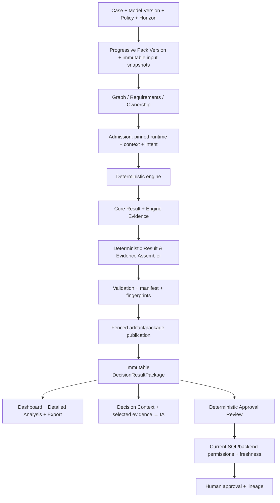
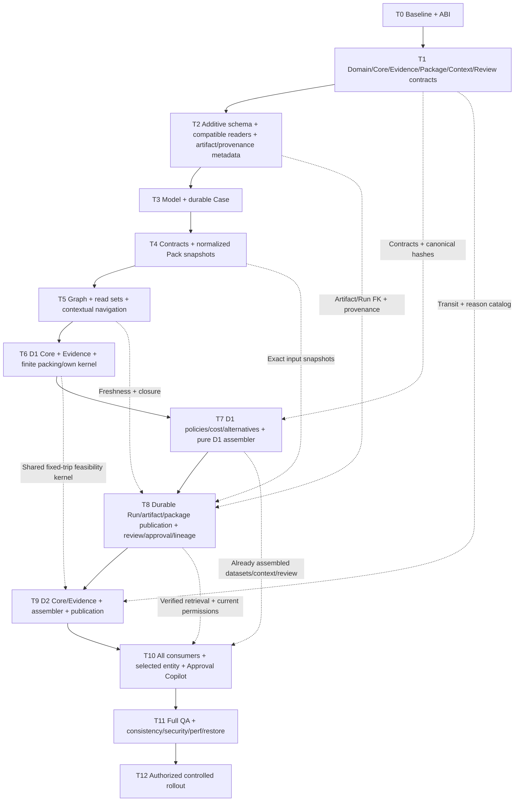

# DATION_FINAL_MASTER_EXECUTION_PLAN

## 1. Executive Summary

**Documento de ejecución, no autorización de implementación.** Emitido el 25/10/2026, referencia horaria UTC. Baseline del repositorio: `main` / referencia local `origin/main`, HEAD `ef997235a30251fbf7ae53690ed738092ee973d8`. No se refrescó el remoto en esta etapa documental. En esta ejecución sólo se redacta este archivo: no se ejecuta T0, no se modifican código, datos o infraestructura y no se hacen commits.

Se conserva el orden **T0 → T12** del Implementation Master Plan. El contrato nuevo no requiere volver a diseñar Case, Logistics Model, Data Pack, D1 o D2. Requiere adelantar y hacer explícita la arquitectura de resultados: contratos en T1; soportes de persistencia en T2; Core Result/Evidence de D1 y assembler en T6–T7; publicación atómica y review en T8; Core Result/Evidence y assembler D2 en T9. **T10 integra consumidores; no inventa el resultado ni sus métricas.**

La fuente de verdad de una decisión nueva será **DecisionResultPackage versionado + artifacts inmutables referenciados por su manifest**. Dashboard, Detailed Analysis, CSV/JSON, IA y Approval Review identificarán la misma Run y `result_fingerprint`. No habrá nuevas sumas de negocio en frontend, reconstrucciones de asignación en export ni razones inferidas por el LLM.

Se preservan los runtimes/resultados actuales, sus URLs, Owners, approvals, lineage, cola, idempotencia, permisos y lectores históricos. Se agregan contratos nuevos y adapters explícitos, sin reinterpretar `assignment_v1` / `scheduling_v1`. Una fase autorizada se ejecuta y reporta individualmente; alcanzar GO no autoriza comenzar la siguiente fase.

Enmienda documental: se incorpora **Skills-Assisted Execution** como soporte de implementación y validación, subordinado al alcance aprobado y al lenguaje visual actual. Se conservan las 30 secciones y T0–T12; cada fase pasa de 19 a **20 campos** al agregar `Applicable Skills / Execution Guidance`. Esta política no ejecuta T0 ni activa workflows de diseño, auditoría, instalación o release.

Accesos: [cambios al plan anterior](#4-current-architecture-reuse-map), [contrato final de resultados](#8-final-decision-result-architecture), [assembler](#9-result--evidence-assembler), [fases T0–T12](#21-final-t0t12-execution-plan), [tests](#22-tests-per-phase), [STOP/GO](#23-stop--go-gates), [readiness](#30-implementation-readiness-assessment).

## 2. Inputs / Sources of Truth

| Fuente | Autoridad y uso |
|---|---|
| `DATION_MASTER_PROMPT_FASE_1_2_ULTIMATE_MVP.md` | Funcional: Case/Model/Policy/Graph/Progressive Pack, D1 Transport Plan y D2 Day Scheduling. SHA256 `daca5cb070dc36d5adfce019450d3caf07de4f4058533f86a65089cd9b84fc53` |
| [Implementation Master Plan auditado](docs/ultimate-mvp-implementation-master-plan.md) | Base técnica conservada. SHA256 al iniciar este trabajo: `ff824a2fae9566cfb4e1f77ae81e8806d0b76d179b208660b29e9bd00e9ab6d6`. No se modifica ni descarta |
| `DATION_ENGINE_OUTPUT_CONTRACTS_V1.md` | Autoridad nueva para resultados, evidencia, assembler, Sankey/Gantt, Detailed Analysis, IA, export y review. Leído completo. SHA256 `d7f4a77cc264893cb89fdf919ca7a380e7c5472f1b038f58cf7b876519b3ab1e` |
| Pedido original del plan | Alcance documental, 30 secciones, 19 campos originales por fase y prohibición de implementar T0. SHA256 `64c3312ed4aeb9b6ec518b0cf5c1558e70801fbe6178492c365c48d05f47898b` |
| Enmienda Skills-Assisted Execution | Agrega F23, Execution Skills Policy, campo de Skills en T0–T12, UI Preservation Gate y validación T11; no cambia funcionalidad/secuencia. SHA256 `3457a23f617895fea1a36abf3090552d1d80fe8c1e6f1aa4a207370fe6dea9c8` |
| [Arquitectura](docs/architecture.md), [dominio](docs/domain-model.md), [navegación](docs/navigation.md), [Runs](docs/decision-runs.md), [componentes](docs/component-map.md) | Estado actual, no sustituyen el target. Se mantienen lectores/semántica legacy donde corresponde |
| [Foundation](docs/foundation-refactor-summary.md), [Lineage](docs/final-polish-run-lineage-saga-summary.md) | Invariantes recientes, cobertura y deuda de QA existente |
| Código/callers concretos citados en §4 | Prueba de incompatibilidades actuales; no nueva auditoría transversal |

La auditoría previa verificó OpenAPI de **91 paths / 98 operaciones**, catálogo live de 19 tablas públicas con RLS, funciones recientes y un historial de migraciones que termina antes que parte del catálogo aplicado. Sus resultados de 383 Python, 20 Node y 9 browser PASS pertenecen a esa auditoría: **no se atribuyen como ejecuciones de hoy ni certifican el target**. No se consultó nuevamente Supabase ni se ejecutaron tests/migraciones en esta etapa documental.

La última observación administrativa de Cloud Run fue HTTP 401; no prueba cuál imagen está hoy desplegada. La inspección de la próxima fase debe verificarlo cuando corresponda. No se recibió en esta ejecución otra especificación visual independiente de Fase 3: se usan los contratos nuevos para las funciones y la UI ya aprobada para el lenguaje visual; no se inventan mockups como fuente acordada.

Precedencia: alcance del pedido actual → funcional Fases 1–2 y contratos de resultados v1 → decisiones técnicas de este plan → compatibilidad de los contratos históricos. Un ejemplo JSON del documento no se toma como un conjunto de datos internamente reconciliado; sí se respetan sus campos, responsabilidades e invariantes. Las precisiones de serialización/compatibilidad se registran explícitamente en §8, sin cambiar decisiones matemáticas.

## 3. Frozen Architectural Decisions

| ID | Decisión congelada para ejecutar |
|---|---|
| F01 | Conservar FastAPI + frontend nativo HTML/CSS/ES modules + worker durable + Supabase. No framework/ORM nuevo ni reescritura transversal |
| F02 | Case nuevo durable antes de los archivos, ligado inmutablemente a Model Version; Pack acumulativo por versiones. Legacy conserva pair Orders/Fleet y su contrato de reemplazo/fork |
| F03 | Model reusable por operación, no por semana. Role SHIPPER/LOGISTICS_PROVIDER/HYBRID modifica copy/defaults, no engine ni permisos |
| F04 | Horizon limita salidas inclusivas. Transit estándar 500 km/día; outbound `ceil(d/500)`; OWN cycle `ceil(2d/500)`; EXTERNAL cycle NULL |
| F05 | Calendario nuevo inclusivo: `arrival = dispatch + outbound_days - 1`; own libre desde `dispatch + cycle_days`, intervalo exclusivo al final. Helpers v1 no cambian |
| F06 | Recursos OWN como capacidad interna reutilizable; EXTERNAL como oferta finita por horizonte. Factibilidad usa capacidad garantizada; maximum no concede capacidad extra |
| F07 | D1 asignación+trips+consolidación+costos+prioridad+residual en una sola decisión. D2 conserva Trip IDs, órdenes, fracciones/cargas, rutas y resource assignments y sólo agrega tiempo |
| F08 | PER_TRIP/PER_KM y ONE_WAY/ROUND_TRIP explícitos. Costo operativo propio del ciclo; no “si cabe usar propio”; moneda/unidades/precisión congeladas |
| F09 | Goal ≠ guardrail ≠ preference. Case Policy/horizonte editables antes de primera admission y congelados después en este MVP, según AD-04 del plan revisado. Metadata no matemática permanece editable. Override local permitido con motivo, sin relajar hard guardrails |
| F10 | Preservar IDs técnicos `logistics_assignment` / `logistics_scheduling`. Nuevos `transport_plan_v1` / `day_scheduling_v1`; legacy sigue resolviendo sus propias identidades de engine/schema |
| F11 | Registry por identidad persistida, no sólo node_id actual. Nuevos perfiles publican nombre/version/runtime_profile coherentes en DB y package; la literalidad de nombres se registra en T0/T1, sin renombrar filas legacy |
| F12 | Engine produce Core Result + matemáticas certificadas + Evidence; assembler puro estructura proyecciones y verifica consistencia; consumidores sólo representan/exploran evidencia |
| F13 | D1 primary visual SANKEY Destination→Trip→Resource, una dimensión primaria. D2 DAY_GANTT Resource×Day×Trip. Ninguno calcula decisiones ni tiempos |
| F14 | `decision_context_v1`, modes EXPLAIN/EXPLORE/COMPARE/REVIEW; selected entity y contexto exacto de Run. IA no optimiza, muta, aprueba, inventa alternativas/what-if/razones o rellena datos |
| F15 | Approval Review determinístico e inmutable. `approval_allowed` es overlay actual de SQL/backend por Run/freshness/permisos/reglas; no cálculo del engine/assembler/LLM |
| F16 | Una intención = una Run; replay antes de checks mutables; invalidación sólo de consumidores afectados y downstream, bajo locks. Resultados, snapshots, actores y approvals históricos no se borran |
| F17 | Una decisión puede ser parcial y válida. Gap de negocio no es error técnico. Status OPTIMAL sólo con certificado; FEASIBLE/UNKNOWN/INFEASIBLE no se maquillan |
| F18 | `null ≠ 0`, desconocido ≠ infinito/confirmado, `alternatives=[]` no demuestra que no existan alternativas |
| F19 | Results/artifacts inmutables y hash-linked; summary ligero y evidencia pesada bajo demanda. Ningún consumer reconstruye un package mezclando revisiones |
| F20 | Sólo D1/D2 funcionales; futuras ramas COMING_SOON/NOT_APPLICABLE. No Branch entity, industria-hardcodes, patentes/choferes, multiparada ni scheduling horario |
| F21 | Mantener T0–T12 y sus gates. Las migraciones previstas del MVP no son por sí mismas STOP; sí lo son una mutación no prevista/destructiva o una desviación semántica no aprobada |
| F22 | No recalcular/reensamblar silenciosamente una Run aprobada con código nuevo. Cambio de resultado/evidencia requiere versionado y procedimiento explícito; locale/display no cambia los hechos |
| F23 | Skills-Assisted Execution: usar sólo Skills disponibles y pertinentes como soporte de la fase autorizada. Arquitectura aprobada→comportamiento que debe preservarse→design system/patrones actuales→Skill. No autorizan rediseño, nuevo design system/framework, sustituciones innecesarias, cambios de dominio/arquitectura ni ampliación de alcance. Preservación visual y trazabilidad obligatorias conforme a §3.1 |

La primera fase registra estas decisiones como especificación ejecutable; no invita a rediseñarlas. Si el código impide una de ellas, reportar prueba, impacto y adaptación mínima antes de avanzar. Aclaraciones formales indispensables de DTO/precisión no autorizan alterar el negocio.

### 3.1 Execution Skills Policy

#### 3.1.1 Detección, lectura y precedencia

Antes de ejecutar una fase, consultar el catálogo de Skills del entorno y los `SKILL.md` locales accesibles del proyecto; distinguir disponibilidad de pertinencia. Revalidar después de un cambio de entorno. Leer la guía de cada Skill elegida **antes de usarla** y sólo las referencias necesarias para la frontera técnica de esa fase. No atribuir capacidad a una Skill por su nombre ni asumir que sus scripts, navegador, dependencias o permisos están operativos por existir el archivo.

Precedencia para resolver recomendaciones: **(1) arquitectura/requerimientos aprobados; (2) comportamiento existente que debe preservarse; (3) design system y patrones actuales de Dation; (4) Skill como soporte de ejecución/validación**. Se mantienen las instrucciones de seguridad/autorización del entorno. Una Skill no es fuente de requerimientos funcionales ni sustituye los contratos, tests, criterios de aceptación o gates de este plan.

No ejecutar generadores de estilos/paletas/fuentes, persistir un design system nuevo, importar CSS/shells de ejemplo, migrar a React/Tailwind/shadcn, cambiar icon family, reemplazar componentes o agregar abstracciones/features por recomendación de una Skill. Tampoco aplicar fórmulas/KPIs/fechas de una demo de charts: el engine/package conserva su autoridad. Omitir la recomendación incompatible y registrar el motivo; no reabrir una decisión visual cerrada para cumplir el estilo preferido de una Skill.

Esta enmienda no instala herramientas, plugins ni Skills. Durante las fases, esta política tampoco concede autorización implícita para instalarlos. Si una Skill opcional falta/no aporta valor, registrar N/A y continuar con el harness y las guías pertinentes disponibles; no inventar una alternativa nominal. Si falta una verificación técnica obligatoria, aplicar G-ENV, sin falsear PASS. La lectura/inventario documental de hoy no activa los workflows de esas Skills ni constituye ejecución T0.

#### 3.1.2 Inventario pertinente verificado

Verificado el 25/10/2026: 12 `SKILL.md` accesibles en `.agents/skills/`; catálogo cloud consultado y catálogo executor sin entradas. Los archivos locales son utilizables por su path aunque no aparezcan en el listado executor. Esta tabla registra **disponibilidad de las guías**, no ejecución ni certificación de todos sus scripts.

| Skill real / fuente | Uso pertinente dentro del plan | Restricción de preservación |
|---|---|---|
| [`design-system`](.agents/skills/design-system/SKILL.md) | Identificar/reutilizar tokens, escalas, specs, estados y variantes existentes; especialmente T3–T5/T10/T11 | No generar/reorganizar un sistema nuevo ni adoptar su starter/slide system; no activar dependencias por cadena |
| [`emil-design-eng`](.agents/skills/emil-design-eng/SKILL.md) | Cohesión de componentes, interacción, drawer/dropdown/modal, focus, reduced motion y polish acotado | Extender el dashboard actual; sus ejemplos/bibliotecas/easings no reemplazan los patrones vigentes por defecto |
| [`ui-ux-pro-max`](.agents/skills/ui-ux-pro-max/SKILL.md) | Consultas/checklists focales de accesibilidad web, formularios, responsive, estados, tablas y charts | Usar criterios pertinentes al stack real; no `--design-system`/`--persist`, nueva paleta/tipografía ni reglas nativas móviles como obligación web |
| [`break-ui`](.agents/skills/break-ui/SKILL.md) | Stress de componentes afectados con datos plausibles/schema-backed: labels largos, null, vacío/uno/muchos, overflow y zoom | Sólo fixtures/dev/harness; ningún toggle comercial ni mutación de datos reales. Findings/fixes dentro de la fase autorizada, sin auditoría transversal |
| [`design-taste-frontend`](.agents/skills/design-taste-frontend/SKILL.md) | Opcional para comparación visual/inspección de componentes en su entorno existente | Conservar layout/brand/tokens/shell; no draw de nueva dirección, rebuild de secciones ni importar `assets/app.css`/`charts.js`. Una preferencia de su house style no invalida la UI aprobada |
| [`review-animations`](.agents/skills/review-animations/SKILL.md) | Revisión acotada de motion cuando corresponda y exista invocación explícita | Declara `disable-model-invocation: true`: no invocarla automáticamente por esta política. La revisión ordinaria puede usar `emil-design-eng`; no abre un motion redesign |
| `supabase:supabase` — `skill://plugin_asdk_app_69d3e5ee6a708191baa733f7b8931995/supabase/SKILL.md` | Backend Supabase/Auth/RLS/Storage/RPC/migrations, verificación de API/seguridad y documentación vigente | Sólo operaciones/entorno autorizados por fase; una guía de iteración SQL no permite mutar producción ni saltar M0/locks/history |
| `supabase:supabase-postgres-best-practices` — `skill://plugin_asdk_app_69d3e5ee6a708191baa733f7b8931995/supabase-postgres-best-practices/SKILL.md` | Schema/query/index, RLS, concurrencia/locking y medición de performance SQL | No agregar índices/abstracciones sin consulta real ni cambiar semántica/ownership/approvals |
| `cloud-environment:cloud-environment-runtime` — `skill://plugin_connector_1p_c5b7d5df5d7081918f2c4be5a633ed5d/cloud-environment-runtime/SKILL.md` | Entorno managed, sandboxes Docker/red/credenciales como requisitos de tests y observación del release | Es soporte de runtime, no Skill de despliegue ni permiso para modificar Cloud Run/Cloud Build/secrets/triggers/infra |

Otras Skills locales detectadas: `brand`, `design`, `banner-design`, `slides`, `ui-styling`, `improve-animations`. No se activan por defecto: branding/creatividad/presentaciones no forman parte de esta ejecución; `ui-styling` propone shadcn/Radix/Tailwind, stack ajeno al frontend nativo congelado; `improve-animations` es un workflow de auditoría/planes de motion y queda excluido del avance automático, dado que no se autorizó una nueva auditoría. No generar nuevos planes/branches mediante esas guías como efecto de la política.

No se identificó una Skill dedicada a FastAPI/Python/OR-Tools, testing Python, seguridad general o release/deployment de Dation. No inventar esos nombres: usar contratos, revisión de código, oracles, suites y runbooks existentes. Supabase cubre seguridad específica de su frontera y `break-ui` aporta stress UI; Playwright/Chromium, unittest y Node son herramientas/harness, **no Skills adicionales detectadas**. Skills cloud de Sites, Drive y otras apps sin relación con este repositorio no justifican publicar Dation en otro servicio.

#### 3.1.3 Preservación visual antes y después de cada cambio frontend

En **toda fase que modifique frontend**, ejecutar este procedimiento sobre los componentes afectados y su integración, sin una auditoría general:

1. Inspeccionar los componentes actuales y sus callers; registrar el patrón reutilizable y la referencia visual vigente antes del cambio.
2. Identificar typography, spacing, sizing, radii, borders, shadows, colors/tokens, cards, buttons, dropdowns, drawers, modals, loading, empty/error states, responsive e interaction states. Registrar paths reales/tokens/variantes, sin inventar una nueva escala.
3. Seleccionar y leer sólo las Skills disponibles pertinentes; aplicar sus recomendaciones compatibles con la precedencia de §3.1.1.
4. Reutilizar componentes/tokens y comportamiento. Crear un componente sólo cuando la nueva funcionalidad lo requiera y documentar por qué no alcanza una extensión/composición existente.
5. Comparar antes/después en navegador con mismos datos/estado/viewport/theme; verificar responsive y accessibility antes de GO. Usar viewports de T11 y los estados afectados, incluyendo teclado/foco/Escape/retorno de foco, nombres/roles accesibles, contraste, zoom200%, reduced motion e interacción touch cuando aplique. No declarar comparación visual completada por inspección de CSS únicamente.
6. Adjuntar evidencia de paridad y diferencias funcionales intencionales al reporte de fase. Sin ejecución browser requerida, dejar BLOCKED/NOT RUN y aplicar el gate pertinente. Cambiar tokens o patrones globales exige una autorización explícita; esta política no la concede.

Sankey/Gantt pueden necesitar renderers nuevos; sus card shells/toolbar/legends/controls/hover/selection/drawer/spacing/borders/colors/responsive deben extender los del dashboard actual. No imponer CSS independiente de un ejemplo de Skill. Las vistas nuevas pueden agregar información aprobada; preservar UI no significa impedir funcionalidad prevista.

#### 3.1.4 Trazabilidad de uso por fase

En el reporte/ledger ya previsto para cada fase registrar: Skills detectadas/seleccionadas o N/A con motivo; nombre exacto, path/package y versión declarada o SHA256; referencia leída; tarea/frontera donde se aplicó; recomendación adoptada y evidencia/test/archivo afectado; recomendaciones omitidas por conflicto/inaplicabilidad y motivo; dependencias no disponibles; resultado del gate visual si hubo frontend. Separar guía **leída**, **aplicada** y **verificada**, sin declarar una Skill utilizada sólo por listar su nombre.

No crear un documento parcial adicional por esta enmienda. No forzar uso de Skill en tareas puras donde no aporte valor. Un veredicto favorable de una Skill no sustituye GO de la fase; una preferencia estética fuera de alcance tampoco es por sí sola una STOP funcional. Sí bloquean regresiones de UI/a11y/responsive, deriva visual introducida por la fase, duplicación innecesaria o tokens alterados sin aprobación, conforme al UI Preservation Gate y T11.

## 4. Current Architecture Reuse Map

### 4.1 Qué conserva, amplía y modifica el plan anterior

| Área anterior | Decisión final | Responsabilidad/fase |
|---|---|---|
| T0 baseline, catálogo SQL, deuda y decisiones | Válido; agregar matriz de ABI y consumidor/result contract | T0, sin implementarlo ahora |
| T1 dominio/registry/Transit | Ampliar: Core DTOs, Evidence, reason/metric catalogs, package, Context/Review y hashes | T1; no esperar T10 |
| T2 schema/readers compatibles | Ampliar: manifests/artifacts de resultados y provenance IA nullable para legacy | T2, comportamiento de publicación en T8 |
| T3 Models/Case, T4 contracts/Pack, T5 graph | Válidos; sus snapshots y read sets alimentan el envelope | T3–T5 |
| T6 D1 packing/feasibility | Ampliar: instrumentación de hechos/constraints/candidates y Core/Evidence tipados | T6 |
| T7 policies/cost/coverage | Ampliar: certificación completa, 0–3 alternativas, assembler D1 y datasets Sankey/details/export/context/review | T7 |
| T8 Run/worker/approval/lineage | Ampliar: publicación fenceada de todos los artifacts y package, retrieval y review actual | T8 |
| T9 D2 | Ampliar: Core/Evidence, Gantt, details, review/context/export D2 en el mismo assembler | T9 |
| T10 consumidores | Modificar: conectar datasets ya certificados, no construir resultado ni ejecutar alternativas | T10 |
| T11 QA/seguridad/performance y T12 rollout | Válidos; incorporar consistencia cruzada y carga progresiva de evidencia | T11–T12 |

Phase 3 agrega una capa funcional a resultados, no otra secuencia de negocio. No cambia la jerarquía DDA→Case→Decision→Run ni reabre la UI cerrada.

### 4.2 Callers actuales y adaptaciones mínimas demostrables

| Evidencia real | Riesgo/incompatibilidad | Adaptación del contrato nuevo; preservar legacy |
|---|---|---|
| `backend/app/platform/exports.py::generate` usa `schema_version`; caso desconocido cae en CSV Dispatch; Assignment repite costo de Trip en cada fila de carga | Package nuevo usa `result_schema`; riesgo de export incorrecto y suma duplicada | Registry exhaustivo, rows certificadas y costo reconocido una vez por Trip; unknown schema seguro |
| `assignment-dashboard-selectors.mjs::getScenarioMetric` divide costo/trips para promedio; mix actual por peso | Negocio en selector y semántica distinta de nuevo mix por trips | Nueva UI toma metrics certificados, sin reutilizar cálculo v1 para v2 |
| `run_service.get_run` hace `select=*` | Carga de `result_json` completo en reads | Para nuevas Runs persistir package ligero y refs; APIs de artifacts/details sin cambiar el payload histórico |
| `decision_context.py::build_decision_context` contempla schemas concretos y fallback a scenarios/baseline | Nuevo package no tiene ese árbol; numeric verifier sólo enumera schemas viejos | Dispatcher explícito a `decision_context_v1`; unknown schema bloquea interpretación segura |
| `decision_interpreter_service.answer_question` usa intent_hash de la pregunta; contexto actual sin selected entity/mode tipados | Replay de una misma pregunta en otra selección podría perder contexto | V2 intent incluye Run/fingerprint/mode/entity/alternative refs/context version; v1 mantiene su hash |
| `comparative_analysis_service.completed_evidence` mezcla scenarios comparativos al leer una Run v1 | Overlay tardío diferente para IA y export podría crear otra vista | Esa función sigue sólo para v1; v2 usa package congelado. Alternativas v2 se fijan antes de publicación |
| `dispatch_job_service`/`dispatch_service.execute` terminan la Run mediante finish RPC | No existe publicación conjunta de artifacts + package | Nueva rama lease-fenced; COMPLETED sólo cuando el package y sus referencias están validados/listos |
| `tests/integration/sql_support.py::upgrade` sólo aplica upgrades anteriores a `20261018090000` | Un test nuevo podría no cubrir tenancy/plataforma actuales | Helper Ultimate completo a partir del sandbox vigente; no alterar el baseline histórico de todos los tests |
| `tests/e2e/run_suite.py` descubre `test_*.py` y rechaza skips | Harness reutilizable | Registrar nuevos módulos por archivo; conservar gate testsRun>0 y cero skips |
| Case/pack/readiness/SQL actuales descritos en plan anterior | Case exige pair; nuevos snapshots no pueden obtenerse del estado activo de UI | Cohortes, pinning y readers ya previstos T2–T8, sin cambiar approvals legacy |

Se reutilizan: Auth/JWT/RequestContext, tenant repository, checked RPC, cola/leases, Owner/Admin, Case history, scopes/abort/focus, Hero/toolbar, Data Hub/upload recovery, ECharts/lazy analysis, CSV quoting/formula protection, proveedor Groq/OpenAI, knowledge/prompt versionados y almacenamiento de interpretaciones. No se copian engines por industria ni se borran módulos históricos con importadores reales.

## 5. Final Target Architecture



Engine y assembler son determinísticos y no tienen HTTP/DB/LLM. Los servicios gestionan Storage/SQL/worker. Los consumers leen un package publicado; no llaman al assembler en cada request ni reconstruyen la decisión a partir de Case/datasets actuales. D2 usa el D1 aprobado exacto y su fingerprint, no “el último resultado” de una sesión.

`DecisionResultPackage` conserva `decision.status=COMPLETED` como estado del resultado calculado. Aprobada/stale/permisos actuales son overlay separado, ligado a esa Run/fingerprint. Aprobar no reescribe el resultado ni su hash.

## 6. Final Domain Model

| Concepto | Representación/autoridad final |
|---|---|
| DecisionCase | Aggregate durable tenant-scoped, identidad/metadata, ModelVersion inmutable, Horizon, CasePolicy congelada tras primera admission, Graph Version y Pack estable |
| LogisticsModel / Version | Operación reusable y configuración publicada append-only: role, DIRECT, source, capacidades, split, costo y versiones de contratos |
| CasePolicy / NodePolicy | Goal, hard guardrails y preferences separados; recomendación compilada y override explícito con motivo |
| DataPack / Version / Entry | Un Pack lógico por Case; manifests de entradas inmutables, contracts/normalizer/hashes; outputs vinculados vía Runs, sin ciclo con su propio input |
| DataContract / SemanticField | Catálogo de código versionado y descriptor compilado desde Model; no schemas arbitrarios ni mapping automático |
| DecisionDefinition / Node | Pregunta, deps, read sets, variables/constraints/objectives/output/handoff/evidence; estado proyectado, no otra tabla de estado de negocio redundante |
| Demand / TransportResource | DTOs nuevos pseudonimizados; cantidades vectoriales; OWN con unidades reutilizables y EXTERNAL con cupo por horizonte |
| Trip / Schedule | Asignación canónica de D1; D2 añade tiempos/ocupación/servicio sin modificarla |
| DecisionRun / Approval | Intención persistida + contexto/motor fijados; aprobación humana formal y eventos históricos |
| EngineCoreResult | Selección, residual, métricas matemáticas, factibilidad, constraints y referencias de evidencia producidos por engine |
| EngineEvidence | Hechos verificables, reasons aplicables, candidatos relevantes, policy/constraint/solver evidence; no search tree |
| DecisionResultPackage | Documento publicado versionado que une Core/Evidence y sus proyecciones certificadas |
| ResultArtifact | Parte pesada inmutable con schema/hash/tamaño/owner Run; no segunda versión del plan |
| EntityEvidence | Hechos/reasons/exceptions de entidad identificada por `(run, fingerprint, entity_type, entity_id)` |
| DecisionContext | `decision_context_v1` derivado del package, con provenance y selección acotada; no otro store de verdad |
| ApprovalReview | Checklist/evidencia determinísticos, distinto del permiso actual para aprobar |

Sin entidad Branch, Trip Planning independiente, patente, chofer, engine por industria o estado de aprobación controlado por IA.

### 6.1 Contratos funcionales que ejecutan T1–T5

`DataContract = compile_contract(model_version,semantic_entity,registry_version)`: contract_id/schema_version/model_version_id/fields/rules/hash. Cada SemanticField declara semantic_key, entity, type, unit, required_for, used_by, validation, engine_role, header y ejemplo. Template, parser, normalizer, readiness y admission usan ese mismo descriptor, sin deducir semántica de un label. Pallets-only no requiere kg; MIXED activa campos condicionales por source. `dispatch_date` es output D2, nunca input nuevo disfrazado de ready_date.

Demand nuevo: order_id, origin/destination, distance_km, ready_date, delivery_due_date, HIGH/MEDIUM/LOW, split_allowed, cantidades activas y compatibilidad explícita/controlada. Resource común: resource_id/source, capacidad garantizada por dimensión, maximum opcional, lanes/compatibility y cost model. OWN: units_available, base y operating_cost_per_km; EXTERNAL: services_available por horizonte, CONFIRMED/ASSUMED, PER_TRIP o PER_KM y base de facturación. Carga homogénea sólo si el Model la declara; ausencia de compatibility no autoriza consolidación arbitraria.

`DecisionDefinition`: id/version/question/implemented/applicability/dependencies/required_approvals/required_inputs/read_set/decision_variables/hard_constraints/soft_constraints/objectives/outputs/evidence/downstream_contract. Registry acíclico confiable; cliente no envía closure ni engine arbitrario. `resolve_case_graph(context,pack,run_history,responsibilities,runtime_capabilities)` devuelve ocho estados y acciones; SQL revalida bajo locks.

| Estado target | Regla / diferencia que debe preservarse |
|---|---|
| LOCKED | Falta dependencia/aprobación upstream vigente |
| DATA_REQUIRED | Dependencias satisfechas, faltan inputs requeridos del nodo |
| READY | Contexto/inputs/dependencias listos; permiso y runtime availability se informan aparte |
| IN_PROGRESS | Run queued/running admitida |
| COMPLETED | Resultado publicado pendiente de aprobación |
| APPROVED | Aprobación actual y contexto/read set vigente |
| COMING_SOON | Definition futura sin implementación; acción de ejecutar deshabilitada |
| NOT_APPLICABLE | No aplica al Model/resultado; por ejemplo D2 con cero trips |

Error técnico/failure_reason y freshness stale/superseded son dimensiones ortogonales. No borrar un approval histórico porque el nodo actual vuelva a READY/LOCKED. Completar los nodos aplicables del Case no afirma cobertura total si hubo gap. Mantener navegación Home→DDA→Case→Map→Config→Run→Dashboard y Case Data contextual; Nueva corrida D1→Config D1, D2→Config D2. Labels de producto pueden cambiar; node IDs, Run explícita en URL y lineage no.

## 7. Final Data Model

### 7.1 Base conservada del plan anterior

Mantener workspaces/members/profiles/DDAs, datasets, Cases/Runs, jobs/reconciliations, assignments, approval events, audit y tablas de interpretación. Agregar las cinco tablas de dominio y catálogo ya previstos:

| Tabla nueva | PK/FK/constraints esenciales |
|---|---|
| `logistics_models` | UUID PK; workspace FK; name/status/revision/created_by/timestamps; UNIQUE(workspace,id); índice workspace/status/updated |
| `logistics_model_versions` | UUID PK; FK tenant/model; UNIQUE(model_id,version); config/contract descriptors JSONB, hashes, registry version; published append-only |
| `case_data_packs` | UUID PK; Case único/tenant FK; current_version y revision CAS; pointer sólo al mismo Pack/Case |
| `case_data_pack_versions` | UUID PK; tenant/Case/Pack FK; UNIQUE(pack,version), manifest/contract hashes; inmutable |
| `case_data_pack_entries` | PK(version,slot); tenant/Case/version/dataset FK; contract/raw/canonical hashes, normalizer, normalized object ref; índice dataset y Case/version |
| `dation_private.decision_definition_versions` | Registry version/hash y definición aprobada; release-only, no edición libre desde clientes |

Extender Cases con `workflow_version`, ModelVersion FK, planning_start/end DATE, Mode, CasePolicy version/JSONB/hash/freeze y graph version. Pair Orders/Fleet permanece obligatorio en v1; nullability condicionada para v2 vacío, sin modificar su binding histórico. `workflow_policy_version` actual de gates no es la versión Ultimate.

Datasets nuevos `transport_demand`/`transport_resources`: contract ID/hash y normalizer/canonical hash; dedup incluye interpretación para los nuevos tipos. Índice legacy se conserva. Runs nuevos pinnean Model/Pack/Policy/NodePolicy/Transit/Graph/Contract y hashes; `dataset_id` genérico puede referir Demand raw; no se rellenan campos Fleet legacy con Resources sólo para pasar un guard.

Enriquecer approval events con causa tipada/PackVersion para invalidación de datos; no inventar actores/motivos para filas antiguas. Conservar índice de única aprobación vigente por Case/nodo, locks workspace→Case y eventos append-only.

### 7.2 Extensión necesaria por Result Architecture

**Agregar `decision_result_artifacts`:** metadata, no los bytes pesados.

| Campo | Regla |
|---|---|
| id UUID | Identidad estable por Run/kind/part/content hash; PK |
| workspace_id, run_id | FK compuesta a Run del mismo tenant; índice `(workspace_id,run_id,kind,part_key)` |
| kind, part_key, artifact_schema, schema_version | Enum/catálogo cerrado: core, evidence, entity evidence, detail dataset, visual, export rows, AI base, alternative plan |
| content_sha256, size_bytes, media_type | Obligatorios; checksum y tamaño positivos/no negativos correctos; no blob JSONB gigante |
| storage_bucket, storage_path | Ruta generada server-side, privada/content-addressed; unicidad de object identity |
| assembler_version, core_fingerprint | Provenance del producer; no depender del estado actual del Case |
| result_fingerprint, publication_state | NULL/PREPARED hasta el commit fenceado; READY requiere binding al package publicado; inmutable tras READY |
| lookup_keys text[] | Índice de entidades por chunk acotado, por ejemplo TRIP/VIA-004; sin filas de datos comerciales. Índice GIN sólo para esa consulta real, combinado con tenant/Run/kind |
| created_at, producer lease/generation | Auditoría/recuperación de preparación; no otorgan permiso al browser |

La FK de binding `(workspace_id,run_id,result_fingerprint)` requiere una clave única de referencia en Runs; puede ser diferida para el commit de publicación. `lookup_keys` identifica chunks, no convierte las proyecciones en otra tabla de asignaciones.

En `decision_runs` agregar `result_package_version`/`assembler_version`/`artifact_manifest_hash` donde son útiles para integridad y consultas. `schema_version` de DB sigue existiendo y debe coincidir con `result_json.result_schema` en v2. No persistir dos headers con valores independientes. Legacy usa su `schema_version` JSON original.

En `decision_interpretation_sources` agregar provenance nullable para legacy: result fingerprint, AI context schema/hash, mode, selección y refs de evidencia. Los checks/RPC v2 requieren coherencia tenant/Run/fingerprint/artifact y los legacy conservan la semántica anterior. Reusar chat turns/messages/explanations y su idempotencia; no otra tabla de conversación.

### 7.3 Constraints, RLS y Storage

Todas las relaciones de dominio nuevas: workspace NOT NULL, UNIQUE(workspace,id), FKs compuestas tenant-safe, RLS y grants mínimos. Escribir mediante checked RPC/worker con lease; lectura por membership actual. Service key no sustituye autorización. RPCs privadas con search_path fijado; revocar PUBLIC/anon/authenticated donde corresponde. No usar user_metadata para roles.

Agregar snapshots normalizados/result artifacts al Storage privado con MIME JSON/JSONL explícito, sin MIME falso ni bucket público. Bucket/size/path checks se amplían en código y configuración **cuando se autorice la fase**, no ahora. La lectura actual verifica owned dataset: para artifacts debe verificar también el manifest Run/Pack dueño, sin aceptar una URI externa del cliente.

No sólo JSONB: tenant/FKs/versiones/status/actors/hash columns/context pinning/publication state. JSONB: DTOs versionados de policies/config/summaries/resultado ligero y manifests acotados. Core/Evidence voluminosos van a artifacts. No se crean tablas por cada load/Trip salvo que una necesidad futura real lo justifique.

### 7.4 Progressive Pack y compatibilidad de contexto

El Case crea en una transacción Pack estable y primera versión vacía; DATA_REQUIRED se proyecta de requirements. Cada publish conserva raw+canonical hash/normalizer/contract y crea una versión completa por CAS; nunca UPDATE de bytes consumidos. Pipeline: validate sin persistencia→journal→upload privado upsert=false→metadata→manifest completo→publish bajo locks workspace→Case→read-set invalidation. Un candidato no publicado no cambia approvals. Recovery resuelve Storage-sí/DB-no y DB-sí/response-no antes de mover current pointer.

Los outputs se resuelven por Runs/artifacts, no se agregan retroactivamente al manifest input que los produjo. Reuse de un dataset exige igualdad de interpretación/unidades/contrato; una conversión explícita crea entrada/version nueva. D2 puede usar un Pack con enrichment compatible si el hash semántico del read set D1 coincide con su upstream aprobado; publicar una versión nueva no invalida D1 por número de versión solamente. Si Demand/Resources leídos cambian, invalidar D1 y descendientes; si cambia sólo input D2, invalidar D2 y descendientes. Metadata/abrir panel/subir candidato no son publicación.

Case/Run/Pack/Model/artifact FKs son compuestas tenant-safe con ON DELETE RESTRICT para historia consumida. Fechas de planificación DATE y auditoría timestamptz; revision bigint para CAS. Readers de listas no descargan result_json/evidence ni hacen N+1 por Run. Dataset dedup nuevo distingue raw hash **y contract hash**; legacy conserva su índice parcial. No confundir `workflow_version=2` con los gates actuales de `workflow_policy_version`.

## 8. Final Decision Result Architecture

### 8.1 ABI y root especializado

DTO común `DecisionResultPackageV1`, discriminado por `result_schema` y `result_schema_version`. D1 agrega `transport_plan`; D2 agrega `schedule` y `source_transport_plan`. La lista del envelope común no elimina esos cuerpos especializados definidos después en el contrato fuente.

| Campo | Producer / contenido certificado |
|---|---|
| result_schema / result_schema_version | Registry: `transport_plan_v1` o `day_scheduling_v1`, versión 1 |
| decision | node/type/label/run_id/status COMPLETED del resultado |
| context | Snapshot admitido: Case, Model/version, role, horizon, Pack, CasePolicy, NodePolicy; nunca rehidratado desde otro Case actual |
| engine | Identidad/version/runtime_profile/solver/status/Transit y datos de ejecución |
| feasibility | solution_found, policy_feasible, hard constraints, full coverage; no permisos |
| transport_plan / schedule | Core canónico o ref a su dataset de trips; source D1 explícito en D2 |
| summary | Valores/referencias y templates determinísticos sustentados; sin LLM |
| metrics | Matemáticas certificadas del Core; no fallback a sumar datos de frontend |
| primary_visual | SANKEY o DAY_GANTT ya proyectado; inline o ref versionada |
| details | Datasets/proyecciones con cardinalidad, refs, claves y orden estable |
| alternatives | 0–3 alternativas calculadas/certificadas; estado de cálculo explícito |
| exceptions / assumptions | IDs/códigos/facts/source/severity; inline resumen y refs completos cuando exceden límite |
| evidence | Policy/constraints/solver/candidates/entities y manifest de referencias |
| approval_review | Review determinístico con references a los mismos facts |
| exports | Formats/tipos/rows refs/schema disponibles, no URLs firmadas persistidas |
| ai_context | Base `decision_context_v1` y referencias; selección se recupera al pedirla |
| fingerprints | Context/Model/Pack/Policy/NodePolicy/Contract/engine/Transit/upstream y result fingerprint |

No existe traducción genérica “si no reconozco schema, es Dispatch”. Registry exhaustivo o respuesta UNSUPPORTED_RESULT_SCHEMA segura; historical JSON/download originales siguen accesibles con permisos.

### 8.2 Precisiones explícitas de ABI e incompatibilidades

| Tema | Precisión operativa, sin cambiar la decisión |
|---|---|
| FAILED vs SQL actual | El contrato dice Run FAILED; DB/worker actual usa `error`. Adapter de ciclo mapea error→FAILED; no migrar el enum legacy por un label |
| `result_schema` nuevo vs `schema_version` viejo | Resolver por cohorte/registry; header DB y package deben coincidir. No agregar un alias ambiguo que tape conflictos |
| Money | Metric principal `{amount,currency}`; campos escalares de ejemplo en alternatives/candidate summaries conservan su shape, unidad ligada a moneda del contexto congelado. DTO por path y descriptor de unidad; no asumir moneda actual del workspace ni convertir null en 0 |
| D2 `on_time_ratio` | Se fija conforme al ejemplo/recomendación: cumplimiento esperado `(ON_TIME+AT_RISK)/total_trips`. Strict ON_TIME queda en su conteo; no etiquetar 6/8 como 100% de holgura positiva. Denominador y primary labels explícitos |
| D2 llegada/margen | `schedule.expected_arrival_date` se copia a `service_analysis.arrival_date` y Gantt arrival; schedule_margin_days se copia a margin_days. No se recalculan |
| Cifras de snippets | El mix .18/.82 con 8 trips es ilustrativo, no un oracle reconciliado. Métricas se derivan de Core real y se validan, no se copian del ejemplo |
| Nombres de reason codes | Usar IDs nuevos exactos, por ejemplo NON_SPLIT_EXCEEDS_GUARANTEED_CAPACITY y HIGH/MEDIUM/LOW. Mapeos de lectura legacy explícitos, sin reescribir historia |
| Ref de datos grandes | Variantes de transporte INLINE/REFERENCE, discriminadas y versionadas en T1; mantienen schema lógico/tipo y dataset_id. No simular arrays vacíos cuando faltan datos o falló un artifact |
| Pureza de review | `decision_ready_for_review` no equivale a approval_allowed. Este último es overlay actual fuera del hash/package inmutable |

No se corrigen silenciosamente ejemplos con otro significado. Si el cierre de ABI de T0/T1 requiere cambiar una semántica aprobada, STOP CONTRACT con evidencia y adaptación mínima antes de modificarla.

### 8.3 Métricas, null y estados

D1: costo conocido completo o NULL con completeness explícita; trip_count; coverage por dimensión primaria con requested/assigned/unassigned; weighted utilization `sum(load)/sum(guaranteed capacity de trips usados)`; mix **por trips**, separado del mix legacy por peso; resources_used y coverage_by_priority. Para denominador cero, ratio NULL, no 100% ni 0 inventado. Toda métrica tiene catalog version, unidad, precisión, producer y numerator/denominator cuando corresponde.

D2: scheduled/total/ratio; conteos disjuntos ON_TIME/AT_RISK/LATE/PRE_HORIZON/UNSCHEDULED, compliance esperado, promedio de margen sobre viajes con margen conocido, peak_dispatch_day con empate por fecha estable y exception_count. PRE_HORIZON permanece categoría propia; no se esconde en LATE ni se cuenta dos veces como UNSCHEDULED. Los denominadores incluyen todas las Trips aprobadas de D1 salvo definición explícita distinta ya certificada.

Status de solver: OPTIMAL/FEASIBLE/UNKNOWN/INFEASIBLE. Error técnico → Run FAILED/error, sin package de negocio fabricado. Sin solución utilizable, Core puede describir business infeasibility y conservar todas las entidades/residual; no publicar una recomendación falsa ni un approval-ready inventado. UNKNOWN sin solución no se presenta como prueba de capacity gap inevitable.

### 8.4 Fingerprints sin ciclos de hash

1. `input_context_hash`: canonicalización de la proyección semántica de inputs/snapshots/versions/contratos/policies/runtime/Transit/upstream fijados en admission. Excluir labels/metadatos de display/clock/usuario actual de esa proyección matemática; conservarlos por separado en el contexto histórico del package.
2. `core_result_fingerprint`: hechos matemáticos de selección/tiempo/métricas y su contexto. Labels/clock/usuario actual no modifican las matemáticas.
3. Artifacts: contenido con core fingerprint/provenance ya conocida, **sin result_fingerprint de package futuro ni URLs firmadas**. SHA256 de bytes exactos; orden/canonical encoding deterministas.
4. Assembler produce package + manifest de hashes/roles/schemas/refs. `result_fingerprint = SHA256(canonical immutable package projection)` excluyendo el propio campo, signed URLs, permisos/approval overlay y delivery metadata; incluye manifest y assembler/contract versions.
5. Guardar package/manifest/refs mediante finish fenceado. Las respuestas añaden provenance `{run_id,result_fingerprint}` verificada; eso no reescribe los artifacts.

Los artifacts no incluyen el hash futuro que a su vez los contiene. IA base también se almacena ligada al core; en retrieval se añade el binding al package y se calcula context_hash con selección/mode/evidence hashes. No hay autorreferencia.

El hash de package demuestra identidad de esa publicación/Run y puede diferir entre Runs aunque tengan la misma solución; core fingerprint permite comparar matemáticas. No se recalcula un package viejo con el assembler actual. Legacy fingerprints mantienen su significado original.

## 9. Result & Evidence Assembler

### 9.1 Ubicación y API

Crear `backend/app/results/` (no existe actualmente):

| Módulo propuesto | Responsabilidad |
|---|---|
| `contracts.py` | DTOs inmutables Core/Evidence/Package/refs/Review/Context y registry de schemas |
| `canonical.py` | Canonicalización, hashes y reglas contra ciclos |
| `reason_codes.py` | Catálogo versionado, requirements de evidencia y validación de emisiones |
| `assembler.py` | `assemble(core,evidence,frozen_context,versions) -> AssemblyBundle(package,artifacts)` puro |
| `projections.py` | Sankey/Gantt/detail datasets estables, entity index y provenance |
| `approval_review.py` | Checklist determinístico desde métricas/constraints/exceptions/assumptions |
| `export_rows.py` | Proyección export certificada y política de costo por granularidad |
| `ai_context.py` | Base decision_context_v1 y references; sin proveedor LLM |
| `validation.py` | Validación independiente cruzada de facts/IDs/metrics/refs/schema |
| `registry.py` | Producer/reader/assembler version por identidad, sin fallback genérico |

T1 crea contratos/registry/canonicalización, no módulos vacíos para simular entregables. T6 instrumenta el Core D1; T7 implementa los módulos puros necesarios con callers reales y package D1. T8 agrega `services/result_package_service.py` y `services/result_artifact_service.py` para publicación/retrieval; T9 agrega builder D2 al mismo boundary; T10 conecta clientes. No dos assemblers independientes por consumidor.

### 9.2 Límites de responsabilidad

**Puede:** copiar valores certificados, construir joins por IDs, proyectar nodos/links/rows, ordenar/group display, emitir templates basados en facts, construir review/context/export, validar invariantes y materializar artifacts. **No puede:** optimizar, cambiar una asignación, recalcular un calendario, elegir otra alternativa, inventar un reason, completar un dato faltante o aprobar.

Las matemáticas de KPIs se calculan mediante certificadores puros llamados por el engine sobre el resultado final validado. El assembler las copia y puede comprobarlas independientemente; si difieren, falla publicación. No mantiene otra fórmula productora que prevalezca sobre el Core. Lo mismo vale para costs/margins/ratios y no sólo para total trips.

### 9.3 Publicación íntegra y recuperable

Worker prepara bytes/refs con su lease; upload privado content-addressed/upsert=false; verifica hashes/tamaños y valida bundle; RPC de finish v2 comprueba contexto, lease y metadata del manifest, vincula artifacts READY y publica Run COMPLETED/package/fingerprint en una transacción. SQL no se pone a descargar objetos HTTP: el worker trusted valida bytes y el retrieval verifica integridad; SQL controla pertenencia/fencing/commit.

El contexto que debe coincidir al finalizar es el snapshot admitido de esa Run, no un Pack actual distinto. Si la operación avanzó mientras corría, puede conservarse su resultado histórico completo bajo lease válido; finish no lo vuelve vigente/aprobable ni restaura una aprobación retirada. Freshness y autorización se revalidan aparte. Un worker no cambia inputs ni publica como actual otro contexto para evitar un mismatch.

Si falla un upload o assembler, no hay package público parcialmente completado. Lease perdido no puede publicar; retry de la misma intención puede reutilizar bytes exactos ya preparados sin duplicar Run/approval. Orphans PREPARED se limpian sólo mediante procedimiento seguro que prueba que no hay manifest publicado que los refiera. Después de READY, bytes/metadata de evidencia no se reemplazan.

Artifacts faltantes/corruptos en una Run publicada → error técnico de retrieval/integridad y bloqueo de aprobación; no array vacío, costo cero ni “no hubo alternativa”. Preservar historia y recuperar la copia verificable, nunca recalcular evidencia con otro runtime para llenar el hueco.

## 10. D1 End-to-End Architecture

```text
Demand + Resources + Model/Policy/Horizon snapshots
 → typed normalized input
 → D1 packing/assignment + finite resource feasibility
 → TransportPlanCoreV1 + EngineEvidenceV1
 → independent constraint/metric validation
 → assembler transport_plan_v1
 → package/artifacts published with one fingerprint
 → Hero/KPIs/Sankey/Plan/Demand/Resources/Alternatives/Exceptions/Evidence
 → CSV/JSON/decision_context_v1/Approval Review
```

D1 mantiene el diseño del plan anterior: cargas vectoriales, split/no-split, capacidades garantizadas, servicios externos finitos, unidades propias reutilizables, compatibilidad de ruta/carga/fechas, costos explícitos, prioridad y residual. Se implementa como nueva versión de la familia, conservando v1. No se reduce a renombrar vehicle_id ni se vuelve a separar Trip Planning.

Core produce `transport_plan.trips`: trip_id, route/distance, resource_id/source, allocations por order_id/fraction/load, total_load, guaranteed_capacity, utilization, estimated_cost, ready/due y references de reason evidence. Order resolution conserva requested/assigned/residual/coverage/status; Resource usage conserva cuotas/servicios/loads/costos/weighted utilization certificados.

La conservación es asignado+residual=solicitado, para todas las dimensiones activas. Cantidad de unidades propias no multiplica la capacidad de un Trip non-split. Cero disponibilidad es posible como dato de negocio; capacidad física cero no es válida. Feasibility temporal mínima de own usa el kernel de T6; D2 no arregla una mala asignación reasignando cargas.

### Kernel matemático y policy que conserva el plan base

Variables `y_t∈{0,1}` abren trips; `x_it` transporta fracción/cantidad de orden; residual `u_i` mantiene conservación. Para cada dimensión activa, carga≤guaranteed_capacity×y_t. Una fracción split conserva proporciones vectoriales; non-split se asigna íntegra a un solo Trip o queda residual. `sum(y_t)` de un externo comparte services_available entre todas sus lanes/horizonte, sin reset diario. Own groups comparten units_available y ventanas/ciclos; un bound agregado por lane no certifica simultaneidad. Consolidar sólo misma ruta/distancia/carga compatible con intersección temporal no vacía y todas las capacidades respetadas.

T6 crea `day_resource_feasibility` puro para trips fijos: factible/no factible/desconocido + witness. D1 valida/repara candidatos bajo presupuesto sin publicar un calendario ni depender de D2 futura. T9 reutiliza ese kernel y decide tiempos. UNKNOWN no certifica garantía own ni una causa inevitable. El validador independiente revisa conservation, non-split, cuotas, compatibilidad, costos y witness antes de assembly.

Jerarquía: hard guardrails→máxima cobertura priorizada factible HIGH/MEDIUM/LOW→primary_goal→preferences/tie-breaks estables. MINIMIZE_COST no gana con plan vacío cuando hay demanda servible. Guardrail imposible conserva `policy_feasible=false` y hechos; partial permitido por policy permanece revisable. BALANCED/CUSTOM sólo pondera términos inferiores normalizados/bounded; no compra capacidad o relaja hard constraints. Enteros escalados/Decimal, bounds CP-SAT sin overflow y ties por IDs estables, no por orden CSV/industria/proveedor. T1 fija escalas; T7 certifica esa política contra oracles, sin epsilon monetario no acotado.

EXTERNAL/PER_TRIP=tarifa por servicio; PER_KM=tarifa×distance×(1 ONE_WAY o2 ROUND_TRIP). OWN marginal/km usa distancia del ciclo DIRECT de vuelta a base. No fixed fees/FX implícitos. Costo desconocido bloquea objetivos económicos dependientes y deja métricasNULL; política no económica puede operar con requirements suficientes. Payment terms no cambia prioridad de órdenes. La disponibilidad/default1 externo es ASSUMED explícito aceptado, nunca se convierte silenciosamente en confirmación.

### Sankey

- Producer T7: proyección backend desde trips/total_load certificados, `type=SANKEY`, value_dimension del Model, nodos Destination→Trip→Resource. Coordenadas/layout corresponden al renderer.
- IDs gráficos type-qualified y opacos para evitar colisión de resource_id con trip_id; cada nodo lleva entity_type/entity_id auténticos y result binding. Labels no son IDs de negocio.
- Links Destination→Trip y Trip→Resource contienen el mismo load certificado de esa Trip. Para validar cobertura se suma **un corte del grafo**, no todos los links de ambas capas (eso duplicaría la carga).
- No añadir residual como Trip ficticia ni mezclar pallets/kg/m³ en anchuras. Coverage/gap se muestran desde metrics/demand_resolution, no se deducen de nodos ausentes.
- Click/keyboard en Trip abre su drawer; la IA recibe una selección exacta, no el grafo entero. Order IDs numerosos pueden ir en un ref del mismo artifact.
- En escala grande, delivery REFERENCE/chunks o filtros explícitos del servidor con `scope=PARTIAL` y totales globales separados. No ocultar entities bajo un “Other” que parezca toda la decisión ni reducir el plan a un top-N silencioso.

Hero: summary certificado; KPIs de costo/viajes/cobertura/utilización/mix; resources_used en Context/Details si no cabe en los 4–5 KPIs. No promediar porcentajes ni sustituir mix por peso del schema viejo. Costos/ratios desconocidos conservan NULL. Los detalles y export apuntan a las mismas allocations.

## 11. D2 End-to-End Architecture

```text
Approved D1 Run + exact result_fingerprint + compatible snapshots
 → fixed Trips/loads/resources/routes
 → TransitEstimator + day resource feasibility/scheduling
 → DayScheduleCoreV1 + EngineEvidenceV1
 → unchanged upstream signature + timing validation
 → assembler day_scheduling_v1
 → Hero/KPIs/Day Gantt/Schedule/Trips/Resources/Service/Exceptions/Evidence
 → CSV/JSON/decision_context_v1/Approval Review
```

`source_transport_plan` declara run_id/result_fingerprint del package D1 aprobado; validar además su contenido canónico, Case/tenant, vigencia y read sets. `schedule.trips` conserva todas las Trips D1, incluso si alguna queda UNSCHEDULED/PRE_HORIZON con tiempos NULL. No se elimina una Trip para mejorar scheduled_ratio ni se cambia su recurso.

Earliest=max(ready,planning_start,disponibilidad); latest limitado por planning_end y due−(outbound−1). External consume servicios y publica cycle/busy/available_again NULL. Own usa intervalos `[dispatch,available_again)` y unidades disponibles; NoOverlap para una, Cumulative/slots internos para grupos. Un slot de render no es patente ni otra resource assignment.

Margin>0 ON_TIME; =0 AT_RISK; <0 LATE únicamente donde la policy admita ese calendario. Default duro no programa tarde silenciosamente: conserva excepción/no factibilidad. PRE_HORIZON es su propio diagnóstico. Si D1 no tiene Trips, D2 es NOT_APPLICABLE, no una optimización vacía con 100% de cumplimiento.

### Day Gantt

- Producer T9: rows por resource_id/source y items por Trip; dispatch/arrival/status y occupancy_start/end se copian del Core. External no tiene barra de retorno own.
- Own groups pueden requerir subtracks; engine/certificado provee unit/slot interno determinístico. Assembler lo transforma en lane_index; frontend no asigna vehículos ni resuelve conflictos de intervalos.
- Día de llegada/retorno se representa correctamente aunque supere planning_end, con marca de horizonte. No cortar el dato al ancho visible de la semana.
- Backend provee el calendario discreto/índices y bordes de display si el renderer los necesita. Un viaje de un día con dispatch=arrival sigue siendo visible; frontend convierte índices a píxeles, no calcula outbound/cycle/margin o cambia fechas por zona horaria.
- D2 selection comparte el mismo binding de §15; drawer Trips une datos D1 y tiempo D2 mediante refs verificadas, no mediante Case activo ni un nuevo dataset.

## 12. Detailed Analysis Architecture

Tabs usan datasets definidos por el package; no contienen nuevos cálculos ni llaman a engines. Schema del descriptor: dataset_id/schema/version/columns/types/units/row_key/default_sort/row_count/data_scope/data_ref/content_hash. Un cursor de lectura incluye Run/fingerprint/dataset y orden estable; no permite saltar a otra publicación.

| Nodo / Tab | Dataset canónico | Filtro/orden permitido y evidencia |
|---|---|---|
| D1 Plan | transport_plan.trips + allocations | Trip/resource/destination; costs/loads ya certificados |
| D1 Demand | details.demand_resolution | Priority/status/order; requested/assigned/residual y razones |
| D1 Resources | details.resource_usage | OWN/EXTERNAL; servicios/unidades/costos y utilization certificada |
| D1 Alternatives | alternatives | Máximo tres calculadas, diferencias certificadas y scope |
| D1 Exceptions | exceptions + assumptions | Category/severity/entity; no deducir reasons de mensajes |
| D1 Evidence | evidence | Constraint/policy/solver/entity facts con refs |
| D2 Schedule | schedule.trips | Día/status/recurso; fechas exactas |
| D2 Trips | Trip fijo D1 + tiempo D2 | Join por ID contra upstream fingerprint validado |
| D2 Resources | details.resource_timeline | Own occupancy vs external dispatch_events |
| D2 Service | details.service_analysis | Menor margen primero; NULL al final, tie por trip_id |
| D2 Exceptions | exceptions + assumptions | Pre-horizon/unscheduled/at risk no se fusionan |
| D2 Evidence | evidence | Feasible window, selected dispatch, blocking occupancy y solver |

Filtros/sort/group son presentación. Los KPIs globales siguen siendo los del package y llevan alcance “Run completa”. Si se necesita un agregado de negocio por destino/recurso, debe existir certificado como rollup del Core; no se genera al sumar las filas de la página. Empty state real ≠ artifact faltante ≠ loading ≠ unknown schema. No mover selección ni cambiar aprobación al abrir una tab.

Reutilizar disclosure/lazy loading, drawer y lifecycle actuales; agregar un reader v2 de datasets y adaptación de tablas. No sustituir la UI histórica ni convertir cada tab en otra consulta de datos operativos actualizados.

## 13. Reason Codes / Evidence Architecture

Catálogo semántico versionado en `app/results/reason_codes.py` y snapshot/metadata serializable en `app/static/contracts/result-contracts-v1.json`; el JSON se genera/verifica desde las declaraciones tipadas, no se mantiene como segundo catálogo manual. Traducciones por message_key separadas del ID. Cada definición declara versión, entity scope, producer, facts requeridos, precision/units y claim strength. La traducción puede cambiar; la semántica estable exige otra versión si cambia.

### 13.1 D1: IDs mínimos y condición de emisión

| Code | Producer y prueba mínima |
|---|---|
| SELECTED_LOWEST_COST_FEASIBLE | Engine/certificador; comparación válida y completa bajo mismo scope, o certificado del objetivo correspondiente. Un objetivo MIN_COST o solver OPTIMAL no demuestra por sí solo que cada recurso elegido sea el más barato localmente |
| SELECTED_ONLY_FEASIBLE_RESOURCE | Exhaustividad del candidate set para esa carga/ruta/ventana y rechazo probado de los demás; declarar scope |
| SELECTED_PRIORITY_PROTECTION | Trace/certificado de política de prioridad y cobertura; no inferencia del LLM por observar una orden HIGH |
| SELECTED_OWN_COST_ADVANTAGE | Own/external comparables y factibles, misma carga/base/moneda, costos certificados que prueban ventaja |
| CONSOLIDATED_COMPATIBLE_DEMAND | Más de una orden en Trip y compatibilidad/capacity/date witnesses válidos |
| NO_COMPATIBLE_RESOURCE | Eligible set inspeccionado y constraints/facts de exclusión |
| NON_SPLIT_EXCEEDS_GUARANTEED_CAPACITY | Carga non-split y capacidades garantizadas elegibles, por dimensión |
| EXTERNAL_SERVICE_LIMIT | Cupos/uso/saturación y vínculo a demanda afectada, sin afirmar un counterfactual no calculado |
| HORIZON_CAPACITY_LIMIT | Evidencia de capacidad temporal/ventanas de recursos; no sólo cantidad nominal de vehículos |
| DATE_WINDOW_INCOMPATIBLE | Ready/due/transit/intersección que prueba incompatibilidad |
| CAPACITY_GAP | Residual cuantificado por dimensión y prioridad; distinguir gap del plan vs inevitabilidad probada |
| RESOURCE_SERVICE_LIMIT_REACHED | services_used==services_available, con source/evidencia |
| ASSUMED_EXTERNAL_AVAILABILITY | Valor y assumption source explícitos, nunca CONFIRMED implícito |
| GUARANTEED_CAPACITY_USED_FOR_FEASIBILITY | Capacidades y regla de factibilidad del Model Version |

### 13.2 D2: IDs mínimos y condición de emisión

| Code | Producer y prueba mínima |
|---|---|
| SCHEDULED_WITHIN_FEASIBLE_WINDOW | Selected dispatch dentro de earliest/latest certificados |
| SCHEDULED_EARLIEST_FEASIBLE | Certificado/trace de earliest factible, no simplemente el primer resultado hallado |
| SCHEDULED_TO_PROTECT_DUE_DATE | Objetivo/trace y facts de due/window que lo sustentan |
| DELAYED_BY_READY_DATE | ready bound activo con dato de origen |
| DELAYED_BY_RESOURCE_OCCUPANCY | Intervalo own bloqueante y fin exclusivo, no un retorno externo imaginado |
| ZERO_MARGIN | schedule_margin_days=0 certificado |
| PRE_HORIZON_DISPATCH_REQUIRED | latest_due<planning_start y facts de cálculo |
| NO_FEASIBLE_DISPATCH_DAY | Ventana/constraints o certificado de no factibilidad; UNKNOWN no lo prueba |
| RESOURCE_CAPACITY_CONFLICT | Conflicto de unidades/ocupación certificado |
| UNSCHEDULED | Estado explícito de Trip retenida sin despacho y reasons disponibles |

Evidence de entidad contiene facts, selection/schedule_window, reason refs, candidate_summary relevante, constraint refs, exceptions y assumptions. Candidate summaries declaran alcance/completeness; una lista truncada no permite concluir “único factible”. Si no hay causalidad certificada, exponer que no está certificada y omitir el claim: no fabricar un reason para llenar todas las filas.

Producer: engines/validadores en T6–T7/T9. Persistence: artifacts + manifest T8. Retrieval: tenant/Run/fingerprint/entity vía result package service. Display: código+template/facts, sin parsear texto. IA: FACT→REASON→BUSINESS IMPLICATION usando referencias existentes. Assembler verifica/copia reason codes; nunca los deduce a partir del objetivo elegido.

### 13.3 Exceptions, assumptions y provenance

Exception conserva `exception_id/category/severity/code/entity_type/entity_ids/message_key/facts`; categorías BUSINESS/FEASIBILITY/POLICY/DATA/ASSUMPTION. Assumption conserva `assumption_id/code/entity_type/entity_id/value/unit/source`; source USER_CONFIRMED/MODEL_DEFAULT/DATION_DEFAULT/DERIVED. IDs estables y facts tipados permiten que tabla/review/IA/export referencien exactamente el mismo objeto. Un failure técnico del engine no se disfraza como exception de negocio: queda Run error/FAILED sin resultado fabricado.

Policy evidence fija CaseGoal/effectiveNodePolicy/override; constraint evidence expresa code/status y facts/witness; solver evidence conserva status/objective/best_bound y límites pertinentes. Evidence de entidad puede ir por ref privado. Sus summaries/paginación declaran scope/completeness y conservan el acceso a los facts íntegros. El texto traducido no sustituye esos datos ni un assumption default pasa a USER_CONFIRMED al mostrarse en la UI.

## 14. Alternatives Architecture

D1 publica recomendación + **0–3 alternativas materialmente distintas**, calculadas por el engine con la misma InputSnapshot/Model/Case hard constraints. Set de policies de exploración acotado/versionado (por ejemplo trips/costo/own); orden de ejecución y selección determinista. No guardar tree, hints internos masivos ni todas las soluciones CP-SAT.

Cada alternativa: ID estable, policy y solver status, metrics certificados, plan_fingerprint y artifact/ref del plan necesario para demostrar diferencias; deltas contra recomendación con unidades y null handling; lista de material_differences certificada. No basta guardar una cifra alternativa sin evidencia recuperable. Una alternativa no es una Run aprobada ni otra rama del Case.

Materialidad v1 se fija en T1/T7 con reglas deterministas: diferencia de trips/allocations/resource source o delta económico/servicio con umbral declarado; excluir mismo plan con otro label. Los thresholds son metadata versionada del análisis, no sliders frontend. Las alternativas no violan guardrails para parecer más baratas.

Se calculan **antes de publicar** el package v2, bajo un subpresupuesto dentro del total de engine; recomendación primero. Si no queda presupuesto o no hay comparación pertinente, alternatives=[] con `alternatives_status=NOT_COMPUTED/BUDGET_LIMIT/NO_MATERIAL_ALTERNATIVE`, sin afirmar que ninguna alternativa exista. COUNT y estado no requieren que haya tres.

No se extiende el package aprobado por debajo con un job posterior. El upgrade comparativo actual se preserva para v1; no se llama `completed_evidence` para mutar virtualmente v2 sólo ante IA. MVP v2 compara únicamente alternativas ya publicadas. Recalcular otras restricciones es una nueva ejecución explícita, nunca consecuencia automática de abrir Compare. Attachments analíticos posteriores con versiones completas quedan preparados conceptualmente y diferidos, evitando dos vistas incompatibles de la misma publicación.

T7 implementa cálculo/certificación/assembler; T8 persiste; T10 muestra/explica. No mover la generación de alternativas a T10 ni al LLM. Adoptar otra policy implica nueva intención/Run con las aprobaciones correspondientes; no aprobar una fila ALT dentro de una Run diferente.

## 15. Dation IA / Decision Context

### 15.1 Contexto base y modos

`decision_context_v1` incluye case+horizon+Run, Logistics Model/version, CasePolicy, DecisionDefinition, NodePolicy/override, input_summary, result_summary, metrics, exceptions/assumptions, evidence_summary, alternatives_summary, approval_review y selected_entity. Se deriva del package ya publicado, no del raw result tree legacy ni del estado actual de otro Case.

| Mode | Evidencia permitida | Lo que no se ejecuta |
|---|---|---|
| EXPLAIN | Summary, políticas, facts/reasons/certificates de selección/calendario | Nuevo solver o causalidad inferida de pesos |
| EXPLORE | Datasets/entidades existentes y sus facts | Completar campos faltantes o extrapolar otro plan |
| COMPARE | Alternativas publicadas y deltas del mismo scope; comparación entre Runs sólo si está explícitamente implementada y autorizada | Alternativas imaginadas o what-if no ejecutado |
| REVIEW | Checklist/review_items/exceptions/assumptions/certificados y overlay actual separado | Autorizar, aprobar, modificar policy o mutar plan |

Reutilizar proveedor Groq/OpenAI, HTTP pool/timeouts, knowledge/prompt versions, chat turns/messages/explanations, retries acotados y saved interpretation. Adaptar `decision_context.py` y el dispatcher del interpreter a contratos nuevos. Un schema nuevo no cae al contexto de baseline/scenarios antiguo. Numeric verification actual no basta para verificar motivos: ampliar guardrails/citas y fallback determinístico.

La respuesta estructurada referencia metric/fact/reason/entity IDs del contexto recuperado. Verificar que los IDs y números citados existan y que claims críticos (mínimo costo, único recurso, motivo, fecha, review) tengan certificado apropiado. Comparar números sólo no prueba causalidad. Claims críticos se construyen desde templates/datos certificados; narrativa del modelo no sustituye esos facts. Ante evidencia insuficiente/fallo de validación, usar respuesta determinística o declarar límite, nunca una “explicación probable”.

Pregunta what-if: explicar dependencias del plan actual y que cambiar una restricción exige nueva ejecución. No generar what-if por texto ni tools con permiso de ejecutar/aprobar.

### 15.2 Selected entity y retrieval acotado

1. Sankey/Gantt/table entrega `{run_id,result_fingerprint,entity_type,entity_id}`; drawer conserva ese binding en URL/state de selección.
2. Backend verifica membership, acceso a Run y fingerprint publicado. Rechaza entidad inexistente/tipo inválido; no busca el mismo ID en otro Case.
3. Lookup por entity key devuelve sólo chunk/ref pertinente y datos relacionados: Trip, Orders, Resource, reasons/exceptions/assumptions relevantes. Para D2 une source D1 exacto por fingerprint.
4. Drawer muestra esos datos. Request IA envía IDs/mode/question/turn_id, no hechos proporcionados por el cliente como autoridad.
5. Context builder incorpora sólo evidencia acotada y base context. Si excede presupuesto, mantiene counts/ref/limit explícitos; nunca trunca un calificativo que cambie el claim.
6. Respuesta incluye provenance/context_hash. Si cambió selección/Run antes de llegar, scope/AbortController la descarta; foco vuelve al trigger. Lecturas no alteran Case ni approval.

Cache sólo de artifacts verificados por tenant+Run+fingerprint+artifact hash; autorización se comprueba en cada request. Nunca cache global por entity_id o pregunta. User labels/raw text se tratan como datos no confiables dentro del prompt, no instrucciones del sistema.

V2 request de assistant añade mode/selected entity/expected_result_fingerprint/alternative IDs tipados. Puede ser nueva ruta versionada para no romper `DecisionQuestion` y chat/explain actuales. Intent hash v2 incluye esos campos, context version y la pregunta; repetir un turn con otra selección da 409. Persistir qué refs/context/prompt/model produjeron cada respuesta. Lectura de historia no regenera explicación con un contexto nuevo.

## 16. Approval Review Architecture

Review D1: coverage/full/partial, hard constraints, policy_feasibility, solver status/bounds, exceptions, assumptions y review_items ordenados establemente. Review D2: scheduled_ratio, expected_delivery_compliance, at-risk/late/pre-horizon/unscheduled counts, constraints, exceptions y assumptions. Los conteos y refs provienen de los mismos datasets/metrics del package.

El assembler determina `decision_ready_for_review` y review_status de contenido. Por separado backend/SQL calcula `approval_allowed`, blockers, current approval/actor y freshness. El permiso puede variar por usuario/tiempo sin cambiar el package matemático. IA explica el review, nunca escribe el permiso ni aprueba.

Approval v2 requiere Run/fingerprint esperado, package publicado íntegro y completo, contexto/read sets/upstream vigentes, Case no archivado, Owner/Admin actual y reglas de aprobación aplicables. Revalidar todo bajo locks en la transacción; el GET de review no es una autorización duradera. Cambio entre review y POST →409/403 con datos actuales, sin sobrescribir el resultado.

No agregar silenciosamente checkboxes obligatorios o una nueva política de aprobación sólo porque hay assumptions. Hard guardrail incumplido no puede relajar el LLM; un plan parcial permitido por policy conserva gap visible y puede revisarse conscientemente. Actualizar badges/trace desde columnas/eventos actuales y mantener el actor histórico real, no el owner de hoy.

## 17. Export Architecture

`exports` declara formats/schema/rows refs disponibles. Serializer de CSV formatea rows certificadas; JSON materializa el package/evidencia completa. No llama a engines, Case actual ni dataset actual para recomponer asignaciones.

| Formato | Granularidad / origen |
|---|---|
| `Transport_Plan.csv` | Una fila por allocation Trip–Order; todas las dimensiones activas; IDs/ruta/recurso/source/load/capacity/utilization/cost model/reasons del package |
| `Day_Schedule.csv` | Una fila por Trip D1, también si UNSCHEDULED/PRE_HORIZON; tiempos NULL donde corresponda; sin retorno externo ficticio |
| JSON completo | Envelope + Core/details/alternatives/exceptions/assumptions/evidence y manifest/provenance. Resolver refs autorizadas, no limitarse a emitir artifact:// como si fueran evidencia completa |

**Costo D1 y filas:** el costo de Trip no se redistribuye por orden sin regla del engine. Para la columna Estimated Cost, el export projection reconoce ese costo una sola vez, en la primera allocation ordenada canónicamente por order_id; otras filas llevan NULL/blanco, y el descriptor declara cost_scope=TRIP_ONCE. Así la suma de importes conocidos del CSV completo coincide con total_cost cuando el costo está completo. No duplicar costo por cada orden consolidada ni inventar costo proporcional por pallet. Si costo es desconocido, no afirmar que el subtotal conocido es total_cost.

El export principal es Run completa; filtros de pantalla no alteran su scope sin contrato de export filtrado específico. Residual no crea una asignación ficticia en Transport_Plan.csv; demand_resolution y JSON conservan la demanda no cubierta.

Mantener quoting/UTF-8/BOM/delimiters y defensa de fórmulas. Para nuevos rows, serializer tipado distingue números certificados de texto no confiable; un margen -2 se conserva como número, y un ID textual con fórmula se escapa sin ejecutar nada. Tests comparan valor semántico y encoding declarado. Legacy `exports.generate` mantiene sus columnas/semántica, sin corregir retroactivamente archivos antiguos por este cambio.

JSON completo puede generarse por streaming con límites de tamaño y sin URLs firmadas como evidencia estable. Si un artifact requerido falta/corrompe, export falla de forma explícita; no produce JSON “completo” con huecos. Nombre/version/Run/fingerprint viajan en metadata y response; no cambiar las fechas en presentación por timezone.

## 18. Performance / Evidence Storage

### 18.1 Layout y carga progresiva

DB `result_json` para nuevas Runs: package ligero con summary/metrics, visual inline o ref, descriptors y pequeños summaries. Core/evidence/entity chunks/details/export rows/alternatives voluminosas en Storage privado. No duplicar el plan en cinco JSONB distintos para cada consumer. Las diferentes proyecciones son derivaciones deterministas certificadas con manifest común.

Object key propuesto: `<workspace>/<run_id>/<kind>-<part>-<content_hash>.json`, o el mismo patrón con sufijo `.jsonl`. Hash no es autorización. Artifacts se dividen por roles y chunks de entidad acotados; entity index permite cargar el chunk pertinente, sin descargar todos los candidates ni raw CSV. Retrieval valida SHA256/schema/tamaño/binding antes de entregar o servir desde cache verificable.

Dashboard inicial carga summary+metrics+primary_visual. No dispara tabs/evidence/AI/export mediante prefetch general. Cuando visual usa ref, sólo se descarga su dataset para dibujarlo; detailed/evidence permanecen lazy. Lectura de polling no incluye toda la evidencia pesada. Las tablas paginan con scope/fingerprint; filtros no calculan nuevos KPIs globales.

### 18.2 Presupuestos de aceptación

Congelar valores configurables en T1 y medirlos en T11. Valores iniciales de trabajo, no benchmarks ya aprobados: package inicial ≤512 KiB sin raw/evidence pesado; visual inline ≤256 KiB; chunk de evidencia ≤1 MiB/100 entidades; página ≤100 filas; selected entity ≤50 KiB antes de reducción del prompt; contexto del proveedor limitado por tokens con truncamiento explícito/referencias. Si un límite no alcanza, ref/chunking; no descartar evidencia ni alterar métricas para caber.

Mantener límites del plan base para la envolvente de benchmark (500 órdenes, 50 recursos, 31 días, 1.000 trips como punto de ensayo, no SLO probado), presupuestos de engine y límite de variables. Alternativas tienen subpresupuesto y no reemplazan la recomendación por la que terminó primero. Medir assembler/artifacts/upload/publicación separadamente del solver.

No aumentar el límite del bucket actual a ciegas: usar chunks bajo límite y observar tamaño de export completo/normalized snapshot. No agregar Redis, motor de búsqueda o un servicio de evidencia externo en este MVP. Snapshot/manifest no desaparece por TTL; sólo orphans no publicados y sin consumidores son candidatos de cleanup autorizado.

Tests de performance incluyen bytes descargados y requests por superficie, peak memory, p50/p95 de retrieval/assembler y aislamiento de caches. Latencia de IA/proveedor no bloquea Dashboard o approval humano.

## 19. Security / Privacy

Conservar Supabase Auth/JWT asimétrico, membership resuelta server-side, roles, entitlements y SQL guards. Los nuevos endpoints no obtienen permisos por source/Operating Role. Viewer no pasa a generar interpretaciones persistidas si hoy no puede hacerlo; puede leer superficies autorizadas según regla vigente. Admin/Decision Owner mantiene ejecución/aprobación; asignar Owner no cambia el actor histórico.

Toda consulta de result/artifact/entity/AI/export valida tenant+Run+fingerprint+scope. Verificar también el upstream D1 de D2, FKs compuestas, artifacts privados, refs generadas por el servidor y paths conocidos; no fetch HTTP arbitrario desde un artifact:// recibido del cliente. Ningún service key llega al browser. GIN/index lookup no es autorización.

Ordenes pseudónimas sin cliente/SKU/factura. Raw comerciales y columnas extra no van al prompt. En nuevos contracts se rechazan extras no declarados antes de persistir; snapshots y evidence usan mínimos necesarios. Labels/preguntas pueden contener prompt injection y se serializan como datos. LLM no tiene tools para mutar, ejecutar o aprobar.

Logs registran IDs/hashes/stages/error types, no tokens, raw files o dumps de payloads sensibles. CSV formula protection, DOM escaping, CSP/private cache headers y retry limits se preservan. Cache y URLs temporales no cruzan workspace; autorización se revalida antes de servir bytes. T11 comprueba RLS/grants, tenant negatives, leak de IDs, artifact tampering y selected-entity cross-Run.

## 20. Final Migration Strategy

**Expand → compatible readers/registry → cohorts → full validation → rollout.** Preservar las migraciones M0–M5 del plan anterior y separar el paquete adicional de artifacts/result provenance/finish-retrieval, sin reordenar arbitrariamente T0–T12.

1. T0 registra catálogo real, scripts y versiones; diez migraciones registradas no prueban que falten funciones posteriores. No replay del baseline sobre producción. No “repair history” sin demostrar equivalencia.
2. T2 agrega Model/Pack/context schema y metadata de artifacts/provenance; NULL legacy y CHECK por cohorte. No mover datos ni actualizar result_json históricos.
3. T3–T5 crean nuevos Cases/Models/Packs/Graph bajo flag backend cerrado y readers duales. Nuevos APIs versionados; contratos v1 sin discriminator conservan su significado.
4. T6/T7 validan engines/assembly puramente sobre snapshots; T8 publica v2 de modo fenceado. Worker resuelve identidad guardada; compatibility deployment antes de admissions nuevas.
5. T9/T10 completan D2/consumers; no habilitar algo en UI antes de existir su producer/data contract.
6. T11 ensaya instalación/upgrade/restore/rollback, FKs/RLS y formatos con datos v1+v2. Conversión de Cases/datasets es opt-in por nuevas versiones/snapshots; no inventa servicios, garantizadas o approvals.
7. T12 sólo activa cohortes si todos los gates pasan y el release fue autorizado. Pipeline existente; no tuning no ensayado ni infraestructura adicional necesaria.

Nuevos endpoints propuestos para resultados: GET `/api/runs/{id}/result` ligero, `/details/{dataset}`, `/entities/{type}/{entity_id}`, `/artifacts/{artifact_id}`, `/approval-review`; assistant versionado y export completo. Todos incluyen expected fingerprint y respuestas seguras ante mismatch. Los paths exactos se congelan T1 como ABI; reutilizar handlers actuales donde no cambie el significado.

No se reensamblan resultados históricos para parecer v2; `assignment_v1`, `scheduling_v1`, Dispatch y sus interpretaciones/export se leen por su registry. Nueva comparación en v1 no se mezcla con un package v2. Una versión desconocida puede ser descargable como JSON original autorizado, pero no renderizada/interpretada/aprobada mediante un fallback engañoso.

## 21. Final T0–T12 Execution Plan

Cada fase se autoriza individualmente. Se conservan sus 19 campos originales y se añade `Applicable Skills / Execution Guidance` como campo 20, regido por §3.1. Los paths CREATE son propuestas concretas todavía inexistentes; MODIFY no autoriza cambiar comportamiento legacy fuera del scope. DEPRECATE LATER significa evitar ese mecanismo en la cohorte nueva y evaluar retiro posteriormente, **no borrar historia ni código usado**. Los comandos de §22 se ejecutan desde `backend/` al autorizar la fase, nunca durante la redacción de este documento.

### T0 — Baseline + decisiones y ABI verificables

**Objective:** dejar una base reproducible y un registro ejecutable de decisiones/compatibilidad sin construir funciones Ultimate.

**Preconditions:** autorización explícita “ejecutar T0”; fuentes de §2 disponibles; baseline real y cambios del usuario identificados. Los dos planes documentales sin commit son estado conocido, no archivos descartables.

**Scope:** verificar HEAD/remoto/árbol, capturar manifests de fuentes/contratos, baseline de suites, catálogo/DDL y mecanismo administrativo; registrar convenciones de §3/§8 y fixtures de oracles. Toda consulta productiva es lectura y limitada a metadata necesaria.

**Out of Scope:** T1/DTOs productivos, nuevos endpoints, engine changes, migraciones productivas, reescritura de UI o deploy.

**Components Impacted:** documentación de ejecución, fixtures/QA y evidencia de baseline; no producto.

**Applicable Skills / Execution Guidance:** Revalidar disponibilidad según §3.1. `cloud-environment:cloud-environment-runtime` para preparar/verificar runners y sandboxes owned; `supabase:supabase`/`supabase:supabase-postgres-best-practices` sólo si aportan a M0/catálogo/guards de lectura. Registrar inventario/selección en el ledger, sin activar workflows UI ni otra auditoría. No cambiar producto, semántica, catálogo remoto o secuencia por una Skill.

**Files / Modules:** CREATE `docs/execution/ultimate/source-manifest.json` y reporte/ledger de baseline; MODIFY sólo fixtures antiguas demostrablemente erróneas si está dentro de la orden de ejecución; PRESERVE este plan, plan auditado, `backend/app/`, SQL y Docker/infra productivos; DEPRECATE LATER expectativas obsoletas documentadas, sin ocultarlas por skips.

**Database Changes:** ninguna escritura remota. Inventariar baseline+upgrades y discrepancia de migration history; ensayos actuales sólo en sandbox owned, sin repair/replay sobre producción.

**Backend Changes:** ninguno de comportamiento. Inventario de APIs y checksums/identidades actuales.

**Engine Changes:** ninguno. Goldens v1, budgets y runtime identities registrados.

**Frontend Changes:** ninguno. Capturar tests vigentes de routing/ownership/focus si se ejecutan; sin auditoría visual nueva.

**Result Contract Changes:** sólo matriz documental Core/Package/consumer/version/header y errores de ABI; no publicar transport_plan_v1 ficticio.

**IA Changes:** ninguno; registrar dispatchers/contexts/replay actuales y dependencia de schema.

**Tests:** `B-PY`, `B-NODE`, `B-BROWSER`, `B-SQL`, `B-E2E`, `B-FOCUS` de §22, con las precondiciones de infraestructura indicadas. Ningún PASS si faltan dependencias o hay cero tests.

**Acceptance Criteria:** fuentes hashadas; baseline por identidad de test y frontera; current SQL probado por catálogo y ruta de reconstrucción documentada; Money/calendario/ratios/headers/status adapters registrados; ninguna modificación de resultado/actor/dato productivo.

**Regression Checks:** mismos hashes de tracked code/SQL/artefactos preservados; sin cambio de roles/gates por arreglar una fixture.

**STOP Conditions:** nueva falla de engine/API/security o cambio remoto no evaluado; fuente normativa ausente; se requiere inferir una semántica contradictoria; intento de usar una DB no owned para tests; pérdida de historia/catálogos inesperados.

**GO Conditions:** baseline íntegro y reproducible, sin nuevas regresiones; fallos browser históricos clasificados por identidad con cobertura vigente y tarea de reparación, conforme G-B de §23; alcance de T1 inequívoco. GO no inicia T1.

**Rollback Strategy:** revertir únicamente cambios de fixtures/docs de T0 si los hubo; retener evidencia; no repair/down migration ni reset del trabajo del usuario.

**Deliverables:** source manifest/ABI matrix, test ledger con logs/versiones y reporte STOP/GO que identifique deuda histórica y gates próximos.

### T1 — Domain/result contracts + registry + Transit

**Objective:** congelar interfaces tipadas y reglas de producción/consumo antes de engines/Storage.

**Preconditions:** T0 GO y fuentes/ABI coherentes; branch/base aprobados para la fase.

**Scope:** dominio nuevo del plan base, Transit/Cost/Policy puros, Core/Evidence/Package DTOs, catalogs metrics/reasons, fingerprint DAG, delivery INLINE/REFERENCE y contratos de API/IA/review.

**Out of Scope:** nuevo solver D1/D2, publicación de artifacts, requests LLM, readers que simulen engines implementados.

**Components Impacted:** domain/models, registry, serializers/schema metadata, tests puros.

**Applicable Skills / Execution Guidance:** Revalidar §3.1. No hay Skill específica Python/OR-Tools: DTOs, Transit, hashes y reason contracts se verifican con U1/oracles del plan. Supabase/Postgres disponibles sólo como soporte al diseño de FKs/grants/contratos de persistencia dependientes, sin aplicar schema. Ninguna Skill altera escalas/semántica aprobada, perfiles legacy o autoridad del engine.

**Files / Modules:** CREATE `app/domain/logistics/`, `app/results/{__init__,contracts,canonical,registry,reason_codes}.py`, `app/static/contracts/result-contracts-v1.json`, `tests/test_ultimate_contracts.py`, `tests/test_ultimate_transit.py`; MODIFY `app/services/dispatch_job_service.py` sólo para lookup compatible cuando lo requiera el registry; PRESERVE engines/configs v1 y sus schemas; DEPRECATE LATER lookup node-only para nuevos perfiles, no sus entradas legacy.

**Database Changes:** ninguna aplicación; entregar especificación de M1–M3 y artifact metadata/FKs/grants para T2.

**Backend Changes:** schemas congelados, registry exhaustivo, canonicalization test vectors, roles de artifacts, versions, errors, request discriminator y provenance. No endpoints públicos nuevos aún.

**Engine Changes:** helpers puros Transit/Cost/Policy y contratos de emisión; no cambiar resultados v1. Solver status y códigos requieren facts/certificados explícitos.

**Frontend Changes:** metadata consumible de contrato/formato, sin pantalla ni matemática nueva.

**Result Contract Changes:** definición completa de envelope/cuerpos especializados, Metric/null, razón/evidence/entity refs, alternatives, review, export y decision_context_v1. No módulos stub contabilizados como runtime disponible.

**IA Changes:** schema de contexto/modos/citas, selección e intent hash v2, sin proveedor ni generación.

**Tests:** `B-PY`, `B-NODE`, `U1` de §22; import/schema checks y test vectors de hashes sin self-reference, 500/501 km, Money/null y unknown schema.

**Acceptance Criteria:** contratos validan fixtures y rechazan inconsistencias; runtime v1 sigue resolviendo su identidad; ningún hash depende de un campo futuro que se contiene a sí mismo; ratios/currency/fecha/IDs definidos por path.

**Regression Checks:** v1 date independence, templates/configs/API existentes, registry y serializers legacy intactos en comportamiento.

**STOP Conditions:** DTO exige cambiar significado de datos históricos; dos productores de métricas; unknown schema cae a Dispatch; reason emitible sin facts mínimos; cualquier fórmula de Transit duplicada en el nuevo contrato.

**GO Conditions:** U1 y baseline de fronteras pasan; schemas/version tables revisados y JSON metadata consistente con DTO; ninguna capacidad nueva marcada implemented sin producer.

**Rollback Strategy:** cerrar perfiles nuevos y revertir módulos/registry no usados; conservar v1 y snapshots de especificación.

**Deliverables:** contratos+catalogs+fingerprint vectors, API ABI y map de producers/consumers, tests puros y reporte de fase.

### T2 — Schema + compatible readers + result artifact metadata

**Objective:** expandir persistencia sin afectar consumidores o escrituras legacy.

**Preconditions:** T1 GO; M0/catálogo base reconocidos; sandbox Postgres 17 completo y owned.

**Scope:** Model/Case/Pack context schema del plan base, tabla de result artifacts, provenance IA, constraints/indexes/RLS y readers por cohorte.

**Out of Scope:** publicar resultados nuevos, generar IA, subir artefactos productivos, cambiar el significado de approval o activar v2.

**Components Impacted:** SQL, tenant repository/checked RPC, readers Case/Home/Center/Hub, harness SQL/CI.

**Applicable Skills / Execution Guidance:** Usar `supabase:supabase` y `supabase:supabase-postgres-best-practices` disponibles para expansión/RLS/grants/FKs/indexes/locks; runtime cloud si requiere preparar sandbox. Si los readers cambian frontend, aplicar `design-system`/`ui-ux-pro-max` pertinentes y preservación §3.1.3. No modificar ownership/approval rules, baseline SQL, framework o tokens para adaptar una guía.

**Files / Modules:** CREATE `supabase/migrations/<generated>_ultimate_foundation.sql`, `<generated>_ultimate_result_artifacts.sql`, `tests/integration/ultimate_sql_support.py`, `tests/integration/test_ultimate_schema.py`; MODIFY `app/{domain/decision_cases.py,services/decision_case_service.py,platform/repository.py,platform/decision_center.py,platform/home.py}`, CI sólo para registrar pruebas/sandbox owned; PRESERVE baseline SQL y guards legacy; DEPRECATE LATER joins obligatorios a pair para cualquier Case, sin eliminar rama v1.

**Database Changes:** tablas/columnas de §7; CHECK por workflow/version; claves compuestas y deferred binding de artifacts; índices de lookups/history; grants/RLS; new provenance nullable en legacy; ninguna conversión masiva.

**Backend Changes:** readers toleran Case vacío/refs y distinguen header schema nuevo/antiguo. Writes legacy no pueden sobrescribir contexto v2 por payload incompatible. Incluir nuevas relaciones en allowlist sólo con autoridad correcta.

**Engine Changes:** ninguno; registry nuevo inactivo.

**Frontend Changes:** soporte de DTO/contexto vacío en superficies compartidas donde sea necesario; no mostrar un nuevo resultado simulado.

**Result Contract Changes:** persistencia preparada para summary/manifest y provenance, sin declarar un package READY sólo porque existe metadata.

**IA Changes:** constraints de provenance futuras; chat viejo sigue funcionando con nullable fields.

**Tests:** `B-PY`, `B-NODE`, `B-SQL`, `S2`. El helper Ultimate aplica toda la plataforma y upgrades aprobados; no usar silenciosamente el SQLSandbox histórico truncado.

**Acceptance Criteria:** fresh-install/upgrade coinciden en catálogo de aplicación; FKs tenant, immutability y grants probados; Case v1 conserva pair NOT NULL lógico y schema; Case vacío nuevo legible; artifact READY inválido rechazado.

**Regression Checks:** history/current approval/Owners, Home/Center/Hub, casts de NULL, archive/read/download y jobs v1.

**STOP Conditions:** down migration/destructive rewrite, FK cross-tenant aceptada, RPC/grant público indebido, reader oculta Cases vacíos, baseline modificado para acomodar una migración.

**GO Conditions:** schema/reader tests completos y compatibility smoke de app v1; v2 público cerrado; restore/rollback operativo documentado.

**Rollback Strategy:** replegar readers a versión compatible manteniendo expansión; nunca restaurar NOT NULL global si ya hay filas v2; ningún DROP de historia.

**Deliverables:** migraciones pequeñas ordenadas, comparaciones de catálogo/grants, helper SQL actual, readers y reporte de pruebas/rollback.

### T3 — Logistics Models + Decision Case

**Objective:** crear contexto reusable/versionado y Cases durables antes de datos.

**Preconditions:** T2 GO, contratos/roles de T1 y readers empty-case disponibles.

**Scope:** Model library/publicación y bind inmutable; Case/horizon/goal/Owner y freeze pre/post-admission según decisiones; Pack vacío.

**Out of Scope:** templates/ingesta nueva, engines, assembler o rediseño del shell global.

**Components Impacted:** Model/Case services, RPC/permissions, forms/context/router y metadata congelada.

**Applicable Skills / Execution Guidance:** Skills disponibles pertinentes: `design-system`, `emil-design-eng`, `ui-ux-pro-max` para formularios/contexto/Owner con patrones actuales; `break-ui` si aporta a campos/errores extremos; Supabase/Postgres para publish/freeze/CAS/tenancy. Aplicar §3.1.3 antes de GO. No rediseñar shell, roles, Model binding, componentes o design tokens por iniciativa de una Skill.

**Files / Modules:** CREATE `app/services/logistics_model_service.py`, rutas/models Ultimate dedicados, vistas `app/static/js/dispatch/models/` y setup de Case, `tests/test_ultimate_case_models.py`, `tests/integration/test_ultimate_case_models.py`, `tests/browser/test_ultimate_case_setup.py`; MODIFY `app/platform/decision_routes.py`, CaseIdentity/context y resource resolver con ramas; PRESERVE Data/Decision Owner rules, current Apply y legacy routes; DEPRECATE LATER creación obligatoria desde CSV para nuevos Cases únicamente.

**Database Changes:** RPC publish Model/create Case/empty Pack, CAS, freeze y guards del binding; PK/FK de T2, sin cambiar Model Version publicada.

**Backend Changes:** validar contexto/moneda/Role/primary capacity y goal/guardrails; Admin publica Model, operador usa versiones según permisos; atomizar identidad/Owner sin copiar aprobaciones.

**Engine Changes:** ninguno; no alterar NodePolicy/matemática al crear Case.

**Frontend Changes:** formulario Model/Case y contexto durable; reuse de controls/layout; errores/CAS conservan draft. No forzar Upload antes del Map nuevo.

**Result Contract Changes:** FrozenContext DTO completo para admission futura: nombres/IDs/versiones/horizonte/policies/currency. No se crea result package durante setup.

**IA Changes:** ninguno; no llamar al LLM para configurar el Model ni completar datos.

**Tests:** `B-PY`, `B-NODE`, `U3`, `S3`, `W3`; SQL de freeze/tenancy y reload de Case vacío.

**Acceptance Criteria:** dos Cases reutilizan la misma versión sin editarla; versión nueva no cambia Cases anteriores; contexto guardado sin CSV, owners elegibles, Model binding siempre inmutable y freeze de horizonte/policy correcto.

**Regression Checks:** Case labels/metadata edit, Data Owner atomic Apply, archive/restore y permisos legacy.

**STOP Conditions:** Operating Role selecciona engine o concede permiso; una publicación sobrescribe versión usada; Case requiere archivo para existir; ownership cambia silenciosamente.

**GO Conditions:** U3/W3 y SQL boundary verdes, contexto serializable/hashable, ninguna ejecución nueva disponible aún.

**Rollback Strategy:** desactivar creación Ultimate; conservar Models/Cases y readers compatibles; archivar candidatos según reglas, no borrar versiones usadas.

**Deliverables:** APIs/vistas Model/Case funcionales bajo flag, RPCs y context snapshots, tests y reporte de fase.

### T4 — Dynamic Contracts + Progressive Data Pack

**Objective:** publicar inputs exactos/versionados que alimentarán engines y evidencia.

**Preconditions:** T3 GO, ABI del descriptor de T1 y Case/Model snapshots estables; el compiler ejecutable se entrega en esta fase.

**Scope:** templates/validate/normalización, upload recovery, manifests CAS, reuse compatible y Case Data panel.

**Out of Scope:** resultado/approval de Run nueva, mapping semántico, megarchivo futuro, conectores, cambios en D1 v1.

**Components Impacted:** validators/requirements, Storage privado/journals, Pack service/RPC, upload/Hub UI.

**Applicable Skills / Execution Guidance:** Revalidar `supabase:supabase`/Postgres para Storage/RLS/journals/publish y `design-system`/`emil-design-eng`/`ui-ux-pro-max` para upload/Case Data; `break-ui` para labels/archivos/errores/vacío/recovery dentro del harness. Aplicar §3.1.3. No enviar raw comercial a búsquedas de Skills, crear toggles productivos, inferir contratos ni cambiar semántica/privacidad o lenguaje visual.

**Files / Modules:** CREATE `app/services/case_data_pack_service.py`, normalizers en `app/domain/logistics/`, `tests/test_ultimate_data_contracts.py`, `tests/integration/test_ultimate_data_pack.py`, `tests/browser/test_ultimate_case_data.py`; MODIFY typed data routes, `platform/data_hub.py`, `dispatch/upload/` y nuevos Case Data callers, RPCs de Pack; PRESERVE raw v1/dedup/parent/download/history; DEPRECATE LATER templates estáticos como única fuente para Cases nuevos, no sus URLs legacy.

**Database Changes:** publicar Pack Versions/entries y nuevos dataset types/contract uniqueness; journals/paths autorizados; habilitar MIME requerido de artifacts normalizados sólo en entorno autorizado. Input artifacts pertenecen a Pack/Case, no se inventa una Run para guardarlos.

**Backend Changes:** validar por descriptor exacto, snapshot raw/canonical hash y normalizer version, publicación sólo completa, retries CAS/idempotencia y checks de compatibilidad.

**Engine Changes:** entregar DTOs nuevos reproducibles; no ejecutar matemáticas en validate ni llenar costos desconocidos con cero.

**Frontend Changes:** descargar template del Model, columnas/errores correctos, candidate vs published, Pack history y recovery; conservar la dirección visual actual.

**Result Contract Changes:** InputSummary/FrozenInputRefs poblables desde manifests; todavía no producir summary de decisión por parsear datos.

**IA Changes:** ninguna llamada; futuro input_summary usa agregados normalizados/pseudónimos y no raw CSV.

**Tests:** `B-PY`, `B-NODE`, `U4`, `W4`, `S4`; dimensiones/sources/costs, 0 availability válido, unknown cost, uploads incompletos, CAS/replay, metadata cross-tenant.

**Acceptance Criteria:** contratos/templates/parser coherentes; pallet-only sin kg obligatorio; source condicional; snapshots/versions previos intactos; ningún current pointer a bytes incompletos; defaults ASSUMED visibles.

**Regression Checks:** v1 validations/reuse/dedup/archive/download/delete journals, Owner gate y privacidad de Storage.

**STOP Conditions:** bytes consumidos reemplazados, contrato inferido por nombre, extras comerciales ingeridos sin regla nueva, publicación parcial o referencia a un artifact de otro tenant.

**GO Conditions:** DTOs/input hashes reproducibles y recovery tests verdes; manifests completos y protección contra delete de consumidores.

**Rollback Strategy:** detener nuevas publicaciones; recuperar journal. Sólo descartar candidato no consumido; no mover Run ni borrar snapshot histórico para volver al pointer anterior.

**Deliverables:** compiler/validators/normalizer/templates y Pack/Storage API+UI, fixtures/SQL tests y reporte de fase.

### T5 — Decision Graph

**Objective:** convertir Map/requirements/acciones en proyección gobernada por contexto y estado.

**Preconditions:** T4 GO; Definitions/read sets, context y Pack versions reales.

**Scope:** resolver ocho estados target, freshness/errors ortogonales, dependency closure, navigation y dataset requirements; runtime availability explícita.

**Out of Scope:** ejecutar D1/D2 aún no integrados, crear Branch, routing/dock/sourcing/simulation funcionales, rediseño general.

**Components Impacted:** domain graph/SQL readers, Map/Home/Center/navigation y Case Data actions.

**Applicable Skills / Execution Guidance:** `design-system`, `emil-design-eng`, `ui-ux-pro-max` disponibles para Map/nav/states/context; `break-ui` si aporta a labels largos/densidad; Supabase/Postgres para proyección/locks/read-set SQL. UI Preservation obligatorio §3.1.3. No alterar node IDs, ocho estados, rutas, closure/approvals ni convertir un COMING_SOON en acción por recomendaciones UI.

**Files / Modules:** CREATE `app/domain/logistics/graph.py`, requirements resolver, `tests/test_ultimate_graph.py`, `tests/integration/test_ultimate_graph.py`, `tests/browser/test_ultimate_navigation.py`; MODIFY Case/Center/Home projections, `dispatch/cases/decision-map.mjs`, `navigation/{resource,case-flow,decision-nav}.mjs` y registry metadata; PRESERVE URL/Run lineage histórico y scopes; DEPRECATE LATER D3 universal de patente sólo en la navegación nueva.

**Database Changes:** snapshot confiable de Definitions/closure por versión; readers con Cases vacíos, no nueva tabla mutable de estado de nodo.

**Backend Changes:** estados/actions/readiness a partir de approvals/inputs/owners; SQL revalida contexto. READY de datos no afirma que un runtime no integrado esté disponible.

**Engine Changes:** ninguno; no llamar solvers desde el resolver ni calcular KPI de futuro resultado.

**Frontend Changes:** setup→Map→Case Data→Config por estado; COMING_SOON≠LOCKED≠NOT_APPLICABLE; no cálculos paralelos en JS; deep links y context reset seguros.

**Result Contract Changes:** Definition y graph version quedan listas para FrozenContext/Review. No mezclar current node state con decision.status inmutable del package.

**IA Changes:** sólo metadata declarativa de Definition/context; no explanations para una Run inexistente.

**Tests:** `B-PY`, `B-NODE`, `U5`, `S5`, `W5`, `B-FOCUS`; readiness/transitions/enrichment/read-set, Back/Forward/reload/focus/races y permisos.

**Acceptance Criteria:** misma acción/estado de negocio en Map/Center/context; D2 sin CSV extra estándar; historical Run explícita no se sustituye por latest; nueva corrida contextual se mantiene.

**Regression Checks:** legacy navigation, owners/archived/viewer, polling disposal y future nodes deshabilitados.

**STOP Conditions:** browser/SQL divergen en vigencia; graph render admite un futuro nodo; enrichment irrelevante invalida upstream; ruta cambia Case al recuperar configuración.

**GO Conditions:** resolver/callers/SQL coherentes, navegación tests verdes, runtime flags honestos y public Ultimate todavía cerrado.

**Rollback Strategy:** routing/readers por cohorte; cerrar nueva entrada sin cambiar IDs/approvals; mantener URLs antiguas.

**Deliverables:** resolver/Definitions snapshot, Map/navigation y state fixtures, reporte de fase con acciones/gates.

### T6 — D1 core + Engine Evidence

**Objective:** construir planes de asignación/trips seguros y producir hechos explicativos desde el engine.

**Preconditions:** T1/T4 GO, contratos Core/Evidence y inputs reales; T5 interfaces de contexto estables.

**Scope:** capacidades vectoriales, finite sources, split/no-split, compatibilidad/consolidación, own feasibility kernel y trace de constraints/candidates relevantes.

**Out of Scope:** todos los goals económicos/alternativas antes de T7, publicación DB/Storage, assembler que invente motivos, cambios al engine v1.

**Components Impacted:** nueva versión D1, feasibility kernel compartido, validadores/certificadores y fixtures matemáticas.

**Applicable Skills / Execution Guidance:** No se identificó Skill dedicada a Python/OR-Tools/packing; no forzar una UX/DB Skill sobre el algoritmo. Usar U6/oracles/validador independiente y runtime cloud sólo si aporta al entorno de pruebas, previa revalidación §3.1. Ninguna guía puede relajar constraints, cambiar la policy, inventar reasons o reducir la garantía del kernel own.

**Files / Modules:** CREATE módulos versionados bajo `app/engines/assignment/` para el perfil nuevo, kernel común bajo `app/engines/common/`, certificadores de metrics/evidence y `tests/test_transport_plan_core.py`; MODIFY registry sólo para tests/perfil inactivo; PRESERVE `assignment_v1`, Dispatch y funciones legacy; DEPRECATE LATER kg-only/unlimited-slot assumptions para la cohorte nueva.

**Database Changes:** ninguna; resolver sobre DTOs/snapshots de test.

**Backend Changes:** adapter de input hacia Core/Evidence tipados, business outcomes distintos de fallos técnicos.

**Engine Changes:** packing + asignación conjunta; cuotas compartidas por resource; tiempo mínimo own validado; candidate facts/rejection reasons con alcance explícito. No publicar una razón causal por leer solver_status.

**Frontend Changes:** ninguna; perfil nuevo no visible como completo.

**Result Contract Changes:** TransportPlanCore/Evidence válidos para configs soportadas de esta fase; allocations/residual/constraints y semantic entity IDs. Todavía no package público completo.

**IA Changes:** no provider. Validar que entity evidence que existe puede sustentar reasons; desconocido permanece desconocido.

**Tests:** `B-PY`, `B-NODE`, `U6`; fixtures A/D/E/M y ventanas disjuntas, brute-force pequeño, invariantes vectoriales/own witness/source units y no falsa optimalidad.

**Acceptance Criteria:** no exceder garantizadas/cupos/unidades; non-split entero; compatibilidad probada; Core retiene todas las órdenes/residual; reason facts sustentados y presupuesto de modelo acotado.

**Regression Checks:** tests v1 de independencia temporal, inputs aliases y outputs históricos sin alteración.

**STOP Conditions:** D1 separado en otro Trip Planning; plan temporalmente no certificado publicado como factible; reasons inferidos en assembler; kernel depende de D2 futura o de otro motor por industria.

**GO Conditions:** validador independiente y oracle pequeño verdes; trace/facts suficientes y deterministas; ningún nuevo resultado persiste todavía.

**Rollback Strategy:** perfil inactivo; conservar v1 y fixtures; revertir la rama nueva sin tocar snapshots productivos.

**Deliverables:** Core/evidence producer y feasibility kernel, constraints tests/oracles y reporte de garantías/limitaciones.

### T7 — D1 policies/cost/coverage + Assembler D1

**Objective:** completar la decisión D1 y su package antes de conectar su publicación/consumidores.

**Preconditions:** T6 GO; reglas de costo/policy/metrics/reason catalog y contrato de artifacts T1.

**Scope:** goals/guardrails/priority/residual/costos, certified KPIs, 0–3 alternativas y bundle D1 completo; ningún cálculo se deja para T10.

**Out of Scope:** UI v2 pública, LLM real, Storage publication, D2 o optimización dentro del assembler.

**Components Impacted:** engine D1/certificadores, `app/results/` puro y export/context/review projections.

**Applicable Skills / Execution Guidance:** No hay Skill matemática dedicada: U7/oracles y contratos son la guía de engine/assembler. `ui-ux-pro-max` puede apoyar únicamente claridad/accesibilidad de metadata de presentación si resulta pertinente, sin elegir otra visual ni producir matemáticas; no hay implementación frontend en esta fase. Revalidar §3.1; no alterar KPIs, alternatives/reasons, costos, null o fingerprints por una preferencia visual.

**Files / Modules:** CREATE `app/results/{assembler,projections,approval_review,export_rows,ai_context,validation}.py`, `tests/test_transport_plan_policies.py`, `tests/test_transport_result_package.py`, fixtures bajo `tests/fixtures/ultimate/`; MODIFY nuevo perfil D1 y catalogs con implementaciones reales; PRESERVE serializers/contexts/runtime v1; DEPRECATE LATER KPI/frontend reconstruction y comparative overlays sólo para v2.

**Database Changes:** ninguna; AssemblyBundle validado en memoria con artifacts preparados como bytes/manifests, sin APIs falsas de publicación.

**Backend Changes:** assembler D1 determinístico; joins/proyecciones/summary/context/review/export rows; invariant failures bloquean output y no corrigen silenciosamente Core.

**Engine Changes:** costos/lexicografía/cobertura prioritaria/partial, reasons de scope certificado y alternativas bajo subpresupuesto; metrics por dimensión/moneda y solver evidence.

**Frontend Changes:** ninguna; fixtures de renderer pueden prepararse sin usarlas como producer.

**Result Contract Changes:** `transport_plan_v1` completo: summary, metrics, SANKEY, seis detail datasets, alternatives, exceptions/assumptions/evidence, review, exports, ai_context y fingerprints/manifests.

**IA Changes:** base decision_context_v1 y entity refs desde el package; tests de citas/claims sin proveedor ni respuesta inventada.

**Tests:** `B-PY`, `B-NODE`, `U7`; B/C/F/G/N y R1–R8 de §25, Sankey cuts, Money/null, costo CSV por Trip, reason proof, max tres alternativas y determinismo.

**Acceptance Criteria:** mismos allocations/costos/metrics en todos los datasets; plan vacío no gana MIN_COST por cero; partial explícito; FEASIBLE honesto; package sin referencias cíclicas y root especializado correcto.

**Regression Checks:** schemas/labels/fixtures legacy, costos v1 y frontend actual intactos; ninguna comparación altera la recomendación.

**STOP Conditions:** assembler elige plan/alternativa o inventa reason; comparaciones sin plan/evidence recuperables; sum de ambas capas Sankey usado como cobertura; CSV costo duplicado; NULL convertido a cero.

**GO Conditions:** todos los invariant/oracle/package tests verdes y dataset schema versionado; artifacts/bundle listos para publicación fenceada T8.

**Rollback Strategy:** seguir con perfil nuevo inactivo; revertir producer/assembler nuevo sin reensamblar historia ni cambiar legacy.

**Deliverables:** runtime D1 completo + AssemblyBundle, datasets/export/review/context certificados y evidence tests de una misma decisión.

### T8 — Run + Worker + Approval + Lineage + Result Publication

**Objective:** ejecutar y publicar D1 nuevo con integridad end-to-end y review autorizado.

**Preconditions:** T2/T5/T7 GO; schema y bundle completos; worker registry compatible con jobs antiguos.

**Scope:** admission/replay, snapshots, worker/leases, artifact upload/manifest finish, result/detail/entity/review retrieval, current approval y read-set invalidation.

**Out of Scope:** consumidores v2 públicos de T10, D2 nuevo todavía no integrado, approve por IA o backfill/reensamblado histórico.

**Components Impacted:** HTTP/modelos Run, job service, worker, SQL, Storage, package/artifact services y permission boundary.

**Applicable Skills / Execution Guidance:** `supabase:supabase`/Postgres disponibles para RPC/RLS/Storage/leases/concurrencia y runtime cloud para harness real. Si cambia submit/retry/Config, usar `design-system`/`emil-design-eng`/`ui-ux-pro-max` pertinentes y §3.1.3. No alterar replay, fencing, lineage/freshness, ownership o approval rules ni ampliar la UI a T10 por sugerencia de una Skill.

**Files / Modules:** CREATE `app/services/{result_package_service,result_artifact_service}.py`, result routes, `<generated>_ultimate_result_publication.sql`, `tests/test_result_package_service.py`, `tests/integration/test_ultimate_publication.py`, `tests/e2e/test_ultimate_d1_result.py`; MODIFY `app/routes/dispatch.py`, `dispatch_job_service.py`, `dispatch_service.py`, Case/tenant repository/RPC y approval endpoints; PRESERVE legacy engine registry/jobs/protocol/events; DEPRECATE LATER terminar v2 sólo con un JSON sin validar refs.

**Database Changes:** finish v2/current review/context guards; registry/cohort checks; artifact PREPARED→READY binding; provenance y causas de Pack invalidation; FKs/RLS/grants. Una transacción publica Run+manifest+artifact refs, sin SQL HTTP.

**Backend Changes:** readers por schema/expected fingerprint; retrieval scoped e integrity checks; replay con versiones guardadas antes de checks mutables; worker por perfil persistido; overlay review actual separado.

**Engine Changes:** conectar perfil D1 T7, sin cambiar el cálculo por persistencia o frontend.

**Frontend Changes:** sólo integración mínima de submit/retry/error/cancel/Config contextual; no declarar dashboard nuevo completo antes de T10.

**Result Contract Changes:** package D1 publicado, result fingerprint único y artifacts recuperables; availability errors no se transforman en negocio. D2 readiness de datos no simula runtime aún ausente.

**IA Changes:** retrieval de base/entity evidence y provenance disponibles; provider no necesario para probar integridad/aprobación.

**Tests:** `B-PY`, `B-NODE`, `B-FOCUS`, `U8`, `S8`, `E8`; API/worker/Postgres reales aislados, crashes/leases/uploads/races, context mismatch, viewer/tenant y replay después de nuevo lineage.

**Acceptance Criteria:** COMPLETED sólo con bundle íntegro; artifacts de otra Run rechazados; una intención/Run; retries no invalidan de nuevo; review y POST approval mismo fingerprint, con SQL actual como autoridad.

**Regression Checks:** lineage A–F existente, actors/history/current Run, Owner/Admin/Viewer, Case metadata, Data Pack v1 y jobs encolados antes del deploy.

**STOP Conditions:** publicación parcial, lost lease publica, approval sin evidencia/contexto/permisos, replay crea Run o actualiza snapshots, storage path arbitrario, worker no resuelve identidad vieja.

**GO Conditions:** U8/S8/E8 y invariantes de storage/SQL pasan; API-reader completo y D1 gobernado; admisiones públicas Ultimate cerradas aún.

**Rollback Strategy:** admissions v2 off, drenar/cancelar con protocolo, imagen dual-compatible y schema/artifacts retenidos; nunca resucitar approvals o borrar events para rollback.

**Deliverables:** APIs/package storage/publication, migration/RPCs y reportes E2E de integridad, review e idempotencia.

### T9 — D2 Day Scheduling + Assembler D2

**Objective:** completar el calendario y package D2 preservando exactamente D1 aprobado.

**Preconditions:** T8 GO; D1 publicado/aprobable, kernel T6, Transit y contratos D2 T1.

**Scope:** nuevo Scheduling Core/Evidence, statuses/feasibility, Gantt, seis details, export/context/review, integración al pipeline de publicación existente.

**Out of Scope:** reasignar, nuevo CSV estándar, retorno externo, horas/patentes/otra decisión posterior ejecutable.

**Components Impacted:** nuevo runtime Scheduling, shared assembler, registry/worker/service upstream checks.

**Applicable Skills / Execution Guidance:** No hay Skill específica de scheduling Python; U9/E9 y oracles H–L gobiernan cálculo. Supabase/Postgres/runtime disponibles sólo para integración/publish/harness; para cambios Config/upstream aplicar `design-system`/`emil-design-eng`/`ui-ux-pro-max` pertinentes y §3.1.3. No cambiar D1, fechas/ciclos, resource assignments, policy o patrones vigentes para satisfacer una guía.

**Files / Modules:** CREATE perfil versionado bajo `app/engines/scheduling/`, `tests/test_day_scheduling_core.py`, `tests/test_day_result_package.py`, `tests/e2e/test_ultimate_d2_lineage.py`; MODIFY assembler/projections/review/context/rows/registry y checks de service para nuevo schema; PRESERVE Scheduling v1/calendario legacy y source D1 inmutable; DEPRECATE LATER cycle/speed-hours universal para nuevos recursos externos únicamente.

**Database Changes:** habilitar perfil nuevo en checks/version compatibility; ningún nuevo estado de aprobación de origen frontend; usar finish/artifacts de T8.

**Backend Changes:** upstream Run/fingerprint exactos; source_transport_plan y joins; v2 result/detail/entity APIs reutilizadas.

**Engine Changes:** fechas/ventanas/std Transit, own units/cycles/slots, external outbound y servicios, margin/status/exceptions con evidence. Preservar todas las Trips incluso no programadas.

**Frontend Changes:** configuración/review de upstream y estándar; no producer de fechas en JS ni nuevo renderer definitivo hasta T10.

**Result Contract Changes:** day_scheduling_v1 completo con Gantt/resource timeline/service analysis, Review y Context; scheduled/total/ratios consistentes y source fingerprint validado.

**IA Changes:** Core/entity facts de calendario listos para explanations sustentadas; reasons de bloqueo no inferidos por mirar el Gantt.

**Tests:** `B-PY`, `B-NODE`, `U9`, `E9`; H–L y R9–R13, two-unit own, horizon crossings, PRE_HORIZON, soft lateness sólo bajo policy explícita y D2 original-preservation checks.

**Acceptance Criteria:** backend/Core/Gantt/details/CSV usan mismas fechas; ciclo externo NULL; own no reuse anticipado; cero pérdidas de trips; margin/status correctos; D2 B mantiene D1 A y D2 C usa D1 B.

**Regression Checks:** D1 recomendación/approvals/metricas, Scheduling histórico, rutas/contexto Nueva corrida y selección de historial.

**STOP Conditions:** reoptimización de D1, cambio de loads/resources, frontend/assembler calcula tiempos, PRE_HORIZON escondido en LATE, comparaciones contra un upstream distinto o slot transformado en nueva resource assignment.

**GO Conditions:** contratos/matemática/publication/lineage E2E D2 pasan, overlays y artifacts íntegros, nuevos runtimes completos para consumers T10.

**Rollback Strategy:** cerrar admissions de perfil D2 nuevo, conservar lectura/metadata/history y registry dual; nunca corregir D1 automáticamente.

**Deliverables:** runtime/assembler/package D2, Gantt/details/export/context/review certificados y reporte de preservación upstream.

### T10 — Dashboard + Detailed Analysis + Export + IA

**Objective:** conectar todas las superficies al mismo package ya producido/publicado.

**Preconditions:** T7–T9 GO, datasets y evidence retrieval reales; ABI/UI metadata estables.

**Scope:** Hero/KPIs/Sankey/Gantt, tabs, selection drawer, CSV/JSON completo, Approval Review visible y Copilot con context/provenance/guards.

**Out of Scope:** resolver optimización en cliente/LLM, calcular nuevas alternativas, cambiar principios visuales, nuevo scenario engine o aprobación automática.

**Components Impacted:** frontend/results readers, dashboard selectors/renderers, detail tables/drawers, exports/interpreter/context APIs y knowledge.

**Applicable Skills / Execution Guidance:** Priorizar `design-system`, `emil-design-eng`, `ui-ux-pro-max` y `break-ui` realmente disponibles; `design-taste-frontend` sólo para inspección focal compatible, sin nueva dirección ni estilos de ejemplo. Motion review conforme a las restricciones de §3.1.2, sin activar `improve-animations`. Supabase/Postgres sólo en provenance/RPC/security y runtime para browser/API. Obligatorio UI Preservation Gate de esta fase. No cambiar visual family, stack, tokens, contratos/KPIs/lineage/approval o alcance por una Skill.

**Files / Modules:** CREATE `app/static/js/dispatch/results/package.mjs`, renderers/adapters de datasets y `tests/browser/test_ultimate_result_consumers.py`, `tests/test_ultimate_result_consumers.mjs`, `tests/test_decision_context_v1.py`, `tests/e2e/test_ultimate_consumers.py`; MODIFY dashboards/shells/evidence necesarios, `platform/exports.py`, `services/{decision_context,decision_interpreter_service}.py`, AI request routes/provenance y knowledge/prompt versions; PRESERVE v1 selectors, contexts, comparative service y visual family; DEPRECATE LATER JS average-cost/ratio reconstruction para la cohorte nueva.

**Database Changes:** checked RPCs de chat/explain provenance v2 usando columnas de T2; sin tabla de conversación paralela ni cambios matemáticos/approval rules.

**Backend Changes:** servir certified rows y JSON completo; assistant mode/entity/fingerprint typed; verifier de facts/reason references y fallback determinístico; live permission overlay para review.

**Engine Changes:** ninguno. Si falta una métrica, volver al producer de la fase correspondiente; no crear fórmula frontend como arreglo local.

**Frontend Changes:** representar package, seis tabs por nodo, lazy loading, selection/event binding, evidence citations y review. 4–5 KPIs, una visual principal, accesibilidad de chart mediante acciones/lista equivalente, tokens/Hero/toolbar vigentes. Sankey D1, Gantt D2, Detailed Analysis, Detail Drawer, Approval Review y Dation IA/Decision Copilot deben sentirse como extensiones nativas del dashboard actual; aplicar UI Preservation Gate, sin componentes aislados con estilos independientes.

**Result Contract Changes:** sólo consumo/render de DTOs existentes; ninguna modificación de result_json, metrics, selected plan o manifest al abrir la página.

**IA Changes:** EXPLAIN/EXPLORE/COMPARE/REVIEW sobre decision_context_v1; selection acotada; replay contextual; qué no está certificado se declara, no se rellena. No raw CSV ni tool de mutation/approval.

**Tests:** `B-PY`, `B-NODE`, `U10`, `W10`, `E10`, `B-FOCUS`; R1–R18 y matriz de una misma Run entre UI/details/CSV/JSON/IA/review, selección rápida/back/reload y provider failure.

**Acceptance Criteria:** métricas/fechas/costos/reasons/fingerprints coinciden en todos los consumers; carga inicial no baja evidencia completa; unknown schema seguro; IA no produce claim sin soporte ni outcome nuevo. UI Preservation Gate PASS con evidencia visual/responsive/accessibility y ledger de Skills; los componentes nuevos justifican su necesidad y reutilizan shells/tokens/patrones.

**Regression Checks:** usuarios legacy conservan exports/chat/compare/filter/focus/history/module redirects y refinamientos Hero; permisos y publish no dependen de UI.

**STOP Conditions:** KPI calculado en selector, nueva decisión en export/Gantt/Sankey/LLM, generación de alternativas al abrir Compare, provenance perdida, evidence de otra Run en selección o permiso inferido desde review_text. También bloquea G-UI: deriva visual, duplicación innecesaria, tokens sin aprobación o regresión responsive/accessibility introducidos por la fase, aunque una Skill recomiende el cambio.

**GO Conditions:** consistencia de consumers y navegación/a11y pasan con API real; UI Preservation Gate PASS y trazabilidad §3.1.4 completa; no nuevos cálculos de negocio; packaging/runtimes idénticos a los validados. Un veredicto de Skill no sustituye esos resultados.

**Rollback Strategy:** flag de UI/IA nuevo cerrado conservando JSON/readers; fallback determinístico del Copilot, imagen dual-compatible y ninguna reescritura de artifacts aprobados.

**Deliverables:** consumidores schema-aware, context/Copilot/Review/export integrados, capturas y matrices de consistencia con fingerprints.

#### UI Preservation Gate — obligatorio para T10

Antes de implementar, inspeccionar los componentes reales afectados y fijar referencias del dashboard actual; registrar typography/spacing/sizing/radii/borders/shadows/colors/tokens, cards/buttons/dropdowns/drawers/modals, loading/empty/error, responsive e interaction states según §3.1.3. Seleccionar Skills disponibles después de identificar los patrones, sin convertir su estilo propio en referencia visual de Dation.

| Check | Evidencia requerida para PASS |
|---|---|
| UI-P1 — Referencia actual | Paths/componentes/tokens/variantes identificados y capturas before de estados comparables; no una nueva propuesta de diseño |
| UI-P2 — Integración nativa | Sankey/Gantt/Details/Drawer/Review/Copilot reutilizan typography, card shells, toolbar, legends, controls, hover/selected states, spacing, borders, colors y responsive actuales. Renderers nuevos sólo donde la funcionalidad lo requiera |
| UI-P3 — Reuse y tokens | Justificación de componentes nuevos; sin duplicación innecesaria, CSS paralelo/framework nuevo, sustituciones injustificadas ni cambio de tokens sin aprobación |
| UI-P4 — Comparación visual/responsive | Before/after con mismos datos/estado/theme y viewports de T11; sin visual drift ni nuevos overflow/clipping/acciones inaccesibles. Diferencias por nueva funcionalidad identificadas y dentro del plan |
| UI-P5 — Accessibility/interacción | Teclado, foco/Escape/retorno, labels/roles/states, contraste, zoom200%, reduced motion y alternativas accesibles de charts; carga/vacío/error verificables sin depender sólo de hover/color |
| UI-P6 — Uso de Skills trazable | Ledger identifica guías leídas/aplicadas, recomendaciones compatibles/omitidas, evidencia real y dependencias; ninguna decisión funcional/visual congelada fue reemplazada por una Skill |

Todos UI-P1–UI-P6 deben quedar PASS antes de GO. Verificación no ejecutada queda BLOCKED/NOT RUN; no presentar un screenshot de una demo aislada o una revisión de CSS como paridad completa. La misma política de preservación aplica a cualquier otra fase que modifique frontend, con evidencia proporcional a su superficie.

### T11 — QA / Migration / Security / Performance

**Objective:** certificar convivencia/upgrade/rollback y experiencia de resultados de extremo a extremo.

**Preconditions:** T0–T10 GO, registry/versions completos, sandboxes y datos controlados owned; ninguna decisión semántica pendiente escondida.

**Scope:** full gates, A–L/edge cases/lineage/cross-consumer, restore rehearsal, canonical artifact integrity, privacidad, payload/latency/memory y resolución de deuda de fixtures vigente. Verificar además que el uso de Skills no haya generado visual drift, componentes duplicados innecesariamente, cambios de design tokens sin aprobación, responsive regressions o accessibility regressions.

**Out of Scope:** nuevo feature, elevar límites para ocultar fallos, tocar producción en un test, rediseñar solvers/UI después del gate sin repetir lo afectado.

**Components Impacted:** tests/CI/runbooks/conversion previews y todos los boundaries; cambios de producto sólo para corregir regresión concreta revisada.

**Applicable Skills / Execution Guidance:** Revalidar Skills por frontera: Supabase/Postgres para aislamiento/migración/locks/performance; runtime cloud para entorno; `design-system`/`emil-design-eng`/`ui-ux-pro-max`/`break-ui` para paridad visual/responsive/a11y de superficies modificadas. Sin Skill general de testing/seguridad, usar las suites definidas. Verificar ledger de Skills y cero deriva/duplicación/tokens sin aprobación; no iniciar redesign/auditoría global ni instalar herramientas para obtener un veredicto.

**Files / Modules:** CREATE `tests/e2e/test_ultimate_consistency.py`, `tests/integration/test_ultimate_restore.py`, `tests/test_ultimate_performance.py`, `tests/e2e/ultimate_release_smoke.py` y fixtures/cases de tampering; MODIFY suites/runbooks/CI pertinentes y sólo fixes necesarios; PRESERVE snapshots/history/ACL y baseline ledger; DEPRECATE LATER tests obsoletos únicamente con sustitución de cobertura y justificación, nunca un skip global.

**Database Changes:** ensayar paquetes M0–M5 y artifact migrations en copias aisladas, catálogo/constraint validation/grants/índices; procedimiento opt-in de conversión/restore; ninguna migración improvisada.

**Backend Changes:** límites/checks de integrity y telemetría por versión; probar recuperación y compatibilidad entre imágenes/colas; cero fetch arbitrario de refs.

**Engine Changes:** benchmarks con envolvente acordada y comparación de oracles; no retocar outputs aprobados para pasar snapshots.

**Frontend Changes:** pruebas a 1440×900, 1024×768, 768×1024, 375×812 y 320×640; keyboard/focus/overflow/unknown/missing/data-scope y byte budgets. Comparar superficies afectadas con referencias anteriores a cada fase y dashboard aprobado: revisar diff de tokens/CSS/componentes y ledger de Skills para demostrar ausencia de deriva visual/duplicación/regresiones, sin una auditoría general de rediseño.

**Result Contract Changes:** ningún cambio silencioso; fixture matrix valida todos los versions y envelopes publicados. Cualquier cambio contractual vuelve a su fase y repite consumidores.

**IA Changes:** pruebas adversarias/contexto/facts/what-if/selected entity/modes/replay, sin requerir un LLM real para afirmar cumplimiento matemático. Probe live sólo si autorizado y con datos sintéticos.

**Tests:** `B-PY`, `B-NODE`, `B-BROWSER`, `B-SQL`, `B-E2E`, `ALL-U`, `PERF11`, SQL negative/multi-connection y restore drill de §22; comprobaciones de Skills/UI de §22.5 y UI-P1–UI-P6 sobre todas las superficies modificadas.

**Acceptance Criteria:** suites activas verdes sin skips; ningún consumer difiere; manifest/byte-integrity/tenant negatives y rollback con datos v2 pasan; limits/SLO medidos, no declarados por intuición; historial no cambia. Cero visual drift, duplicación innecesaria, tokens cambiados sin aprobación o regresiones responsive/accessibility atribuibles al uso de Skills; evidencia y ledger completos, sin exención por veredicto de una Skill.

**Regression Checks:** todos los contratos actuales, funciones preservadas y dos operating roles con el mismo runtime; labels/CSV/IA no confunden own/external/group/physical resource.

**STOP Conditions:** cualquier regresión nueva, fixture reemplazada sin cobertura, artifact no verificable, inconsistencia de producción vs catálogo reconocido, límite incumplido sin estrategia de chunking real o rollback destructivo. También cualquier fallo G-UI o recomendación de Skill aplicada que haya alterado arquitectura/lenguaje visual fuera del alcance autorizado.

**GO Conditions:** matriz U/R/B completa PASS, UI-P1–UI-P6 y validación de uso de Skills PASS, riesgos abiertos no bloqueantes explícitos, backup/restore y versión rollback dual-compatible verificadas; release candidato congelado y revisable para T12.

**Rollback Strategy:** volver a último candidato validado de fases afectadas; reabrir gate correspondiente; no “aceptar” datos falsos/ausentes para declarar pass.

**Deliverables:** dossier de QA/consistencia/performance/seguridad/migración/restore y reporte de readiness con imágenes/SHAs, sin deploy automático fuera de autorización.

### T12 — Controlled Rollout

**Objective:** publicar únicamente el candidato certificado y observar la cohorte.

**Preconditions:** T11 GO y release autorizado; catálogo, backups, compatibilidad de workers/API y accesos de observación disponibles.

**Scope:** migraciones previstas pendientes bajo runbook, compatible worker/readers antes de admissions, flag server-side piloto→general y smoke/observación de result delivery.

**Out of Scope:** tuning/fixes/features no ensayados, force/squash/reescritura de historia, reenviar un resultado con otro assembler o infraestructura adicional improvisada.

**Components Impacted:** pipeline existente, API/worker/schema/gates y observabilidad; ninguna nueva plataforma.

**Applicable Skills / Execution Guidance:** `cloud-environment:cloud-environment-runtime` disponible para readiness/observabilidad del pipeline existente; Supabase/Postgres si aporta a pasos DB ya ensayados/autorizados. No hay Skill específica de release Dation; gobiernan T12/runbook/SMOKE12. Mantener paridad UI validada sin nuevas propuestas visuales; ninguna Skill autoriza deploy extra, cambio de Cloud Run/Cloud Build/secrets/triggers/infra, nuevas migraciones o ampliación de cohorte fuera del runbook.

**Files / Modules:** CREATE reporte de release/provenance de candidato; MODIFY sólo configuración/gates ya previstos y autorizados por runbook; PRESERVE Docker/Cloud Build/Cloud Run/secrets/triggers salvo cambio expresamente aprobado de release, y todos los contratos históricos; DEPRECATE LATER compatibilidad legacy sólo en otro release con política de retención/uso, no aquí.

**Database Changes:** únicamente migraciones ensayadas y reconocidas; nunca baseline replay ni repair a ciegas. Verificación post-release de schema/RLS/catalog versions e integridad.

**Backend Changes:** ninguna funcional nueva; deployment ordenado y admissions nuevas sólo con runtime/assembler/schema disponibles.

**Engine Changes:** ninguna; mismos IDs/versions/options/hashes certificados T11.

**Frontend Changes:** habilitación de cohorte sobre UI aprobada; mantener deep links/history/reader legacy y salida segura ante fallos de retrieval.

**Result Contract Changes:** ninguna. No reensamblar publicaciones previas con un hotfix como parte del smoke.

**IA Changes:** mismos context/prompt/knowledge versions aprobados; fallback si proveedor falla, sin impedir lectura/review humano.

**Tests:** `SMOKE12` y verificación hash/manifest/permissions de §22; no repetir oracles si imagen/contenido no cambió. Datos sintéticos y operaciones de smoke previamente autorizadas.

**Acceptance Criteria:** piloto crea Case→D1→review/approve→D2→review/approve; cada consumer muestra mismo fingerprint y datos; cola/latencia/retrieval/errores observables y dentro de presupuestos; old Cases siguen legibles.

**Regression Checks:** interpretación/export/approval/Owner/history/tenant y versiones/ArtifactRefs de ambas cohortes.

**STOP Conditions:** imagen/catálogos/capabilities distintos al candidato, pipeline no autorizado, fallos de integridad/tenant, jobs antiguos rechazados o regresión observada; no compensar con cambios manuales no revisados.

**GO Conditions:** para ampliar cohorte, smoke e indicadores del período de observación autorizado pasan; si no, detener admissions del perfil afectado y ejecutar rollback. GO de T12 cierra MVP, no autoriza futures branches.

**Rollback Strategy:** admissions nuevas off, terminar/cancelar según protocolo, volver a imagen dual-compatible, mantener lectores/artifacts/SQL/history; no restaurar approvals por cache ni hacer downgrade destructivo.

**Deliverables:** release manifest, resultados del pipeline/smoke/observación, head/image/schema/assembler versions y reporte final GO o rollback con causa.

## 22. Tests per Phase

**Son instrucciones futuras, no tests ejecutados al escribir este plan.** Los paths `app/` y `tests/` de §21 son relativos a `backend/`; `supabase/`, `docs/` y este documento son relativos a la raíz del repositorio. CREATE identifica archivos que debe entregar la fase correspondiente. Un comando que apunta a un archivo aún no creado no es una prueba disponible ni un PASS.

### 22.1 Entorno y runners

Desde `backend/`, usar el Python 3.13 y dependencias lockeadas del candidato. En el workspace auditado los runners son `../.venv/bin/python` y `.browser-venv/bin/python`. En otro entorno resolver sus paths antes de ejecutar; no sustituirlos silenciosamente por otro Python. Configuración de una **shell exclusiva de pruebas**:

```bash
export DATION_PY=../.venv/bin/python
export DATION_BROWSER_PYTHON="$PWD/.browser-venv/bin/python"
export PYTHONDONTWRITEBYTECODE=1
export SUPABASE_URL= SUPABASE_SECRET_KEY= SUPABASE_ACCESS_TOKEN=
export LLM_API_KEY= LLM_BASE_URL= GCP_ACCESS_TOKEN=
```

SQL requiere un PostgreSQL 17 desechable **owned por la tarea**, roles/Auth fixtures y todo el catálogo de aplicación. `DATION_SQL_TEST_CONTAINER` debe contener su nombre real verificado; no el de un recurso ajeno. E2E usa el harness local `tests/e2e/sandbox.py`, PostgREST/Storage/Auth de fixtures y worker real. Browser requiere Playwright/Chromium. Preparar estas dependencias conforme a la política del entorno; no usar un servicio remoto para eludir una dependencia local ausente. El helper SQL Ultimate de T2 aplica baseline y todos los upgrades pertinentes para las pruebas SQL nuevas. El E2E Sandbox actual ya aplica todos los archivos posteriores al baseline; reutilizar esa ruta, verificar catálogo resultante y no aplicar una segunda vez el helper SQL sobre ella. El SQLSandbox histórico truncado puede conservar su alcance para suites antiguas.

Fijar `DATION_E2E_ARTIFACTS` a un directorio de evidencia por fase fuera del árbol de producto. Conservar runtime/versiones, comandos, duración, exit code, número de tests, IDs de failures/errors/skips y hashes de fixtures. Cero tests, imports fallidos, skips o infra no disponible → STOP ENV; nunca convertirlos en PASS. Las pruebas de IA usan un proveedor stub adversario/determinístico; la ausencia de credenciales LLM no elimina esa cobertura.

### 22.2 Baseline y regresiones existentes

| Alias | Comando exacto desde `backend/` | Alcance |
|---|---|---|
| B-PY | `"$DATION_PY" -B -m unittest discover -s tests -v` | Unit/domain/service legacy y módulos nuevos ya incorporados |
| B-NODE | `node --test tests/test_*.js tests/test_*.mjs` | ES modules/selectors/contratos del cliente |
| B-BROWSER | `PYTHONPATH=tests/browser "$DATION_BROWSER_PYTHON" -B -m unittest discover -s tests/browser -p 'test_*.py' -v` | Navegación/UI y fixtures completas |
| B-FOCUS | `PYTHONPATH=tests/browser "$DATION_BROWSER_PYTHON" -B -m unittest test_run_lineage_polish test_navigation.NavigationTests.test_foundation_dashboard_navigation_prefers_approved_over_later_candidate -v` | Preservación focal de lineage y selección aprobada |
| B-SQL | `"$DATION_PY" -B -m unittest discover -s tests/integration -p 'test_*.py' -v` | Requiere DATION_SQL_TEST_CONTAINER owned; comprobar cero skips |
| B-E2E | `"$DATION_PY" -B tests/e2e/run_suite.py` | Todos los módulos E2E, API/worker/SQL reales aislados; runner rechaza cero tests/skips |

B-PY no sustituye B-SQL/B-E2E/B-BROWSER: los subdirectorios tienen sus propios runners. El test ledger verifica presencia de los módulos nuevos esperados y no sólo un conteo global. No comparar 383 tests antiguos con un conteo futuro mayor para deducir cobertura equivalente.

### 22.3 Nuevos módulos obligatorios

| Alias / fase | Comando exacto desde `backend/` | Prueba que debe aportar |
|---|---|---|
| U1 / T1 | `"$DATION_PY" -B -m unittest tests.test_ultimate_contracts tests.test_ultimate_transit -v` | DTOs/headers/status, registry, reason requirements, Money/null, Transit y vectores hash |
| S2 / T2 | `PYTHONPATH=tests/integration "$DATION_PY" -B -m unittest test_ultimate_schema -v` | Install/upgrade/RLS/grants/FKs, inmutabilidad y binding artifacts |
| U3 / T3 | `"$DATION_PY" -B -m unittest tests.test_ultimate_case_models -v` | Models/version/binding/Case durable/policy |
| S3 / T3 | `PYTHONPATH=tests/integration "$DATION_PY" -B -m unittest test_ultimate_case_models -v` | Freeze bajo locks, actor/roles, CAS y cross-tenant con SQL real |
| W3 / T3 | `PYTHONPATH=tests/browser "$DATION_BROWSER_PYTHON" -B -m unittest test_ultimate_case_setup -v` | Setup sin CSV, reload/dirty/CAS/Owner |
| U4 / T4 | `"$DATION_PY" -B -m unittest tests.test_ultimate_data_contracts -v` | Descriptor/template/parser/normalizer y privacidad coherentes |
| S4 / T4 | `PYTHONPATH=tests/integration "$DATION_PY" -B -m unittest test_ultimate_data_pack -v` | Publish/CAS, journals, retries, no current pointer incompleto |
| W4 / T4 | `PYTHONPATH=tests/browser "$DATION_BROWSER_PYTHON" -B -m unittest test_ultimate_case_data -v` | Upload/recovery, candidate vs published y Pack history |
| U5 / T5 | `"$DATION_PY" -B -m unittest tests.test_ultimate_graph -v` | Ocho estados, Definitions acíclicas, read-set closure y applicability |
| S5 / T5 | `PYTHONPATH=tests/integration "$DATION_PY" -B -m unittest test_ultimate_graph -v` | Proyección/guards SQL coherentes con resolver y snapshot de Definitions |
| W5 / T5 | `PYTHONPATH=tests/browser "$DATION_BROWSER_PYTHON" -B -m unittest test_ultimate_navigation -v` | Map/Center/Config, URL/reload/Back/Forward/BFCache y races |
| U6 / T6 | `"$DATION_PY" -B -m unittest tests.test_transport_plan_core -v` | Conservation/vector capacity/non-split/consolidation/cupos y kernel own; A sólo factibilidad, costo completo en T7 |
| U7 / T7 | `"$DATION_PY" -B -m unittest tests.test_transport_plan_policies tests.test_transport_result_package -v` | Policies/costos/partial/prioridad/alternatives y assembler D1; R1–R8 |
| U8 / T8 | `"$DATION_PY" -B -m unittest tests.test_result_package_service -v` | Prepare/upload/finish/retrieval/integridad con failures controlados |
| S8 / T8 | `PYTHONPATH=tests/integration "$DATION_PY" -B -m unittest test_ultimate_publication -v` | Lease fencing, manifest binding, approvals, replay y dos conexiones concurrentes |
| E8 / T8 | `PYTHONPATH=tests/e2e "$DATION_PY" -B -m unittest test_ultimate_d1_result -v` | D1 real: admission→worker→package/artifacts→review→approval |
| U9 / T9 | `"$DATION_PY" -B -m unittest tests.test_day_scheduling_core tests.test_day_result_package -v` | H–L, fixed upstream, Gantt/Service/export, statuses y R9–R13 |
| E9 / T9 | `PYTHONPATH=tests/e2e "$DATION_PY" -B -m unittest test_ultimate_d2_lineage -v` | D1 aprobado→D2 y escenarios L-A–L-F con upstream exacto |
| U10 / T10 | `"$DATION_PY" -B -m unittest tests.test_decision_context_v1 -v` y `node --test tests/test_ultimate_result_consumers.mjs` | Context/modes/claims/provenance, selectors sin matemáticas |
| W10 / T10 | `PYTHONPATH=tests/browser "$DATION_BROWSER_PYTHON" -B -m unittest test_ultimate_result_consumers -v` | Render/selection/drawers/details, requests lazy y accesibilidad |
| E10 / T10 | `PYTHONPATH=tests/e2e "$DATION_PY" -B -m unittest test_ultimate_consumers -v` | Misma Run en Dashboard/details/CSV/JSON/IA/review con API real |
| PERF11 / T11 | `"$DATION_PY" -B -m unittest tests.test_ultimate_performance -v` | Payloads/chunks/assembler/memory; measurements con entorno y escala registrados |
| RESTORE11 / T11 | `PYTHONPATH=tests/integration "$DATION_PY" -B -m unittest test_ultimate_restore -v` | Backup+restore catálogo/datos+objetos, dual-image rollback y hashes |
| CONSISTENCY11 / T11 | `PYTHONPATH=tests/e2e "$DATION_PY" -B -m unittest test_ultimate_consistency -v` | R1–R18, todas las superficies, artifacts alterados y cross-tenant |

**ALL-U** es la unión de los módulos Ultimate anteriores ya entregados hasta T11, no otro runner ni un comando ficticio. B-PY/B-NODE/B-BROWSER/B-SQL/B-E2E pueden cubrir esos mismos módulos en una ejecución completa. Si el ledger demuestra que ya se ejecutaron sobre el mismo candidato, no repetirlos sólo por su alias. Cada fase corre sus comandos de §21 y los regresivos pertinentes; T11 exige todas las suites activas, RESTORE11 y mediciones. Un fix posterior obliga a repetir el gate afectado y sus consumers, no a aceptar resultados de otra imagen.

### 22.4 Smoke de release entregado por T11

`tests/e2e/ultimate_release_smoke.py` se crea y prueba en T11, no existe hoy. Interfaz requerida: manifest del candidato, base URL, mode, workspace, nombre de variable de token y archivo de reporte. No acepta secrets literales como argumento. Ejecución de **SMOKE12**:

```bash
"$DATION_PY" -B tests/e2e/ultimate_release_smoke.py --manifest "$DATION_RELEASE_MANIFEST" --base-url "$DATION_RELEASE_URL" --mode read-only --workspace-id "$DATION_SMOKE_WORKSPACE" --token-env DATION_RELEASE_SMOKE_TOKEN --output "$DATION_SMOKE_REPORT"
```

Modo `read-only`: verifica versión/capabilities/health y una cadena sintética existente autorizada, package/manifest/hash, lectura de detalles/export/IA persistida y current review; nunca crea/ejecuta/aprueba por defecto. Si el runbook de T12 autoriza la cohorte sintética, el mismo comando con `--mode pilot-write` crea un Case sintético y recorre D1→approve→D2→approve bajo permisos reales; no toca Cases comerciales ni borra su historia. Ambos modos se ensayan en local en T11 y fallan si el candidato/tenant/fingerprint no coincide. T12 no consigue GO funcional sólo con health HTTP 200: exige la cadena del piloto y observación del pipeline existente.

El release manifest fija candidato/image digest, schema/registry/engine/assembler/contract/knowledge versions, migration set, artifact layout, cohort flag, rollback image y budgets. Registrar pipeline observado por ID/estado/commit cuando el acceso lo permita; falta de acceso significa **no observado**, no “disparado exitosamente”.

### 22.5 Verificación de Skills y preservación UI

Estas verificaciones se ejecutan **en la fase autorizada que cambie frontend** y se consolidan en T11; no se ejecutan durante esta enmienda. Reutilizar W3/W4/W5/W10/B-BROWSER/B-FOCUS/E10 y el harness real correspondiente, sin instalar un runner de Skill ni sustituir las suites funcionales. Registrar comandos exactos y evidencia obtenida. Si un script de Skill resulta compatible/opcional, verificar antes sus argumentos/dependencias, limitarlo a la superficie afectada y registrar lo que efectivamente midió; su ausencia no elimina el gate de navegador.

| Frontera | Verificación obligatoria / evidencia |
|---|---|
| Visual drift | Capturas before/after comparables de componentes modificados y contexto del dashboard en los viewports T11; verificar typography, spacing, sizing, radii, borders, shadows, colores y estados. Separar cambios funcionales previstos de deriva estética |
| Componentes | Revisar diff/callers y mapa de reuse; toda pieza nueva responde a funcionalidad del plan y compone patrones actuales. Sin copias innecesarias de buttons/cards/drawers/toolbars ni CSS/shell de ejemplo importado |
| Design tokens | Revisar declaraciones, valores, aliases y overrides en archivos reales; cualquier cambio requiere referencia a aprobación explícita. Un generador/recomendación de Skill no la reemplaza |
| Responsive/stress | Viewports T11, zoom200%, contenido plausible/schema-backed largo, null/vacío/uno/muchos; no overflow/clipping ni controles esenciales inaccesibles. Fixtures/toggles de `break-ui` sólo en dev/harness |
| Accessibility | Pruebas reales de teclado/foco/Escape/retorno, labels/roles/states/errores, contraste, reduced motion, lectura/acciones equivalentes para Sankey/Gantt y touch cuando aplique. No suponer PASS por usar una biblioteca o Skill |
| Trazabilidad | Reporte §3.1.4 contrasta Skill/version/guía, recomendación, cambios y evidencia. Probar que ninguna guía alteró arquitectura/contratos/matemática/ownership/approval ni el lenguaje visual fuera del alcance |

T11 exige estos checks PASS además de las suites, y los UI-P1–UI-P6 de T10. Una nueva regresión visual/responsive/accessibility o tokens sin aprobación bloquea GO. No iniciar una auditoría global de motion, branding o redesign para cerrar esta comprobación.

## 23. STOP / GO Gates

Cada autorización termina en un reporte con fase, baseline/candidato, archivos modificados, migraciones aplicadas **y entorno**, tests/logs, criterios PASS/FAIL/BLOCKED/NOT RUN, rollback y decisión STOP/GO. No usar PASS para trabajo futuro. **GO permite solicitar autorización de la fase siguiente; nunca la inicia automáticamente.**

| Gate | STOP inmediato | Evidencia requerida para GO |
|---|---|---|
| G-A — Alcance | Cambios productivos fuera de fase, nueva auditoría general, permiso de escritura remota inferido de este documento | Fase explícitamente autorizada, working tree conocido, plan preservado y scope diff revisado |
| G-C — Contract | Semántica incompatible real, schema desconocido tratado como Dispatch, dos significados para un campo, un reason sin prueba | Referencia concreta a código/contrato, impacto, adapter mínimo y ABI versionada; escalamiento antes de cambiar semántica aprobada |
| G-D — Datos | Rewrite de Model/Pack/Run/artifact consumidos, migration no prevista, baseline replay, historia de migraciones mal interpretada | Catálogo real reconocido, expand/dual readers, fresh+upgrade+restore, SQL/RLS/tenant y provenance correctos |
| G-E — Engine | Capacidad/cupos/ventana/non-split incumplidos, plan vacío gana costo, falsa optimalidad/certificado de causa, D2 reasigna | Oracles independientes, conservation, límites/bounds, own witness y status honestos |
| G-R — Result | Métrica/fecha/assignment distinto entre consumers, hash cíclico, null→0, export parcial llamado completo | Package y manifest íntegros, schema-aware consumers, R1–R18 según fase |
| G-L — Lineage | Upstream reescrito/invalidation incorrecta, replay reejecuta efectos, lost lease publica | L-A–L-F y races con SQL/worker real, read sets bajo locks y snapshots inmutables |
| G-S — Security | Tenant leak, viewer/actor no autorizado, path/ref arbitrario, secrets públicos, evidence extra en LLM | Negativos de permisos/FKs/RLS/Storage/cache/context y SQL guards actuales |
| G-P — Performance | Payload/contexto no acotados, prefetch de evidencia completa, entrega incompleta que parece completa | Presupuestos T1 medidos, chunking/refs/paging/limits reales, main result antes de alternatives |
| G-UI — UI Preservation / Skills | Deriva visual introducida, componentes duplicados innecesariamente, tokens cambiados sin aprobación o regresión responsive/accessibility; Skill aplicada fuera de alcance/precedencia | Referencias/reuse/patrones actuales, UI-P1–UI-P6, checks §22.5 y ledger §3.1.4 PASS en superficies frontend afectadas; sin redesign ni nueva arquitectura |
| G-ENV — Entorno | Runner/DB/browser ausentes, tests=0, skips, API remota usada como sandbox | Infra owned, dependencies/versiones conocidas, logs reproducibles; BLOCKED hasta restaurar entorno |
| G-REL — Release | Candidato distinto/no ensayado, rollback incompatible, deploy/escritura no autorizado, divergencia remota incompatible | T11 íntegro, autorización de T12/runbook, pipeline existente, piloto y observación completos |

**G-B — deuda histórica acotada:** la documentación previa registra tres fallos de WorkflowContext; no basta repetir ese número. T0 reproduce la suite e identifica test IDs exactos, assertion/causa y commit. Sólo puede clasificar como deuda preexistente una falla idéntica del baseline, sin regresión nueva y con cobertura actual de la regla funcional. Crear tarea/fixture repair acotado para la fase que toca esa superficie; no desactivar tests, suprimir asserts ni degradar permisos. Un fallo nuevo de engine/API/security/integridad o lineage detiene la fase. T0 puede terminar GO de planificación con esa deuda explícita; desde la fase que toca el consumer debe resolverse, y T11 requiere **todas las suites activas verdes, sin excepciones ni skips**.

Una pérdida temporal del entorno es STOP ENV operacional, no un cambio de arquitectura: preservar evidencia, restablecer el entorno y reanudar desde HEAD/contexto real. Nunca marcar una fase terminada porque “probablemente pasaría”. Una migración aditiva prevista por la fase y ensayada no exige rediseño ni una STOP semántica por sí sola.

No existe STOP por disponer de 0 alternativas, costo desconocido, resultado parcial permitido, solver FEASIBLE honesto o nodo NOT_APPLICABLE correctamente evidenciados. Sí existe si esas condiciones se esconden o se sustituyen por datos inventados.

## 24. Rollback per Phase

Regla común: detener nuevas escrituras/admissions del perfil afectado antes de cambiar imágenes; drenar/cancelar jobs según leases/idempotencia; conservar lectores y runtime identities requeridos por datos/jobs existentes. **Rollback no restaura approvals retiradas, no cambia actores y no borra Runs ni artifacts READY.** Retener un candidato dual-compatible certificado, no sólo el baseline anterior a Ultimate.

| Fase | Operación de rollback segura | Datos/historia que se conservan | Condición de reanudación |
|---|---|---|---|
| T0 | Revertir sólo fixture/doc propios si corresponde; mantener ledger | Trabajo previo del usuario y evidencia baseline | Causa clasificada y entorno reproducible |
| T1 | Perfil nuevo inactivo; retirar callers nuevos no publicados | Contratos v1 y vectores de especificación | ABI/canonicalization tests verdes |
| T2 | Mantener expansión; volver a readers duales certificados | Case v2 vacío, metadata artifacts y columnas nuevas | Fresh/upgrade/grants/FKs y lectura v1+v2 pasan |
| T3 | Cerrar creación Model/Case nueva; usar reader compatible | Versions publicadas, binding, Owners y Cases creados | Freeze/CAS/tenant y setup probados |
| T4 | Cerrar publicaciones Pack; recuperar journal/CAS | Bytes/manifests/versiones consumidos y dedup histórico | Recovery demuestra pointer+bytes íntegros |
| T5 | Volver al resolver/routing compatible por cohorte | IDs/URLs/Run elegido/approvals/events | Estados, actions y read-set closure reconciliados |
| T6 | Perfil de engine nuevo deshabilitado | Legacy y fixtures; no hubo publicación nueva | Constraints y own witness certificados |
| T7 | Retirar candidato engine/assembler no publicado | Core/output fixtures y todos los resultados legacy | Oracles/packages/reasons/alternatives pasan |
| T8 | Admissions v2 off; worker/reader dual; recuperar sólo bytes exactos verificables | Runs, manifest, artifacts READY, approvals y eventos reales | Fencing/integridad/replay/approval pasan; jobs viejos ejecutables |
| T9 | Admissions D2 nuevo off; conservar D1 y lectura D2 | source D1 exacto, D2 históricas y temporal evidence | D2 fixed-plan y calendario pasan |
| T10 | Cerrar nueva UI/IA por flag; deterministic fallback; mantener acceso a evidencia/export compatibles | Package y provenance de respuestas históricas | Consistencia, selection y permisos verdes |
| T11 | Reabrir gate de la fase causante y volver a candidato validado | Reportes fallidos, hashes, datos sintéticos de reproducción | Todas las suites y restore/performance aplicables verdes |
| T12 | Cohorte off, rollback a imagen dual-compatible y migrations aditivas retenidas | Cases/Models/Packs/Runs/artifacts, estados actuales y toda la historia | Nuevo candidato ensayado; no hotfix de semántica sin gate |

Backup/restauración es un procedimiento de recuperación aislado ensayado, no un botón para deshacer selectivamente eventos comerciales. T11 ensaya restaurar metadata **y objetos privados** a un entorno aislado y verifica sus hashes/enlaces; un backup SQL sin evidence bytes no certifica recuperación del producto. Un artifact publicado corrupto bloquea approve/export completo hasta recuperar una copia con el hash original. Un cambio en el assembler no es una reparación aceptable del artifact histórico.

Si una recomendación de Skill causa regresión, retirar sólo el cambio causante dentro de la fase, recuperar patrones/tokens aprobados y repetir los checks afectados. Conservar ledger/evidencia de la corrección; no revertir datos/approvals ni rediseñar superficies ajenas para adaptar Dation a la guía.

## 25. Controlled Test Datasets

Fixtures objetivo, aún no implementadas. Ubicación futura `backend/tests/fixtures/ultimate/`; cada manifest conserva inputs exactos, policies/versions, oracles independientes y expected status. Moneda sintética única, IDs pseudónimos, DIRECT O1→DEST-1; por defecto horizonte **2026-11-02→2026-11-08**, ready 2/11, due 10/11, distancia 120 km, carga compatible y split permitido. No copiar cifras incongruentes de los snippets como goldens.

### 25.1 Negocio y matemáticas — preservación del plan anterior

| ID | Datos / variante controlada | Oracle esperado |
|---|---|---|
| A | 70 pallets; externo E1 guarantee26/max30, 2 servicios a100; E2 guarantee30, 1 servicio a150 | Coverage70, gap0, 3trips, costo350 bajo MINIMIZE_COST; no imponer split único entre múltiples óptimos |
| B | 1pallet; own guarantee2, 1unidad, 30km, 2/km round-trip; externo300/trip | Own costo120 elegido |
| C | B con480km; externo800/trip | Own1920; elegir externo800 |
| D | Órdenes6+8pallets compatibles; externo26, 1servicio a100 | Un Trip14/costo100. Ventanas disjuntas2–3 y6–8/11: no consolidar; con2servicios dos trips, con1 residual |
| E | Non-split28; A guarantee26/max30 y B guarantee30 | Sólo B puede servir28. Sin B residual28, nunca26+2 |
| F | 70pallets; externo26, 2servicios | Assigned52/gap18/2trips; outcome parcial, no error técnico |
| G | HIGH30+MEDIUM30; capacidad40, 1servicio | HIGH30+MEDIUM10 y gapMEDIUM20; CSV permutation no cambia cobertura prioritaria. NORMAL del ejemplo anterior se normaliza explícitamente a MEDIUM |
| H | Trip externo1150km ready2/11 due8/11 | Outbound3, cycle/busy/available_again NULL; earliest dispatch2 y arrival4/11 |
| I | Dos trips own480km, 1unidad, ready2 due8/11 | Outbound1/cycle2; dispatch2/4, available_again4/6 |
| J | Externo1150km, ready8/11, due10/11 | Dispatch8/11 y arrival10/11 válidas pese al fin del horizonte8/11 |
| K | Handoff defensivo1150km ready1/11 due3/11, horizon start2/11 | Latest dispatch1/11; PRE_HORIZON_DISPATCH_REQUIRED. Unit D2 prueba guard; E2E hard policy D1 no fabrica aprobación de un Trip imposible |
| L | Tres trips own480km, ready2 due8; 1unidad | Earliest dispatch2/4/6. Con2unidades:2/2/4; no exceder dos ciclos simultáneos |
| M | Non-split28pallets/28.000kg; A30/20.000 y B30/26.000 | Ninguno sirve. Variante24.000kg sólo B. No ignorar una dimensión |
| N | 100km; E1 PER_KM1/ONE_WAY y E2 PER_TRIP150 | Elegir E1costo100. Sólo cambiar E1 a ROUND_TRIP: cuesta200, elegir E2costo150 |
| O | Externo no confirmado; usuario acepta default1servicio, demanda para2 | ASSUMED visible y sólo1servicio asignable; no CONFIRMED/infinito |
| P | ORD-001 sin cliente/SKU/factura, cantidades/fechas válidas | Valida/optimiza/exporta. Extra comercial no declarada: rechazo guiado antes de persistencia |
| Q | SHIPPER/LOGISTICS_PROVIDER/HYBRID × OWN_ONLY/EXTERNAL_ONLY/MIXED con mismos hechos/policy | Mismo engine/math; source prohibida no se asigna; Role no concede permisos |
| R | ready>due, capacidad física≤0, guarantee>max, source desconocida, IDs duplicados, descriptor ajeno | Validation/422 antes de publicar/admitir; Pack vigente intacto, solver no invocado |

Availability=0 es válida y distinta de capacidad física=0. Añadir costo desconocido, zero demand/zero trips, sin recurso compatible, cero unidades, hard guardrail imposible y timeout con/sin solución. Pallets/kg/m³ no se suman como una sola cantidad. Cantidades split conservan la misma fracción vectorial. Los enum IDs son `MINIMIZE_COST`, `MAXIMIZE_SERVICE`, `MAXIMIZE_OWN_CAPACITY`, `MINIMIZE_TRIPS`, `BALANCED`, `CUSTOM`; abreviaturas del documento no crean enums alternativos.

### 25.2 Consistencia del resultado y evidencia — R1–R18

| ID | Fixture adversaria / resultado que debe probar |
|---|---|
| R1 | Trip consolidado D de costo100 y dos allocations: CSV reconoce100 una vez, otra filaNULL; total_cost=100 en Core/KPI/export/IA/review. JSON conserva exactamente ambas allocations |
| R2 | Dos trips con load/capacity10/10 y10/30: weighted utilization20/40=0,5, nunca media de ratios≈0,6667. Porcentajes/cifras certificadas en todos los consumers |
| R3 | Assigned14 del casoD: cada corte de Sankey suma14; sumar dos capas daría28 y debe rechazarse como oracle de cobertura. IDs gráficos no colisionan aunque Trip/Resource tengan igual texto |
| R4 | CostoNULL versus costo0 real y ratio con denominador0: distintos en JSON/CSV/UI/context; no fallback0, no subtotal conocido presentado como total completo |
| R5 | Óptimo global con una elección local más cara necesaria por constraints: no emitir LOWEST_COST por Trip sin prueba. Candidate set parcial no demuestra ONLY_FEASIBLE ni residual inevitable |
| R6 | Schema/version desconocido y headers DB/JSON en conflicto: error seguro de render/export/IA/approve; original histórico descargable con autorización, sin fallback Dispatch |
| R7 | 0/1/3 alternativas, misma solución con otro label, budget agotado y sin alternativa material: estados distintos, máximo3, mismo hard scope, plan/evidence recuperables y sin job al abrir Compare |
| R8 | Canonical maps/orden/Decimal/null/version, hash DAG sin autorreferencia, cambio de un byte/schema/path/manifest: hash/binding inválido bloquea publicación/retrieval. Display/approval overlay no altera package hash |
| R9 | H/I/J/K: Core schedule/Gantt/Service/CSV/context contienen fechas/margins idénticos, sin diferencia de timezone ni cálculo frontend |
| R10 | Un día dispatch=arrival visible; own occupancy end exclusivo y externo sin retorno/busy/available_again. Arrivals/returns fuera del horizonte no truncados |
| R11 | PRE_HORIZON, UNSCHEDULED y LATE explícitos/disjuntos; conservar todos los IDs D1 y tiemposNULL donde corresponde; scheduled ratio no mejora borrando trips |
| R12 | Ocho trips:6ON_TIME+2AT_RISK, ningún late/unscheduled → on_time_ratio esperado1; strict ON_TIME count6/8 claramente etiquetado. No afirmar holgura positiva para8 |
| R13 | Own group2unidades del casoL: simultaneidad≤2 y lanes provistos por backend; ninguna nueva patente ni cambio de resource_id de D1 |
| R14 | Cambio rápido Run/selección; VIA-004 existe en tenants/Cases distintos; respuesta tardía descartada. Mismo turn/pregunta con selección distinta→409; selected entity/context/fingerprint exactos |
| R15 | LLM stub inventa motivo/ID/cifra o intenta what-if/mutation; verifier/fallback lo rechaza. Sólo facts→reason→implication con scope/prueba; ningún rawCSV ni columnas comerciales en prompt |
| R16 | Revocar Owner/cambiar Pack/upstream entre GETreview y POSTapprove:403/409 bajo locks; mismos exceptions/assumptions, overlay actual separado, bytes/hash histórico intactos |
| R17 | Benchmark de resultado grande: request inicial ligero y sin evidencia completa, entity lookup acotado, tabs lazy, paginación scope explícito. JSON completo materializa todo; artifact ausente no produce “completo” con huecos |
| R18 | Crash antes/después de uploads/finish, lease perdido, retry y Pack concurrente: una Run/intención, sin publicación parcial, sin reinvalidar camino nuevo; artifacts READY e historia inmutables |

Los tests de consistencia observan valores y provenance recuperados por cada API/renderer/export; no comparan seis mocks construidos del mismo objeto sin ejercer sus callers. El oracle matemático es independiente del código de producción, usa enumeración pequeña para costos/packing/intervalos y no reutiliza su función objetivo. Hash equality sola tampoco prueba que el renderer haya mostrado los valores correctos.

### 25.3 Lineage y routing — L-A–L-F

| Escenario | Acciones | Invariantes a comprobar con API+worker+SQL |
|---|---|---|
| L-A | D1 pendiente→Nueva corrida→Config D1→admitir otra D1 | Mismo Case/nodo, nueva Run/intención; no D2 Config, nueva Decision/Branch ni approval inventada |
| L-B | D1 A+D2 A aprobadas→Nueva D2→Config D2→D2 B | SourceD1 A y fingerprint exactos; D1 A permanece aprobado/vigente; sólo propia cadena downstream D2 afectada |
| L-C | Cadena aprobada→Nueva D1→abrir/cancelar; luego admitir D1 B | Abrir/cancelar no invalida. Admission B aplica supersession/invalidation propia y downstream bajo locks, sin borrar A ni sus aprobaciones históricas |
| L-D | Múltiples D1 sin aprobar, historial/reload/Back/Forward | Mismo Case/Decision; Runs completas seleccionables, actores/contextos propios preservados, aprobación actual no se elige sólo por created_at |
| L-E | D2 A/B nacieron de D1 A; luego aprobar D1 B y crear D2 C | A/B siguen sourceD1 A para siempre; C sourceD1 B. No actualizar links históricos por “latest” |
| L-F | Replay de intención vieja tras nuevo camino; enrichment D2-only; cambio Demand/Resources; metadata/Owner edit | Replay sin Run/efectos nuevos; enrichment invalida sólo consumers/descendientes; cambio consumido invalida closure correcto; metadata no cambia matemáticas, Owner actual no reescribe actor |

Estos escenarios extienden las regresiones ya existentes; no sustituyen `test_run_lineage_polish` ni el test de preferencia por aprobación vigente. Cada prueba captura IDs, source fingerprints, counts, approved_at/by, freshness e invalidation causes antes/después, sin “limpiar” historia para pasar.

## 26. Acceptance Criteria

**Estado hoy: NOT RUN para todos los criterios de implementación.** Las siguientes condiciones son gates futuros; este documento no declara capacidades Ultimate implementadas. Los IDs U01–U25 conservan los del plan anterior y no son los U1–U11 de una saga visual previa.

### 26.1 Funcionalidad conservada y ampliada

| ID | Condición objetiva | Gate responsable / prueba |
|---|---|---|
| U01 | Case durable antes del CSV, Map accesible sin pair legacy | T3/T5; U3/S3/W3/U5/W5 |
| U02 | Model reusable, versiones publicadas/binding de Case inmutables | T3; U3/S3 |
| U03 | Horizonte limita salidas inclusivas, permite llegada/retorno posteriores | T1/T9; U1/U9, H/I/J |
| U04 | Operating Role no selecciona otro engine ni cambia permisos | T3/T7/T11; Q, SQL negatives |
| U05 | Goal/guardrail/preference separados; override con motivo y versión efectiva | T1/T7/T8; U1/U7/S8 |
| U06 | Template/validate/normalizer/readiness/Run usan el mismo contract del Model | T4/T8; U4/S4/E8 |
| U07 | Demand pseudonimizada, sin cliente/SKU/factura obligatorios ni extras silenciosos | T4; P, U4/W4 |
| U08 | Guaranteed capacity, non-split y todas las dimensiones respetadas | T6/T7; E/M, U6/U7 |
| U09 | External cap en horizonte y own units/cycle sin capacidad ficticia | T6/T9; A/F/I/L, U6/U9 |
| U10 | Costos/fuentes/bases explícitos, B/C/N exactos, desconocido distinto de0 | T7; U7/R4 |
| U11 | D1 asignación+trips+consolidación segura como una sola decisión | T6/T7; D/E, U6/U7 |
| U12 | Partial/gap/prioridad explícitos y certificados, no error técnico | T7; F/G, U7 |
| U13 | D2 consume D1 aprobado vigente exacto, sin cambiar Trips/loads/resources | T8/T9; E8/E9/U9, L-B/L-E |
| U14 | D2 no requiere CSV extra estándar; sólo enrichment aplicable | T4/T5/T9; S4/S5/E9 |
| U15 | Transit único/versionado, límites500/501 y H–L correctos | T1/T9; U1/U9 |
| U16 | History/Run seleccionado/URL/Back/Forward/reload/focus/permisos preservados | T5/T8/T11; W5/B-FOCUS/E9 |
| U17 | Model/Pack/Policy/Contract/Engine/Transit/Input/Output/Approval trazables | T8/T9; E8/E9/R8/R16 |
| U18 | Replay/crash/fencing/CAS sin efectos/Run/Pack duplicados | T4/T8; S4/S8/R18 |
| U19 | Enrichment sólo afecta sus read-set consumers y downstream | T5/T8; S5/S8/L-F |
| U20 | Ocho estados diferenciados; futuras ramas sin ejecución/Branch | T5; U5/S5/W5 |
| U21 | Dashboard/export/IA coinciden con resultado y no calculan ni inventan negocio | T10; E10/CONSISTENCY11/R1–R18 |
| U22 | Fresh/upgrade/restore/rollback con datos v1+v2 pasan | T2/T11; S2/RESTORE11 |
| U23 | Tenant/Owner/Admin/Viewer/Storage/service-key boundary pasa negativos | T8/T11; S8/CONSISTENCY11 |
| U24 | Límites/solver status/costo/gap honestos en escala registrada | T7/T11; U7/PERF11 |
| U25 | Shipper y Provider mismo runtime, flujo completo y UI responsive | T11/T12; B-E2E/B-BROWSER/SMOKE12 |

### 26.2 Result Architecture — nuevos criterios obligatorios

| ID | Condición objetiva | Producer / gate |
|---|---|---|
| RC01 | Core y Evidence tipados/versionados, envelope con cuerpo D1/D2 y registry exhaustivo | T1/T6/T9; U1/U6/U9 |
| RC02 | Assembler puro, sin DB/HTTP/LLM/solver; projections sólo desde hechos certificados | T7/T9; U7/U9 más revisión de callers/imports |
| RC03 | Todos los campos de §8 tienen producer, schema y alcance conocidos antes de T10 | T7/T9; package fixtures+contract validation |
| RC04 | KPI total_cost=CSV completo cuando conocido; costo consolidado reconocido una vez | T7/T10; R1/R4/E10 |
| RC05 | Coverage/utilization/mix certificados, null preservado, Sankey suma un corte correcto | T7/T10; R2/R3/R4 |
| RC06 | Gantt/Service/Schedule/export usan exactamente los tiempos/status de Core D2 | T9/T10; R9–R13 |
| RC07 | Detailed Analysis seis tabs por nodo, row keys/types/units/cursor/scope/fingerprint | T7/T9/T10; U7/U9/W10/E10 |
| RC08 | Reason catalog versionado: producer, facts, claim strength; IA no inventa causa | T1/T6/T7/T9/T10; R5/R15 |
| RC09 | Recommended+0–3 alternativas deterministas/materiales con plan/evidence; no search tree ni late overlay v2 | T7/T8/T10; R7 |
| RC10 | `decision_context_v1` contiene todo §15; cuatro modes y fallback sin mutation/what-if inventado | T7/T9/T10; U10/R15 |
| RC11 | Selected entity recupera sólo evidencia autorizada de mismo Run/fingerprint; race/replay seguro | T8/T10; R14/E10 |
| RC12 | Approval Review usa mismos exceptions/assumptions/metrics; SQL revalida freshness/permisos/reglas | T7/T8/T9/T10; R16/S8 |
| RC13 | Fingerprint DAG sin ciclos, manifest íntegro, artifacts inmutables y provenance IA persistida | T1/T8/T10; R8/R18 |
| RC14 | Inicial summary+metrics+visual sin toda evidence; details/entity lazy y budgets medidos | T8/T10/T11; R17/PERF11 |
| RC15 | Unknown schema, artifact faltante/corrupto y null fallan/presentan seguros sin fallback falso | T8/T10/T11; R4/R6/R8/R17 |
| RC16 | CSV/JSON/IA/review/details/chart muestran/usan los mismos hechos y fingerprint de una Run real | T10/T11; E10/CONSISTENCY11 |
| RC17 | Package sólo visible como COMPLETED con todos sus artifacts listos, lease válido y contexto consistente | T8/T9; S8/E8/E9/R18 |
| RC18 | Legacy schemas/exports/context/comparative/history intactos; no reassembly silencioso | Todas las fases; B-PY/B-NODE/B-FOCUS/B-SQL/B-E2E |

Para PASS se adjunta la evidencia, no sólo la presencia de un método/schema o un screenshot. Cualquier FAIL de integridad/seguridad/matemática bloquea el siguiente gate aunque la UI se vea correcta. No compensar un contrato incumplido con copy explicativo.

### 26.3 Skills-Assisted Execution — criterios de conformidad

| ID | Condición objetiva | Gate responsable |
|---|---|---|
| SK01 | F23 y §3.1 respetados; Skills realmente disponibles, pertinentes y leídas, con ledger aplicado/verificado o N/A razonado; sin instalaciones ni ampliación de alcance derivadas de esta política | Cada fase T0–T12, al autorizar su ejecución |
| SK02 | Frontend conserva lenguaje visual/componentes/tokens actuales, componentes nuevos justificados, comparación visual/responsive/accessibility con evidencia; T11 confirma ausencia de drift/duplicación/tokens sin aprobación/regresiones | Fases frontend, UI-P1–UI-P6 T10, §22.5 y G-UI; consolidación T11 |

Hoy SK01/SK02 de implementación están NOT RUN: se documentó el inventario y se incorporó la política, sin ejecutar fases ni verificaciones del producto.

## 27. Deferred Scope

Se conserva el MVP aprobado. Quedan fuera de T0–T12: entidad Branch; motores por industria; Routing multi-stop; patente/chofer/ejecución universal D3; Sourcing/Dock/Simulation/Replanning funcionales; scheduling por hora; reposicionamiento multi-base; FX/múltiples monedas; marketplace/conectores; schema/mapping arbitrario por usuario; entrenamiento del LLM o tools que ejecuten/aprueben; exploración completa del search tree; “what-if” sin ejecución explícita; Redis/microservicio de evidencia.

También se difieren attachments de alternativas posteriores a publicación v2, aprobación directa de una alternativa sin nueva Run, conversiones masivas automáticas de Case/Pack/results antiguos y eliminación de engine/readers/columnas legacy. COMING_SOON no equivale a implementación parcial aprobada. El formato obligatorio inicial de Data Pack es CSV dinámico; no se afirma soporte XLSX inexistente. Si la especificación funcional de una orden futura exige XLSX, su reader/writer/límites ZIP y fórmulas se agregan explícitamente antes de T4, sin hacer pasar CSV por XLSX.

No se difieren hasta después del MVP: source/guaranteed capacity, finite external services, own daily-feasibility witness, costos, partial coverage/prioridad, D2 fixed-plan, artifacts íntegros, reason evidence, determinismo acotado, schema-aware readers, current approval guards, selected-entity privacy, consistencia de export/IA/review ni responsive/a11y. Son dependencias ya distribuidas en las fases, aunque la UI se conecte en T10.

Las precisiones de serialización, minor units, thresholds de materialidad y budgets de T1 se documentan como parámetros versionados; no abren un nuevo diseño de producto. Si requieren cambiar una semántica congelada, aplica STOP CONTRACT antes del código dependiente.

## 28. Risk Register

| ID | Riesgo / impacto | Probabilidad | Mitigación / gate dueño | Recovery seguro |
|---|---|---|---|---|
| K01 | Migration history incompleto induce replay destructivo | Alta | M0 compara DDL/cuerpos/grants reales, T0/T2 | Abortar aplicación; no repair ni baseline replay |
| K02 | Imagen/worker viejo no entiende nuevos jobs/datos | Media | Registry persistido, dual readers/worker antes de admission, T8/T11 | Admissions off, drain, rollback compatible |
| K03 | Legacy y nuevo schema comparten fallback/enum incompatible | Alta | Adapter error→FAILED, headers/registry exhaustivos, T1/T2/T10 | Reader correcto por versión; conservar original |
| K04 | Capacidad máxima/cantidad own/cupo externo inflan factibilidad | Media | Garantizadas por Trip, cupo horizonte y kernel con witness, T6 | No publicar candidato inválido, reparar engine acotado |
| K05 | Objetivo costo elige cero viajes o sacrifica HIGH | Media | Lexicografía acotada, coverage/policy independiente, T7 | Gate E; nunca rellenar residual en UI |
| K06 | D1 own factible agregado pero imposible por ventanas | Alta | Kernel de T6 compartido, no dependencia circular con D2 | Rechazar/reparar candidato bajo presupuesto; garantía honesta |
| K07 | Hash de artifact/package autorreferencial o inestable | Media | DAG de §8.4, test vectors/canonicalization, T1/T7 | Bloquear publicación y corregir contrato antes de consumo |
| K08 | Publish incompleto o lease perdido deja Run COMPLETED falsa | Media | Prep+checks+finish fenceado atómico, T8 | Retry exacto; orphans sólo no referidos; sin duplicar Run |
| K09 | Pérdida/corrupción de objetos evidencia publicados | Media | Upsert=false, hash/size/private paths, backup bytes+DB, T8/T11 | Recuperar bytes con hash original; bloquear approve/export incompleto |
| K10 | Sankey cuenta dos cortes; UI promedia ratios | Alta | Proyecciones/metrics certificadas y R2/R3, T7/T10 | Corregir consumer, no alterar hechos históricos |
| K11 | CSV duplica costo por allocation o export reconstruye plan | Alta | Rows T7, Trip cost once, serializer tipado, R1 | Export versionado correcto; v1 preservado |
| K12 | D2 reasigna D1 o Gantt cambia días por timezone | Media | Signature upstream y fechas/index backend, R9–R13, T9 | Cerrar D2 nuevo; conservar upstream/historia |
| K13 | Motivo inventado a partir de OPTIMAL/priority/candidate parcial | Alta | Catalog proof/claim scope, templates críticos, R5/R15 | Sin claim no probado; fallback determinístico |
| K14 | Selección tardía/cache/replay mezcla Run o tenant | Media | Tuple completo, contexto/intento v2, auth cada request, R14 | Descartar respuesta y recuperar exacta; no cache global |
| K15 | Review GET se trata como autorización o actor histórico se pierde | Media | Rechecks SQL locks/current actor, immutable review, R16 | POST403/409; conservar events/actors |
| K16 | Alternativas vuelven lenta la Run o difieren según consumer | Media | 0–3 antes de publicación, subpresupuesto, materialidad versionada | Estado NOT_COMPUTED/BUDGET_LIMIT, no late overlay |
| K17 | Evidence monolítica rompe carga/LLM/export | Alta | Lightweight package, role chunks/index/cursor, budgets T1, R17 | Ref/chunking y streaming; nunca truncar hechos ocultamente |
| K18 | Nueva data/policy invalida upstream irrelevante o replay reabre cadena | Media | Read sets/locks/replay-before-effects, L-A–L-F, S8 | Detener admissions; reparar lógica, no restaurar approvals falsas |
| K19 | Test helper antiguo no aplica tenancy y da confianza falsa | Alta | Helper Ultimate completo, install/upgrade actuales, E2E real T2 | STOP_ENV/DB; preparar sandbox correcto |
| K20 | Deuda de browser se convierte en exención permanente | Media | G-B por identidad/causa, due phase; T11 cero skips/fallos | Reparar fixture con cobertura; no borrar test |
| K21 | SLO/bit-determinism prometidos sin medición | Media | Seeds/versions/workers/budgets, p50/p95 y solver bounds T11 | Reducir scope operacional explícito o corregir antes de release |
| K22 | Código nuevo interpreta resultados antiguos con contexto actual | Media | Pinning, schema readers y no reassembly, T8/T10 | Volver al reader histórico; recuperar evidence original |
| K23 | Conversiones/defaults inventan garantía/costo/aprobación | Media | Opt-in por nueva versión; ASSUMED/null visibles, T4/T11 | Mantener Case v1; rechazar conversión incompleta |
| K24 | Context export/IA expone raw comercial o texto inyecta instrucciones | Media | Minimización, typed fields, refs autorizadas y LLM sin tools, T10/T11 | Rechazar contexto; fallback/cierre de cohorte afectada |
| K25 | Documentación se toma como permiso para deploy/escritura remota | Media | Autorización por fase/entorno y runbook T12, G-A/G-REL | Detener acción no autorizada; conservar trabajo revisable |

Riesgos con mitigación/test pendiente no se etiquetan “resueltos” hoy. T11 debe identificar cuáles siguen abiertos, con evidencia de impacto residual y responsable. Ninguno de estos riesgos autoriza ampliar el scope preventivamente.

## 29. Final Execution Dependency Graph



Las líneas punteadas muestran reutilización técnica, no permiso para ejecutar fases fuera de secuencia. Cada flecha sólida requiere GO documentado y autorización de la fase siguiente. El kernel T6 evita que D1 dependa de una decisión D2 todavía no implementada. El contrato T1 evita diseñar reason codes/Context/Review al final. T7 genera las proyecciones D1; T9 las D2; T10 sólo las conecta. T8 publica cada bundle antes de que otro consumer lo lea.

Orden de los cambios de persistencia dentro de esa secuencia:

| Paquete de migración | Contenido final | Momento / dependencia |
|---|---|---|
| M0 | Comparación/reconciliación documental de baseline/catálogo/history | T0; no implica repair ni escritura |
| M1 | Definitions y Models/Versions, Case contextual | Schema T2; RPCs/uso T3/T5 |
| M2 | Pack/Versions/Entries, types/contract metadata/dedup/nullability por cohorte | Schema T2; publicación T4 |
| M3 | Run pinning, causas de invalidación, guards/admit/approve v2 | Expansión T2; comportamiento/context guards completos T8 |
| M4 | Readers Home/Center/Hub/context/graph con Cases vacíos, tenant y sin N+1 | Compatibilidad T2; consumers T3–T5 |
| M5 | VALIDATE constraints/índices finales sobre expansión/backfill aditivo comprobado | Ensayo T11, aplicar sólo en release autorizado T12 |
| R-A | `decision_result_artifacts`, manifest binding y provenance IA nullable | T2; depende DTOs/paths/hashes de T1 |
| R-P | Prepare/finish/retrieval/review de publicación v2, checked RPCs y grants | T8; depende AssemblyBundle D1 completo de T7 |
| R-I | Guards de interpretaciones v2 con context/mode/selection/fingerprint | T10; depende columnas T2 y retrieval T8/T9 |

Los identificadores M/R son paquetes lógicos, no timestamps inventados ni una orden de reejecutar archivos previos. Crear migraciones pequeñas con timestamp nuevo real y catálogo reconocido; ensayar instalación y upgrade, luego aplicar sólo al entorno autorizado. Ninguna fase depende de borrar compatibilidad legacy ni de desplegar infraestructura nueva.

## 30. Implementation Readiness Assessment

**Listo como hoja de ruta para autorizar T0 individualmente. No se ha ejecutado T0 ni se certifica readiness de producción del target.** La secuencia T0–T12 sigue siendo correcta; la nueva arquitectura de resultados adelanta contratos a T1, persistencia a T2 y producción/assembly/publicación a T6–T9. T10 consume una decisión ya certificada y publicada.

| Aspecto | Estado de este plan / siguiente evidencia necesaria |
|---|---|
| Arquitectura funcional | F01–F22/U01–U25 preservados; F23 agrega política de ejecución, sin nueva auditoría o rediseño |
| Nuevo output contract | Leído e integrado en §8–§19 y RC01–RC18; adaptaciones de ABI explícitas |
| Reutilización del repositorio | Callers/paths reales y diferencias probadas en §4; CREATE futuros identificados |
| Ejecución por fase | 13 fases con 20 campos (19 originales + Applicable Skills / Execution Guidance); comandos/fixtures/gates/rollback definidos; cada fase necesita su autorización |
| Execution Skills Policy | Inventario real y guía por fase; §3.1/F23 subordinados a arquitectura/comportamiento/UI actuales. UI Preservation Gate T10 y validación T11 obligatorios; workflows no ejecutados durante la enmienda |
| Dependencias de resultados | DTOs/catalogs/hashes T1; Core/Evidence T6/T9; assembler T7/T9; publicación T8/T9; consumers T10 |
| Tests históricos | Evidencia previa delimitada en §2; no acredita target ni CI completa actual |
| Target tests | NOT RUN. Se crean/ejecutan en sus fases; falta de runner/infra bloquea ejecución, no altera arquitectura |
| Supabase/migraciones | Ningún cambio en esta etapa. M0 y sandbox completo son gates de ejecución antes de aplicar expansión |
| Producción/pipeline | No consultados nuevamente, no deploy/push ni confirmación de estado productivo por este documento |
| Código/T0 | Sin implementación productiva. Este archivo es el único nuevo entregable de esta ejecución |

**Cierres técnicos de T0/T1, no decisiones de producto reabiertas:** registrar literalidad de engine identities/versiones y ABI de endpoints nuevos; codificar exactitud/escala/rounding/unidades por campo, ordering/canonical serialization y test vectors; fijar seeds/bounds/budgets/materialidad; reconocer catálogo real y runners; clasificar deuda de fixtures por ID. Ningún cierre puede cambiar F01–F23 de modo silencioso. Si una contradicción real lo impide, se documenta evidencia, impacto y adaptación mínima y se aplica STOP CONTRACT antes del componente dependiente.

La siguiente orden operativa puede ser **“Ejecutá T0. No avances a T1. Ejecutá los tests definidos y entregá el reporte STOP/GO.”** Este plan no la presupone. Al terminar cualquier fase, entregar su diff revisable, comandos/resultados, criterios PASS/FAIL/BLOCKED/NOT RUN, riesgos residuales y rollback; no continuar sólo por haber alcanzado GO.
