# Dation G6 — UX Autopilot

Estado de entrega: **implementación R4; activación productiva cerrada**. No equivale a
`DATION_G6_UX_AUTOPILOT_READY`: requiere bootstrap autorizado y pilotos R1/R2 reales.
Baseline de implementación: `baefc6788b11a1aa9f5e02a21c60d033860e1342` (PR #113).

## Ciclo previsto después del GO inicial

```mermaid
flowchart LR
  A[UX autorizada: rama y PR] --> B[Clasificador Rapid y FAST]
  B --> C[Merge con required-gate verde]
  C --> D[FAST del SHA de main]
  D --> E[Elegibilidad independiente G6]
  E --> F[Publicador existente: SHA y digest]
  F --> G[Snapshot inmutable y revisión con tráfico 0]
  G --> H[Health de la URL de esa revisión]
  H --> I[Promoción explícita 100%]
  I --> J[Health, recibo y validación visual del propietario]
```

Codex sigue implementando, verificando e integrando cada cambio autorizado. G6
automatiza la publicación y el despliegue después del merge; no convierte un label
ni un PR abierto en autorización de producto. La revisión visual final es humana.

## Componentes reutilizados y extensión

- `fast-check.yml`, `impact.py`, `tests/impact-map.json` y la suite FULL permanecen
  intactos. Este PR G6 es R4 y exige FAST + FULL.
- `runtime-v2-publish.yml` conserva `workflow_dispatch`, el builder WIF existente,
  Docker AMD64, dependencias con hashes, imports, etiqueta SHA y publicación única.
  La única extensión es un `request_id` G6 opcional y su correlación en el recibo.
- `scripts/release/dation_release.py` sigue disponible como fallback manual.
  G6 reutiliza su identidad/constantes y añade un backend Actions con checkpoints
  inmutables, CAS y recuperación entre runners; no depende de `$HOME`.
- `dation-ux-autorelease.yml` escucha exclusivamente el FAST de un push a main
  terminado en verde. Separación: elegibilidad sin OIDC; despacho GitHub con
  `actions:write` y sin OIDC; despliegue con OIDC y `actions:read`.
- `dation-ux-ops.yml` permite preflight de lectura y recuperación/rollback explícitos.
- `ux-autopilot-policy.json` es la allowlist independiente, aprobada por su SHA-256.
  Los controles críticos tienen CODEOWNERS y requieren protección efectiva de main.

## Elegibilidad y alcance

Sólo PR fusionado en main del mismo repositorio numérico `1114679650`, creado e
integrado por el propietario `249153366`. No forks, direct pushes, PR heads,
`pull_request_target`, reruns del orquestador ni referencias arbitrarias.

Se comprueban padre real del merge, segundo padre/merge-base del PR cuando existe,
clasificador Rapid y paths reales. El delta acumulado del contexto Docker desde
el baseline aprobado y desde la imagen realmente activa también debe ser UX.
Esto impide publicar un backend R3 pendiente mediante un R1 posterior. Un cambio
R4 de G6 nunca publica ni despliega su propia revisión. El baseline inicial se
obtiene leyendo la etiqueta OCI de la imagen activa, no asumiendo que una variable
de entorno histórica sea fiable.

La allowlist se limita a los módulos Core Configuration/Graph y CSS enumerados
en la política, seis tests de navegador relacionados y raster en dos directorios
específicos. Hay rutas R2 fuera de esta allowlist que seguirán siendo manuales.
Borrados, renombres, ejecutables, symlinks, tests solos, rutas desconocidas o mezcla
con controles/backend/datos requieren revisión. Cambios en imports, rutas API,
verbos HTTP o superficie auth/red de los módulos admitidos también se deniegan.
Las actualizaciones de tests conservan la estructura de assertions; no skips.
Estas comprobaciones conservadoras complementan la revisión, no demuestran la
corrección semántica de cualquier JavaScript ni la calidad visual subjetiva.

## Estado y promoción

1. Kill switch ausente/false: SKIPPED, sin publicación ni OIDC.
2. Bootstrap, hash de política, main protegido, SHA actual y último FAST exacto
   se verifican antes de publicar y nuevamente antes de preparar/promover.
3. Claim inmutable antes del único dispatch; se correlaciona por release ID,
   workflow, SHA, repositorio y recibo oficial del publicador.
4. Snapshot: digest OCI activo, revisión de rollback READY, configuración completa,
   fingerprint IAM, etag y generación. Sólo metadatos y referencias de secretos.
5. PATCH del servicio existente con etag: imagen por digest y marcador SHA; resto
   de configuración preservada. Revisión determinista, anterior al 100%, candidata
   al 0% con tag temporal. Nunca se promueve `LATEST`.
6. READY de esa revisión, digest/configuración iguales, GET `/health` de su URL
   específica. No se ejecutan motores ni consultas funcionales con datos reales.
7. Intent inmutable antes de PATCH de tráfico; nueva revisión exacta al 100% y
   eliminación del tag temporal. Health público y recibo final.
8. Health fallido: antes de promoción se limpia el tag manteniendo anterior100;
   después se revierte sólo la generación/etag controlada, con antigua READY y sin
   drift. Un despliegue ajeno, otra revisión o cambios IAM/config bloquean rollback.

Se preservan min0, max<=2, 1 CPU/512Mi, CPU por solicitud, sin startup CPU boost,
concurrencia<=8, timeout300, identidad runtime, referencias numéricas de secretos,
`DATION_CLOUD_EXECUTION_ENABLED=false`, ejecución por Jobs y el comando API.
G6 no accede a Jobs, DB, Supabase Auth, Scheduler, Billing, Cloud Build ni `apply`.
No puede leer las flags de DB por diseño: no hay evidencia nueva sobre ellas y no
las modifica. No cambia IAM durante un release.

## Pruebas y operación

Los tests de `tests/operations/test_g6_autopilot.py` simulan Git real, API GitHub,
Registry, Cloud Run, IAM, CAS, cortes y errores. La suite FULL existente los incluye
por descubrimiento; actionlint valida localmente los tres workflows afectados.
No se añade otra suite FULL ni se debilita el clasificador para ahorrar pruebas.

Retención de artefactos: 90 días, sujeta a la política de retención del repositorio.
Los cambios R1/R2 gastan cómputo de build de GitHub y almacenamiento Registry; la
revisión sin tráfico puede arrancar por el smoke. min0 no significa coste cero de
requests/build/storage/logs. Presupuesto y spend cap de USD5 no garantizan suspensión
global. No hay recurso residente nuevo; las revisiones/imágenes se conservan para
rollback y su limpieza es una operación posterior autorizada, fuera de G6.

Referencias: [bootstrap](G6_BOOTSTRAP_PREVIEW.md), [runbook](G6_RUNBOOK.md),
[pilotos y evidencia](G6_PILOT_REPORT.md).

- [Seguridad GitHub Actions](https://docs.github.com/en/actions/reference/security/secure-use)
- [WIF para deployment pipelines](https://cloud.google.com/iam/docs/workload-identity-federation-with-deployment-pipelines)
- [Cloud Run v2 Services](https://cloud.google.com/run/docs/reference/rest/v2/projects.locations.services)
