# Saga 10 — G0 / baseline y decisión de compatibilidad

Base real: `main` / `f7fb4be3aa750b1c609a3579fd35e9180b40a9c9` (merge UX09 #125). Rama exclusiva `feat/saga10-logistics-model-v2`, working tree limpio al comenzar. No AGENTS.md adicional encontrado. Paquete 00–09 leído completo. La especificación es un requerimiento, no evidencia de capacidades preexistentes.

CI de main: [44195634266](https://github.com/nicsejara/Dation/actions/runs/44195634266) success. También existen ejecuciones G6/publicación posteriores exitosas; esta tarea no las ejecutó ni consultó recursos productivos. No se inferirá estado live de los motores a partir de eso.

## Arquitectura y consumidores afectados

```mermaid
flowchart LR
  W[Wizard Core01] --> M[Model draft / publicación inmutable JSONB]
  M --> C[Compiler de Data Contract]
  C --> U[CSV / validación / normalización / Storage privado]
  U --> P[Preparación recuperable y Pack inmutable]
  P --> F[Contexto congelado / read-set / hash]
  F --> D1[Transport Plan CP-SAT + certificado independiente]
  D1 --> A[Aprobación humana y publicación de artefactos]
  A --> D2[Day Scheduling sobre Trips fijos]
  A --> R[Studio / resultados / export / AI context]
  D2 --> R
```

| Contrato / función | Ubicación vigente | Impacto v2 |
|---|---|---|
| Configuración estricta v1 | `models/ultimate_foundation.py` | Parser versionado; mantener DTO/hash v1 |
| Model/revisión/publicación | `services/logistics_model_service.py`, SQL foundation/case-models | JSONB v2 en snapshot publicado; no alterar versiones anteriores |
| RLS / tenancy / CAS | RPC `platform_ultimate_foundation`, `platform_ultimate_data_pack`, `platform_decision_journey` | Conservar team_actor, workspace, revisiones e intents; nuevos flags cerrados |
| Compiler | `domain/logistics/data_contracts.py` | Entidades dinámicas y descriptor único para preview/template/validación |
| CSV normalizado | `domain/logistics/normalizers.py` | v1 intacto; órdenes/catálogo/líneas v2 explícitos |
| Pack / preparación | `services/case_data_pack_service.py`, `decision_journey_service.py` | Tercer slot sólo en catálogo; validación cruzada antes de publicar/congelar |
| Readiness / freshness | `domain/logistics/requirements.py`, SQL t8/read-set | Consumir y fijar OrderLines, sin aprobación desactualizada |
| Admisión / worker | `services/ultimate_run_service.py`, `results/registry.py` | Snapshot físico fijado, guardas v2 y runtime verificable |
| D1 activo por release | `engines/assignment/transport_model.py`, `transport_plan.py`, `transport_policies.py`, certifiers | Extensión acotada de variables de línea, objetivo por cantidad primaria, enteros e indivisibilidad |
| D2 | `engines/scheduling/day_*` | Mismos Trips de D1, conservar detalle de línea y binding de aprobación |
| Resultados | `results/contracts.py`, assembler/day_assembler y consumers/export | Detalle opcional; bytes/proveniencia v1 preservados |
| UI | `models/model-fields.mjs`, `planning-model.mjs`, `data-contract-view.mjs`, upload/preparation | Cinco bloques dentro del shell; tercer CSV condicional; sin rutas nuevas |
| Deployment | workflows G6/manuales existentes | No editar, no merge/publicar/deploy; FULL obligatorio por impacto de backend/SQL |

No se toma `engines/logistics/engine.py` ni el Assignment CSV histórico como el solver del Journey actual: el camino Ultimate usa Transport Plan 2.0 y políticas T7. Ambos caminos históricos deben seguir válidos.

## Mapeo campo por campo

| Campo v1 | Representación v2 / semántica |
|---|---|
| version=1 | version=2 explícito; conservar snapshots v1 |
| operating_role | Igual, bloque Operación; independiente de fuente |
| transport_pattern=DIRECT | Igual; no multiparada |
| allowed_sources | Igual; bloque Recursos |
| active_dimensions / primary_dimension | Iguales; en Carga; primaria incluida en activas |
| split_permitted | Intersección con política de modelo y split_allowed por orden; no relajar false histórico |
| homogeneous_loads_declared | Compatibilidad declarada o categorizada explícita; no deducir de categoría de vehículo |
| currency_policy | Igual, sin FX; precisión/ROUND_HALF_UP |
| own_cost_model | OWN_OPERATING_CYCLE sin nuevos precios |
| external_cost_models | PER_TRIP/PER_KM, mismos costos |
| per_km_billing_bases | ONE_WAY/ROUND_TRIP condicional a km |
| sin equivalente | Perfil, catálogo opcional con productos/unidades/presentaciones/componentes, políticas de consolidación y fraccionamiento |

## Decisiones G0

- **Persistencia:** catálogo tipado dentro del JSONB versionado ya existente. Las referencias se resuelven dentro del mismo snapshot del tenant/modelo. No se necesita otro catálogo global mutable ni duplicar RLS; referencias, IDs únicos, límites y validación SQL/Python deben probarse. Las unidades compartidas son referencias internas, no copias ocultas. Publicar una edición crea otra versión; nunca modifica la anterior.
- **Compatibilidad:** v1 mantiene parser, templates, normalizer y camino matemático originales. v2 se negocia explícitamente y tiene flags independientes de esquema/UI/optimización, OFF por defecto. No migración automática de modelos existentes ni backfill de políticas inventadas.
- **Catálogo:** tercer CSV OrderLines. No Products.csv obligatorio, mapeo semántico automático ni edición de catálogo durante una corrida. Referencias cruzadas y combinación ambigüa de cantidades se rechazan antes de crear/admitir.
- **Matemática:** el D1 actual divide cada orden como un vector proporcional (GCD de cantidades escaladas). Eso no garantiza pallets enteros ni permite proporciones distintas por línea. La extensión debe usar cantidades enteras por presentación discreta y quanta explícitos para granel, con cargas por dimensión derivadas de líneas. Se conserva la jerarquía de políticas por cantidad primaria/priority, costos y límites del CP-SAT; no usar una línea como si fuera una orden independiente que cambie pesos del objetivo.
- **Compatibilidad de carga:** no suponer que compartir elegibilidad de vehículo autoriza co-carga; usar declaración uniforme o política explícita simétrica conservadora, también dentro de presentaciones mixtas. No certificar 3D/temperatura/hazmat/ejes.
- **D2:** conserva exactamente las asignaciones y sus IDs; no reoptimiza carga. Es una extensión de trazabilidad, no un nuevo scheduler.
- **Rollback:** flags v2 OFF primero; retener esquema y snapshots aditivos. No aplicar down destructivo. El plan final distinguirá rollback antes/después de generar resultados v2 y compatibilidad del lector.

## Evidencia de baseline

- 125 unit tests: `tests.test_ultimate_case_models`, `test_ultimate_data_contracts`, `test_transport_plan_core`, `test_transport_plan_policies`, `test_day_scheduling_core` — PASS, 3,428 s.
- Browser UX09 T01, API/PostgreSQL/Storage aislados — PASS, 25,967 s; confirma Model→preparación→Case→Graph y geometría en seis viewports.
- [Benchmark CP-SAT](evidence/g0-benchmark.json): 1/10/100/250 órdenes, OPTIMAL; 0,070/0,144/1,840/6,846 s con tracemalloc. Pico RSS acumulativo del proceso hasta 140.784 KiB; no representa memoria total de GCP ni garantía de latencia. 12 slots, hasta 6.024 variables. Se midió con la librería de solver existente, sin dependencias nuevas.
- Envelope vigente: 500 órdenes, 50 recursos, <=256 slots y <=30.000 variables; defaults 128/20.000, presupuestos deterministas y pared ya acotados. V2 deberá acotar líneas/variables separadamente y fallar explícitamente si excede su presupuesto.

G0: **PASS** como diseño técnico compatible dentro del alcance autorizado. G1–G9 siguen pendientes hasta implementar y verificar sus evidencias. No hay decisión de producto crítica sin resolver identificada; si aparece se elevará antes de ampliar semántica.

Ampliación localizada del mapa al conectar G3: Data Hub (`platform/data_hub.py`, `static/js/platform/data-hub.mjs`, `data-presentation.mjs`) también consume dataset_type. Su reconocimiento de OrderLines y descarga se comprobará en G7; no es una nueva auditoría ni un rediseño. La extensión de resultados por línea propuesta en D1_V2_DESIGN.md evita alterar Allocation/Trip v1; ausencia de la extensión debe conservar los bytes históricos.
