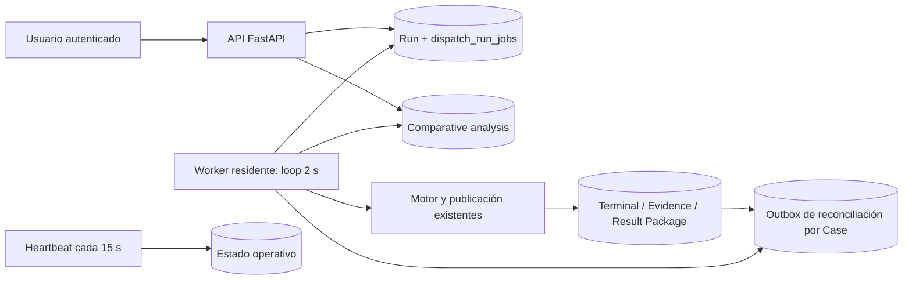

# Inventario focal del runtime actual

Baseline: `92656a1c8c94ae1181a18c47ddd681eaa313f92b`.
La tabla distingue código histórico de configuración live no verificable.

| Recurso/circuito | Evidencia | Estado y consecuencia |
|---|---|---|
| API `dation-core`, us-west1 | `backend/main.py`, `Dockerfile` | FastAPI/estáticos/auth; sin solver residente en proceso HTTP |
| Recursos/escalado API live | GET API HTTP 401 | `UNVERIFIED_LIVE`; deployer anterior preserva settings existentes |
| Worker histórico | `scripts/deploy_production_phase3.py` | min=1, max=2, CPU permanente, 1 CPU/2 GiB, `python worker.py` |
| Worker real live | GET worker HTTP 401 | `UNVERIFIED_LIVE`; no se afirma que coincida con el código |
| Loop y salud | `backend/worker.py` | reporte cada 15 s; servidor health; loop hasta señal |
| Polling | `dispatch_job_service.worker_loop` | `worker_step`, espera de 2 s si no hay trabajo |
| Admisión legacy | `enqueue_dispatch_run` | corrida+intención en transacción; replay/conflicto/capacidad |
| Admisión Ultimate | `platform_ultimate_execution`, operación `admit` | mismo `dispatch_run_jobs`; conserva input/contexto/Result Package |
| Claim | `claim_dispatch_job_v2`, fallback legacy | `SKIP LOCKED`, token de lease, hasta tres intentos, deadline 30 min |
| Ejecución | `_process_job`/`ultimate_run_service.execute_job` | heartbeat durante solver, fencing SQL y publicación durable |
| Comparativas | `enqueue/claim/finish_comparative_analysis` | tabla propia; selección original inmutable; lease y deadline propios |
| Reconciliación | `decision_case_reconciliations` | outbox transaccional por cambio/approval; ACK por versión |
| Operaciones | `operations_service.operational_snapshot` | hoy `ready` exige un worker sano incluso sin cola |
| Cloud Build real | check después del push; GET triggers 401 | externo; no puede neutralizarse con un cambio de GitHub Actions |
| Scheduler/Tasks/Registry/secretos/red live | sin lecturas autorizadas satisfactorias | `UNVERIFIED_LIVE`; costos residuales no se inventan como cero |

## Responsabilidades que deben sobrevivir

| Trabajo | Admisión/persistencia | Activación actual | Exclusión/cancelación/recuperación |
|---|---|---|---|
| D1/D2 legacy y Ultimate | POST autenticado + RPC; run/fingerprint estables | polling de worker | lease/token/deadline; finish/cancel SQL; D2 valida upstream aprobado/vigente |
| Comparativas | RPC separado, base_run_id y generación | mismo `worker_step(include_analyses=True)` | claim y heartbeat propios, selección base inmutable; retry explícito |
| Proyección de Cases | trigger SQL en la misma TX del cambio | `reconcile_cases()` en cada step | ACK con versión, backoff de fallos; conserva una actualización concurrente |
| Expiración/agotamiento | mantenimiento en claim | depende de loop actual | terminal error y token invalidado; GET no repara ni ejecuta |
| Salud/métricas | report_dispatch_worker + métricas de proceso | pulse residente | debe representar capacidad y backlog, no exigir cómputo idle |

No hay señal externa transaccional de activación del solver. Cambiar únicamente
`minScale` a cero dejaría intenciones sin despertar. La ADR debe cubrir la
doble escritura DB/proveedor y recuperación sin una visita futura del usuario.

## Contratos conservados y mediciones

No se cambian motores, presupuestos matemáticos, políticas, DTOs, hashes,
aprobación, D1→D2, Model/Contract/Case/Data Pack ni UI. Se ejecuta el probe
PERF11 existente del baseline (500/50/31 y D2 sobre fuente real de 100 viajes),
más fixtures de comparativas, antes de escoger la alternativa. Las cifras,
límites de la muestra y comparación económica se registran en la ADR.
