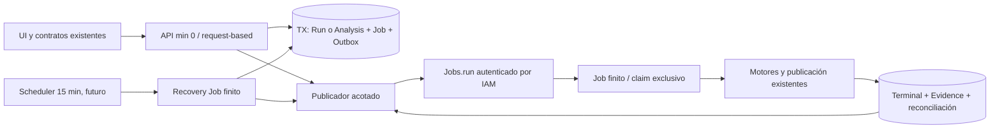

# ADR 02 — ejecución finita con Cloud Run Jobs

Estado: **ADR_APPROVED_BY_TECHNICAL_EVIDENCE** para implementación local.
No constituye autorización económica, despliegue ni autorización de merge.
Baseline: `92656a1c8c94ae1181a18c47ddd681eaa313f92b`.

## Evidencia y límites de las mediciones

Se ejecutó el probe PERF11 existente, sin modificar motores ni presupuestos:
`PYTHONPATH=. ../.venv/bin/python tests/test_ultimate_performance.py --probe`.
Además se midieron tres repeticiones pequeñas en un proceso local, con fixtures
de pruebas existentes y comparativas que conservan la selección original.

| Fixture | n | Wall P50 / máximo de muestra | CPU P50 | Memoria observada |
|---|---:|---:|---:|---:|
| D1 pequeño + ensamblado | 3 | 0,239 / 0,399 s | 0,239 s | high-water de proceso hasta 117,5 MiB |
| D2 de 8 viajes + ensamblado | 3 | 0,276 / 0,480 s | 0,274 s | mismo proceso |
| Comparativa legacy, opciones sintéticas existentes | 3 | 0,505 / 1,326 s | 0,504 s | mismo proceso |
| D1 500 órdenes/50 recursos/31 días: motor | 1 | 31,199 s | 31,039 s | 737,6 MiB pico del probe completo |
| Ensamblado D1 grande | 1 | 28,060 s | 27,813 s | incluido en el pico anterior |
| D2 con fuente real de 100 viajes: motor/ensamblado | 1 | 0,450 / 0,438 s | no separado en ese probe | incluido en el pico anterior |

El D1 grande conserva los límites PERF11: resultado FEASIBLE de 128 viajes,
sin afirmar cobertura completa. El D2 usa otro padre real certificado; nunca
se fabrica un upstream para completar el benchmark. Importar el runtime y los
fixtures pequeños tomó 2,016 s. Estas muestras excluyen red/Storage y no son
P95 de servicio ni cold start live. El máximo de n=3 es descriptivo.

## Alternativas y decisión

Pesos: integridad/durabilidad 30%, costo 25%, simplicidad 20%, seguridad 10%,
latencia 10%, escalabilidad 5%. Puntuaciones 1–5 son juicio técnico explícito;
los pesos se mantienen como en el Master Prompt. Todas requieren outbox y
recuperación externa si se exige progresar sin una visita futura.

| Alternativa | Integridad | Costo | Simplicidad | Seguridad | Latencia | Escala | Total /100 |
|---|---:|---:|---:|---:|---:|---:|---:|
| A Tasks → HTTP privado + recovery finito | 4 | 4 | 2,5 | 4 | 4 | 5 | 75 |
| B Jobs finitos + recovery Job | 5 | 3 | 4,5 | 4,5 | 2,5 | 4 | 81 |
| C cálculo inline en API | 2 | 5 | 2 | 3 | 5 | 2 | 59 |

**Elegida B.** Reutiliza el claim/lease/fencing y el worker Python fuera de HTTP;
no añade un segundo protocolo de ejecución, servidor privado, validación OIDC
de aplicación ni una promesa de CPU después de responder. A es viable pero
requiere controlar el lifetime del solver en una petición y una cola adicional.
El deadline HTTP de Tasks y el deadline DB de 30 minutos dejan menos margen
ante cold start, red y cancelación. C afecta el contrato durable 202, el aislamiento
de API y sus timeouts, por lo que se descarta sin rediseñar negocio.

Se acepta el mínimo facturable de **60 s por ejecución Job**: puede ser más
caro que A para tareas cortas. Con 110 pares D1+D2/mes y supuestos de 1 CPU/
1 GiB, el compute mínimo B cuesta USD 0,264 brutos; A con 3 s por decisión
costaría aproximadamente USD 0,0175. Las comparativas/proyecciones se suman,
no se ocultan en esos pares. La diferencia pequeña de piloto justifica menos
piezas y un lifetime finito comprobable. Los escenarios de volumen se recalculan
con el estimador; no se afirma que B sea siempre la opción más barata.

## Topología, recuperación y costo idle

- API `dation-core`: request-based, min=0, 1 CPU/512 MiB, max=2, concurrencia 8.
- Job `dation-executor`: 1 tarea/ejecución, 1 CPU/1 GiB, retry de plataforma 0,
  timeout acotado por el deadline durable. Se validará el envelope en contenedor.
- Job `dation-recovery`: control/reconciliación finitos, 1 CPU/512 MiB; mismo
  image/entrypoint, permisos y argumentos distintos. Nunca corre un loop idle.
- Scheduler futuro cada 15 min invoca recovery mediante OAuth/IAM. Se publica
  también tras POST durables y al terminar trabajo para no drenar la cola a
  razón de una tarea cada 15 min. Cada activación hace trabajo acotado y termina.
- Sin tareas/usuarios no quedan procesos propios permanentes. El recovery
  periódico sí genera ejecuciones aunque la outbox esté vacía. No es costo
  absoluto cero ni se presenta como un warmer de API.

Con 30 días, 2.880 ticks/mes y mínimo de 60 s, un recovery de 1 CPU/0,5 GiB
tiene costo bruto de compute aproximado USD 3,2832 + USD 0,10 de Scheduler.
El neto podría ser cero con franquicias disponibles; se modela por defecto
sin apropiarse de cuotas de otros proyectos/cuentas. El SLA objetivo de
redespacho perdido es un tick (15 min) más arranque/proveedor; el deadline de
admisión existente sigue siendo 30 min y un fallo permanente termina/alerta,
en vez de quedar queued eternamente. La garantía depende de DB/proveedor y
Scheduler operativos; sus outages se muestran como degradación.



## Transacciones, replay y fallos

Una outbox privada aditiva se alimenta por triggers de las tres fuentes
durables existentes: `dispatch_run_jobs`, `decision_comparative_analyses` y
`decision_case_reconciliations`. No duplica inputs/resultados ni sustituye
las RPC de negocio. Política deshabilitada inicialmente permite instalar
la migración sin activar cloud; el despliegue futuro debe habilitarla con GO.

1. Commit DB ocurre antes del 202. Un crash anterior revierte todo.
2. Publicador reserva intención/capacidad mediante transacción/lock; `jobs.run`
   sucede fuera de la TX. Error/timeout deja evidencia recuperable.
3. Job recibe únicamente UUID de intención y token de entrega; contexto y
   workspace salen de la fila persistida, nunca de un payload del cliente.
4. Claim atómico valida versión/token y adquiere el lease original del job.
   Duplicados/concurrencia no duplican publicación; token vencido queda fenced.
5. ACK de outbox exige terminal durable o ACK de reconciliación por versión.
   Un proceso que falla antes no borra la intención. ACK perdido puede repetirse.
6. Heartbeat existe solo mientras se procesa. SIGTERM/crash deja lease que
   recovery puede recuperar; cancelación y deadline invalidan escritura tardía.
7. Reintentos externos y de dominio son finitos. Agotamiento conserva diagnóstico
   y produce terminal error o dead letter/manual recovery para proyecciones.

```mermaid
sequenceDiagram
  participant A as API
  participant DB as PostgreSQL
  participant G as Jobs API
  participant W as Job efímero
  participant R as Recovery programado
  A->>DB: admitir Run + Job + Outbox (una TX)
  DB-->>A: commit / UUID estable
  A->>G: jobs.run (token de entrega)
  Note over A,G: Puede perderse la llamada o su ACK
  A-->>A: responder 202 después del commit
  R->>DB: recuperar intención pendiente/vencida, reserva acotada
  R->>G: redespacho autenticado y limitado
  G->>W: ejecutar una tarea finita
  W->>DB: claim exclusivo / contexto persistido
  W->>DB: heartbeat durante cálculo; finish fenced
  W->>DB: reconciliar / ACK de versión
  W->>DB: ACK outbox solo con estado durable
  W-->>W: terminar proceso
```

## Cobertura funcional y estados

Landing/Model/Contract/Case y creación/reuso de Data Pack solo utilizan API;
no admiten solver por GET. POST D1 persiste y activa Job. Resultado/Evidence
y aprobación permanecen canónicos. POST D2 conserva validación de upstream
aprobado/vigente. Comparativas usan su tabla y procesador actuales. Case
history se reconcilia dentro del trabajo y mediante su señal propia tras
approval. Crash después del commit, retry, timeout, SIGTERM y resultado tardío
se verifican con transporte falso y SQL real, sin cambiar resultados matemáticos.

Readiness separa DB/admisión, capacidad de dispatch y workers activos. Cero
workers con cola vacía es normal en modo Jobs. Cola vieja, leases vencidos,
deadlines y outbox bloqueada sí alertan. Campos actuales se conservan con
información aditiva. Health/ready/metrics no ejecutan ni reparan decisiones.

## Seguridad, límites y compatibilidad

IAM de `jobs.run`/overrides se limita a los Jobs de Dation; Scheduler invoca
solo recovery. Worker y controller usan identidades dedicadas y referencias
a Secret Manager. Ninguna cabecera de Tasks ni endpoint público sustituye
la autenticación de Google. Nuevas RPC son service-only, con contexto tenant
revalidado para el acceso de API; outbox/política privadas con RLS.

La política limita solver simultáneo, control simultáneo, admisión diaria,
cola, intentos y dispatches. Los límites de ejecución de un Job no son un
cap global entre ejecuciones: SQL debe reservar/fencear capacidad global y
el modelo debe incluir duplicados/arranques ambiguos. Ninguno es spending cap.

El runtime productivo por defecto será Jobs y los manifests lo exigen.
El loop legacy queda únicamente como compatibilidad explícita para fixtures
y entornos previos; el deployer y rollback no pueden publicarlo. Un rollback
inseguro se sustituye por congelar admisión conservando datos y trabajos.

## Fuentes y gates restantes

[Cloud Run pricing](https://cloud.google.com/run/pricing),
[Jobs execution e IAM](https://docs.cloud.google.com/run/docs/execute/jobs),
[Cloud Tasks](https://docs.cloud.google.com/tasks/docs/creating-http-target-tasks),
[Scheduler pricing](https://cloud.google.com/scheduler/pricing),
[spend caps](https://docs.cloud.google.com/billing/docs/how-to/budgets-spend-caps).
Consultadas durante esta ejecución; cifras USD para us-west1/Tier 1 sin impuestos.
Costos externos, almacenamiento/red/builds/secretos y franquicias compartidas
se desglosan en el inventario/estimador, no se equiparan a compute idle.

Live: `UNVERIFIED_LIVE`. Cold start GCP, instancias reales cero, gasto por SKU y
E2E productivo: `PENDING_EXPLICIT_AUTHORIZATION`. La protección de Cloud Build
no está demostrada; **MERGE_BLOCKED_DEPLOY_TRIGGER** continúa vigente.

## Validación posterior a implementación: decisión de recursos

El flujo grande real completo en **Job finito local de 1 CPU/1 GiB**, con rootfs
readonly y sin swap adicional, completó desde admisión en **88,140 s**; proceso
supervisado 73,297 s, CPU total observada 73,689 s, `memory.peak` de cgroup
800.210.944 bytes (763,14 MiB). Conservó 128 viajes FEASIBLE y 83 artifacts.
Se mantiene la configuración de 1 CPU/1 GiB por esa evidencia, con margen temporal
limitado y sin prometer P95. Ver `evidence/finite_scale_local.json`.

La primera medición de contenedor excedió el umbral de observación de 90 s al
coincidir con probes intensivos. Una muestra del control Python existente también
alcanzó 90,679 s sobre un host limitado a 2 CPU mientras competían esos procesos.
Se clasifican como interferencia de recursos de medición; no se alteró ningún
presupuesto, assertion o motor. El ensayo aislado conservó **90 s como gate**;
se permitió observar hasta 180 s únicamente para diagnosticar y registrar un
posible incumplimiento, sin convertir ese límite de observación en aprobación.
La CI completa conserva sus cinco probes y su assertion de 90 s, además de los
ensayos de publicación existentes. Cloud Run real y su variabilidad siguen
pendientes de autorización; si live no sostiene el objetivo, revisar recursos
con costo explícito, sin ampliar silenciosamente el presupuesto funcional.
