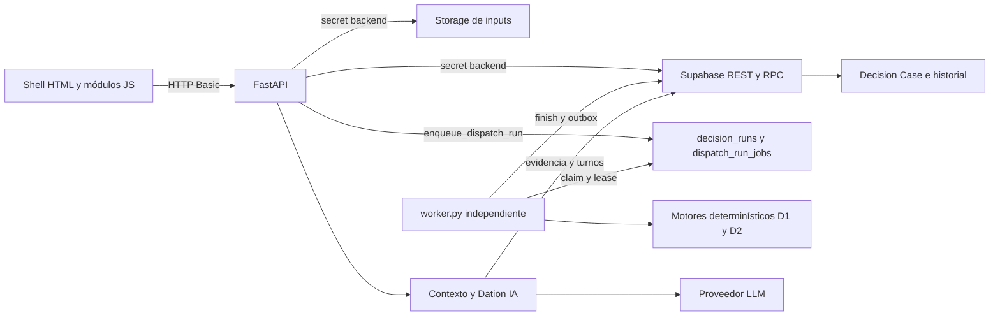

# Fase 0 · Arquitectura actual y límites de aislamiento

## Alcance y evidencia

Baseline de código: `22f1187451429c8e98dfcb9874f89b974500cb35` (`main`, PR #72). Esta auditoría lee el código actual; no introduce autenticación, tablas, migraciones ni cambios funcionales. La comprobación local de `main.app.openapi()` y el inventario de decoradores coinciden en **42 operaciones explícitas**: 19 en `backend/main.py` y 23 en `backend/app/routes/dispatch.py`.

Las afirmaciones siguientes sobre consultas, rutas y efectos corresponden al código de ese commit. Las migraciones y catálogos versionados se usan para explicar las RPC llamadas; **no prueban por sí solos el esquema o permisos desplegados**. La captura real read-only de esta Fase 0 está en [schema/live-catalog.json](schema/live-catalog.json), con [checksums](schema/SHA256SUMS): 12 tablas públicas, 33 funciones, sin views públicas, RLS habilitado en las 12 tablas, sin policies públicas ni grants a `anon`/`authenticated`; ninguna tabla tiene `workspace_id`. Existe un bucket privado `dda-inputs` y seis objetos con path de dos niveles UUID/archivo. Este contraste confirma que el workspace privado actual no es un sistema multi-tenant; RLS y bucket privado no suplen la autorización individual ausente.

## Aplicación HTTP

| Elemento | Implementación actual | Implicación para Platform |
| --- | --- | --- |
| Creación | `backend/main.py:lifespan`, `app = FastAPI(...)`, API v1.0.0 | Una sola aplicación; conservar el shell y encapsular Logística incrementalmente. |
| Arranque de contenedor | `Dockerfile`: Python 3.13, usuario `65532`, `uvicorn main:app`, puerto `PORT` | La API no inicia un worker en su lifespan. |
| Recursos compartidos | `app/services/http_service.py:http_pool`, 32 conexiones / 16 keepalive por event loop; `http_client` crea cliente temporal fuera del lifespan | Headers por petición; no hay caché de credenciales/respuestas de negocio. No hay sesión de usuario en el pool. |
| Middleware propio | `app/observability.py:RequestTelemetry` | Request/trace IDs, métricas y errores genéricos; no autentica ni autoriza. |
| Validación | `main.py:validation_exception_handler` para `RequestValidationError` | 422 con `detail` y lista `errors` (`field`, `message`); los servicios/routes mantienen otros errores HTTP. |
| Routing | `app.include_router(dispatch_router)` antes de las rutas declaradas en `main.py`; `APIRouter` con Basic global | Las rutas fijas POST `preflight` y `assignment-preview` están registradas antes de la ruta legacy POST `/api/runs/{dataset_id}`. Preservar precedencia. |
| Static | `RevalidatedStaticFiles`, mount `/static`; JS/MJS/CSS con `Cache-Control: no-cache` | Assets sin dependencia Basic propia; ningún secreto debe llegar a estos archivos. |
| HTML | `GET /app` y `/upload` leen `backend/app/templates/app.html` con `read_text` | HTML estático protegido por Basic; no render de usuario/workspace ni motor Jinja. `upload.html` existe, pero no es la página que devuelve `/upload`. |
| CORS y sesiones | No hay `CORSMiddleware`, `SessionMiddleware`, middleware CSRF ni resolución JWT registrados en la aplicación | El funcionamiento actual es mismo origen con Basic del navegador; falta diseñar sesión/CSRF según el método final de autenticación. La ausencia de CORS no constituye autorización. |
| Documentación | FastAPI conserva `/openapi.json`, `/docs`, `/docs/oauth2-redirect`, `/redoc` por defecto | No tienen dependencia Basic propia. Describen contratos, sin autorización multiusuario. |
| Liveness | `/` y `/health` no consultan DB y no piden Basic | Un 200 no demuestra persistencia, aislamiento ni worker operativo. |
| Readiness/operaciones | `/ready`, `/api/system/operations`, `/metrics`, Basic; `operations_service.operational_snapshot` | Usa RPC de lectura global y alerta sobre leases, cola y worker. `/ready` 200/503; operations/metrics 503 ante DB inaccesible. |
| Diagnóstico | `/api/system/supabase-check`, `/api/system/llm-status`, `/api/dispatch/status`, Basic | `system_status` comprueba columnas, catálogo RPC y bucket; explícitamente no prueba trigger real ni políticas RLS. |

El inventario con método, ruta, auth, entrada, salida, tablas/storage y mutación está en [api-inventory.md](api-inventory.md). No hay rutas de logout, signup, login Supabase, invitaciones, membresías, roles, administración de usuarios, workspace switching ni API de Platform en el baseline.

## Autenticación y frontera de confianza actual

`backend/app/auth.py:require_upload_access` usa `HTTPBasic`, compara con `secrets.compare_digest` usuario literal `dation` y `DATION_ACCESS_PASSWORD`. Falta de configuración produce 503 cuando la dependencia recibe credenciales; credenciales inválidas, 401. FastAPI/HTTPBasic atiende credenciales ausentes/malformadas antes de esa comparación.

Todas las rutas de negocio dependen de esta misma contraseña compartida: directamente en `main.py` o por dependencia de router en `dispatch.py`. El valor retornado es el mismo usuario `dation`; no se propaga a servicios como identidad individual. No se verifican `auth.uid`, email, JWT Supabase, membresía activa, rol ni workspace. Los UUID son identificadores, no permisos. Cualquier poseedor de la credencial compartida tiene el mismo acceso a biblioteca, casos, corridas, aprobaciones e IA.

Los servicios crean headers `apikey` y `Authorization: Bearer` con **`SUPABASE_SECRET_KEY`**; no pasan el token del navegador. Ese es el acceso privilegiado del backend utilizado por las RPC concedidas a `service_role`, contrastadas con el catálogo real enlazado. Aunque RLS está habilitado, estas llamadas privilegiadas no aportan aislamiento por usuario. `SUPABASE_SECRET_KEY` es un nombre de variable, no evidencia suficiente para afirmar el rol de cualquier valor futuro.

No existe `workspace_id` ni contexto tenant en las funciones de acceso de estos servicios. Los filtros actuales son de objeto/tipo/estado/fingerprint, nunca de membresía. La integridad de lineage y tipos sí tiene controles propios, pero **no equivale a autorización por workspace**.

## Flujo de negocio que se preserva

1. Orders/Fleet se validan localmente; almacenar implica bytes en Storage y metadatos en `datasets`.
2. `decision_case_service.ensure_case` fija el Data Pack del caso y esquema `decision_case_v2`, dominio `logistics`. Los nodos son `logistics_assignment`, `logistics_scheduling` y placeholder `logistics_final_assignment`.
3. `dispatch_job_service.enqueue` identifica la intención por `run_id` + fingerprint y llama `enqueue_dispatch_run`: corrida y job se admiten de forma transaccional. El API devuelve 202, `Location` y `Retry-After`.
4. Worker toma un job con lease, valida versión de motor/upstream, ejecuta `dispatch_service.execute`, verifica hashes de inputs, escribe progreso/resultado mediante heartbeat/finish y deja reconciliación durable.
5. `decision_case_service.approve_run_version` llama RPC transaccional de aprobación/supersesión con eventos inmutables en `decision_approval_events`. La proyección del caso se intenta después; si falla, la aprobación permanece y responde `projection_pending`. Reconciliación la repara.
6. Scheduling requiere Assignment completada, aprobada vigente, del mismo caso/Data Pack. Se valida al admitir y ejecutar; los resultados conservan el handoff. No hay motor D3 funcional en esta saga.
7. Evidencia comparativa vive en artefacto compañero `decision_comparative_analyses`; no crea una nueva decisión ni cambia la recomendación original. Dation IA vincula explicaciones/turnos con la evidencia exacta usada.

También existe el circuito **legacy** `POST /api/runs/{dataset_id}` → `run_service.execute_logistics_run`: crea la corrida y marca dataset, calcula en `asyncio.to_thread` dentro de la petición, y guarda resultado/error. No usa cola/lease/cancelación del circuito nuevo. Mantenerlo cubierto o deprecarlo explícitamente; cerrar sólo rutas nuevas dejaría una vía de ejecución sin autorización tenant.

## Mapa de servicios y efectos

En la columna de acceso, «privilegiado» describe headers backend, no autorización de usuario. Tablas/RPC se refieren al código y SQL versionado, contrastados con el catálogo live enlazado; las condiciones de pertenencia futura siguen sin existir.

| Servicio / funciones concretas | Accesos y filtros actuales | Mutaciones / efectos secundarios | Requisito de encapsulación |
| --- | --- | --- | --- |
| `dataset_service.find_dataset_by_hash`, `upload_dataset` | Privilegiado; `datasets` por SHA-256 global; sin tipo/tenant para ruta legacy. Escribe bucket `SUPABASE_INPUT_BUCKET` | POST objeto, INSERT metadatos. Si falla INSERT, DELETE compensatorio del objeto; no transacción Storage/DB. Duplicado retorna metadatos existentes. | Dedup y lookup dentro de workspace; autorizar antes de revelar duplicados. |
| `dataset_profile_service.get_dataset_profile` | `run_service.get_dataset` por ID. Para Orders/Fleet devuelve `profile_json`; legacy descarga bytes y valida/perfila | Sin persistencia desde esta función | Autorizar ID antes de metadata/bytes; conservar formatos existentes. |
| `decision_case_service._db`, `get_case_row`, `ensure_case`, `update_case` | Privilegiado; `decision_cases` por ID, datasets por ID; estado permite snapshot validado. `list_cases` usa RPC `list_decision_cases` (lectura STABLE por POST) | INSERT/PATCH caso, `updated_at`/`last_activity_at`; archivo lógico. `ensure_case` existente con `state` llama update | Data Pack y caso deben pertenecer al workspace del actor; no confiar en snapshot del cliente para permisos. |
| `decision_case_service.history_snapshot`, `get_run_history`, `get_case`, `list_case_runs` | RPC `decision_case_history` por case/node; `decision_runs` por `decision_case_id`; incluye latest/aprobado/contadores; lee datasets | Lecturas no reparan ni actualizan casos. Proyección calculada en memoria | Scope al padre y a todos sus hijos; conservar paginación/supersesión. |
| `decision_case_service.approve_run_version`, `sync_case_history`, `record_node_state`, `validate_upstream_run` | Run/case/upstream por ID; RPC `approve_decision_run_version`; valida nodo/esquema, estado completado, aprobación y no supersesión | RPC actualiza aprobación/supersesión, INSERT `decision_approval_events` y outbox por triggers; `sync`/`record` PATCH caso | Rol approver, identidad real y lineage del mismo tenant en backend/DB. El actor actual es compartido. |
| `run_service.get_dataset`, `get_run`, `download_dataset`, `_insert_run`, `_update_run`, `_update_dataset` | Privilegiado; select `*` por ID; Storage usa `storage_bucket`/`storage_path` de la fila; PATCH por ID | CRUD parcial: INSERT/PATCH corridas y PATCH datasets; descarga bytes. No DELETE de negocio | No exponer estas funciones sin contexto autorizado; evitar lookup cruzado por ID. |
| `run_service.execute_logistics_run` | Legacy, dataset por ID, descarga objeto, configuración `DecisionRunConfig` | Inserta running; dataset processing; motor local; terminal completed/error y dataset processed/error. Coste de cómputo en request | Aplicar el mismo control tenant y límites, aunque UI no sea el camino principal. |
| `dispatch_service.db`, `system_status`, `_probe_rpc_catalog`, `_probe_bucket` | Wrapper REST privilegiado genérico sin contexto; probes de columnas, OpenAPI y bucket privado | Probes son lectura; no ejecutan RPC de negocio para comprobar catálogo | Separar diagnóstico administrativo de permisos de usuario y no usar `available` como prueba de seguridad. |
| `dispatch_service.list_typed`, `_ensure_profile` | `datasets` por tipo/archivo/query; list devuelve `*`. Profile obsoleto puede leer bytes | `list_typed` llama `_ensure_profile(persist=False)`: no PATCH implícito. `refresh-profile` usa `persist=True`: PATCH metadata | Scope antes de listar/perfilar; impedir fugas por búsqueda y metadatos. |
| `dispatch_service.store_input`, `download_input`, `update_dataset_label`, `archive_dataset` | Por tipo+hash global o ID; parent Fleet validado por tipo/existencia | Storage POST + INSERT dataset; DELETE compensatorio si INSERT falla. Etiqueta/archivo lógico PATCH por ID. No borrado físico al archivar | Parent/dedup/objeto dentro del workspace; archivo lógico no elimina datasets referenciados. |
| `dispatch_service.load_sample_inputs` | Lee CSV del repo, reutiliza dedup global | Puede INSERT 2 datasets/objetos; PATCH `is_sample` incluso en duplicados; RPC `set_default_fleet` | Acción mutante explícita; no ejecutar como probe. No debe cambiar default de otros workspaces. |
| `dispatch_service.load_inputs`, `check_inputs`; `assignment_config_service.preview_assignment_configuration` | Datasets por ID + bytes de Storage; validación, filtros Orders y recursos own/mixed/outsourced | CPU/lectura, sin guardar; POST no implica mutación persistente | Autorizar ambos inputs antes de lectura, también en preflight/preview. |
| `dispatch_service.execute` | Lee ambos datasets/bytes, run fuente para D2; elige motores Assignment/Scheduling/Dispatch según nodo | En worker escribe por execution_writer con lease; si se llama sin writer inserta/PATCH directo. Engine `asyncio.to_thread`; fingerprints/progreso/resultados | Mantener motores determinísticos y contratos; contexto tenant también en worker. |
| `dispatch_service.approve_decision_run` | Helper legacy PATCH `decision_runs` por ID+completed y aprobación JSON | Mutación directa de resultado/config; **no es la función usada por la ruta approve actual** | No reactivar como atajo: evitar saltarse nueva aprobación, actor y outbox. |
| `dispatch_job_service.enqueue`, `cancel` | Lookup job por run ID/fingerprint; validación case/Data Pack; RPC enqueue/cancel | INSERT transaccional run/job; replay idempotente; cancelar cierra run/job como error/cancelled. Admisión tiene capacidad global | Fingerprint/idempotencia y cancel deben comprobar owner/workspace, no sólo UUID. |
| `dispatch_job_service._process_job`, `worker_step`, `worker_loop`, `reconcile_cases` | Cola global `claim_dispatch_job`; comparativo global opcional; outbox por available_at; lease_token/fencing | claim mantiene/expira jobs; heartbeat/finish mutan; reconciliación PATCH caso + DELETE outbox vía ack; retry PATCH por case+version | Worker de confianza debe validar tenant persistido y lineage antes de cada carga; no usar membresía UI como único control. |
| `decision_context.build_decision_context` + `dispatch_context`, `scheduling_context` | Transformación en memoria por `schema_version`; sin DB ni Storage directo | Sin persistencia; produce evidencia enviada a LLM | Conservar fórmulas y límites; sólo invocar con datos ya autorizados. |
| `decision_interpreter_service.generate_explanation`, `answer_question` | Run completado por ID; evidencia comparativa; últimas 6 `decision_messages` por run; knowledge local; LLM externo | Llamada facturable LLM, INSERT explicaciones/turnos/mensajes/sources mediante RPC. `turn_id`+hash permite replay; deadline total 90s; proveedor 60s y un retry429 | Autorizar antes de cargar evidencia o replay; rol de IA y límites por workspace; chat no pertenece a usuario individual actualmente. |
| `decision_interpreter_service.get_saved_interpretation` | RPC STABLE `current_decision_explanation` por POST; mensajes/sources/comparativo por run ID | Sólo lecturas, paginadas; no generación LLM | Scope de run e interpretación, no filtrar sólo la UI. |
| `comparative_analysis_service.base_run`, `get_analysis`, `completed_evidence`, `generate_analysis`, `process_analysis_job` | Run Assignment completado por ID; artefacto por base_run_id; worker lee Data Pack | GET no escribe; POST puede reutilizar evidencia o enqueue/retry; worker calcula referencias, conserva selected; lease/finish en tabla compañera | Scope a corrida y datos base antes de admitir/replay; no contar como nueva aprobación. |
| `workspace_service.list_datasets`, `list_runs`, `workspace_summary` | Privilegiado, listas globales, optional filtro dataset_id y contadores exactos globales | Sin escrituras | «workspace» aquí es nombre del servicio/resumen compartido; no hay workspace real ni membership. |
| `supabase_service.check_supabase_connection`, `operations_service.operational_snapshot` | Privilegiado; lectura datasets, RPC snapshots de jobs/workers/reconciliation/runs/chat/comparativo global | Sin cambios de negocio | Operación global debe restringirse a administradores, o separar agregados del workspace. |
| `knowledge_service`, `llm_service` | Markdown local y proveedor configurable Groq/OpenAI; API key backend separada | Lectura archivos; POST externo con evidencia, pregunta e historial; uso/tokens acotados | Mantener texto de dataset como datos y no instrucciones; gobernar acceso/coste por tenant en capa Platform. |

## Storage y borrado

Bucket configurable `SUPABASE_INPUT_BUCKET` (default `dda-inputs`), cuya privacidad comprueba `_probe_bucket`. El código actual genera:

- Legacy: `<dataset_id>/input.csv`.
- Orders/Fleet: `<dataset_id>/Orders_YYYYMMDD_HHMMSS.csv` o `Fleet_YYYYMMDD_HHMMSS.csv` en `America/Argentina/Cordoba`.
- `original_filename` conserva el nombre de carga; `canonical_filename` es generado por tipo/fecha, distinto de la etiqueta editable.
- Reutilizar duplicado no sube objeto nuevo. No hay prefijo `workspace_id`.
- Archivar/unarchive sólo cambia `datasets.archived_at`; no borra bytes, filas, lineage o corridas.
- DELETE de Storage sólo aparece como compensación de un alta de metadatos fallida; el código no comprueba explícitamente el status de esa compensación. Un error de red puede dejar objeto huérfano o enmascarar el error original. No hay API pública de borrado definitivo de dataset/case/run.

En la siguiente implementación, primero autorizar por fila y mantener la resolución explícita del path histórico. Nuevas cargas pueden usar `<workspace_id>/<dataset_id>/<canonical_filename>`; mover objetos actuales requiere inventario, copia, verificación de hash/lectura, cambio de referencia y rollback. El trigger actual `protect_persistence_identity` prohíbe modificar `datasets.storage_bucket` y `storage_path`: un PATCH de referencias no es una migración válida sin adaptar explícitamente esa protección y restaurar su garantía. Mantener paths legacy evita ese cambio mientras se agrega aislamiento por fila. No deducir el workspace de un path viejo ni renombrar objetos en esta Fase 0.

## Worker y operaciones

`backend/worker.py:run_worker` exige configuración Supabase y visibilidad de RPC de cola/operaciones/comparativos. Abre el mismo pool HTTP, registra UUID de instancia y revisión, reporta disponibilidad cada 15s y responde a SIGTERM/SIGINT. `dispatch_job_service.worker_loop` ejecuta un solver por proceso y recupera leases expirados; la escala/concurrencia efectiva pertenece al despliegue.

`health_handler` es un servidor TCP HTTP mínimo independiente de FastAPI: `/ready` usa readiness local y devuelve 200/503, `/metrics` expone métricas de proceso, cualquier otra ruta responde liveness. No aplica Basic ni auth propia. La accesibilidad externa depende de IAM/ingress Cloud Run: el código de aplicación por sí solo no prueba que el worker sea privado. `report_dispatch_worker` hace upsert y limpieza de registros de instancia de más de 24h según la migración versionada; `claim_*` también realiza mantenimiento mutante, por lo que no se usa para una auditoría read-only.

`RequestTelemetry`/`JSONFormatter` no registran cuerpos, query strings, credenciales, preguntas ni mensajes libres; sólo campos permitidos y IDs validados. Esto protege logs, pero no sustituye un audit log multiusuario. `approved_by` actual se escribe como `shared_workspace:dation` en la RPC de `20261010190000_approval_clock_after_lock.sql`; no identifica qué persona aprobó. No retroatribuir aprobaciones/mensajes históricos a un usuario nuevo.

## Riesgos concretos y gates de la capa Platform

| Riesgo | Evidencia actual | Gate antes de early adopters |
| --- | --- | --- |
| Lectura/escritura cruzada entre futuros clientes | Todos los accesos de objeto/lista por credencial compartida; sin workspace en servicios | Resolver sesión → actor → membership activa → workspace; rechazar IDs externos en todas las rutas legacy/nuevas y en worker; pruebas cruzadas A/B. |
| Dedup y default globales | `find_dataset_by_hash`, `store_input`; `datasets_dispatch_hash_key`; `set_default_fleet` usa lock global y limpia todo default Fleet | Uniqueness y dedup por workspace; default único por workspace+tipo; no filtrar sólo resultados después de escribir. |
| Lineage parcialmente scoped | Se valida case/node/input, pero no tenant | Añadir workspace y constraints/FK compuestas o validadores equivalentes a datasets/case/run/upstream/artefactos; preservar contratos de motor. |
| Identidad y roles inexistentes | Basic y actor `shared_workspace:dation` | Roles y guards backend para ejecutar/aprobar/administrar; actor real en nuevas acciones; históricos explícitamente legacy. |
| Bypass a través de rutas legacy | `POST /api/runs/{dataset_id}` sigue activo; helpers directos de run y aprobación | Auditar y proteger todo inventario; no dejar Basic como bypass después del cambio de sesión. |
| Service-role como falsa garantía RLS | Headers privilegiados, sin JWT de usuario | Guards backend explícitos; RLS/grants para acceso directo. Probar ambos caminos sin secretos en navegador. |
| Jobs/comparativo/outbox sin tenant | Requests/RPC globales y capacidades globales | Persistir contexto workspace de forma validada, verificar al ejecutar; decidir fairness/límites sin romper lease/replay/repair. |
| IA e historial compartidos | Mensajes por run, replay por turn_id, LLM externo | Autorizar antes de replay/evidencia, políticas de coste/acceso y actor; conservar grounding y fingerprints. |
| Compensación de Storage best effort | POST objeto separado de INSERT fila; DELETE sin comprobación de respuesta | Namespace, verificación de rollback y proceso de reconciliación de huérfanos; no reset destructivo. |
| Superficie operativa global | Readiness, metrics, docs; worker sin auth propia | Decidir visibilidad por rol/infra y probar IAM/ingress reales; `/health` no prueba seguridad. |

El objetivo es una capa de identidad/workspace/permisos y administración que envuelva la misma aplicación y DDA Logística. No se justifica reescribir frontend ni motores para lograrlo. Esta Fase 0 termina en documentación, baseline y estrategia verificable; las modificaciones productivas de autenticación, esquema, storage y navegación pertenecen a fases posteriores y requieren su gate correspondiente.
