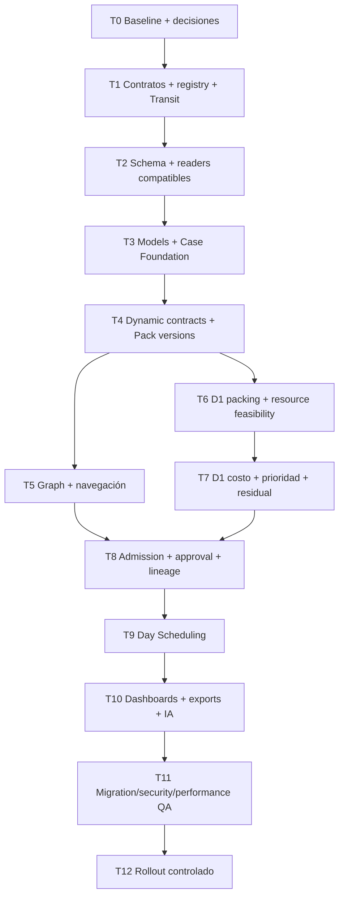

# DATION — ULTIMATE MVP IMPLEMENTATION MASTER PLAN

**Estado: análisis y propuesta técnica; ninguna implementación autorizada por este documento.**

Fecha de auditoría: **25 de octubre de 2026**, zona de referencia America/Buenos_Aires. Baseline: `main` / `origin/main` en **`ef997235a30251fbf7ae53690ed738092ee973d8`**, verificado tras `git fetch origin`; árbol inicialmente limpio.

Fuente de verdad del **objetivo funcional**: `DATION_MASTER_PROMPT_FASE_1_2_ULTIMATE_MVP.md`, leído completo, junto con el pedido de auditoría y planificación. La documentación canónica del repositorio describe el **estado actual**; no se la confunde con el objetivo nuevo. Las discrepancias se explicitan abajo. Este plan no reemplaza su revisión ni constituye un permiso para ejecutar migraciones, modificar producción o hacer commits.

Convenciones: **ACTUAL** = comprobado en código o catálogo; **PROPUESTO** = diseño para implementar después; **PENDIENTE** = decisión o verificación de la siguiente etapa. Los tests del objetivo descritos aquí son criterios futuros, salvo los identificados expresamente como ejecutados durante esta auditoría.

Accesos de revisión: [gaps](#4-current-vs-target-gap-analysis), [decisiones](#5-architectural-decisions), [modelo físico](#7-data-model-propuesto), [fases](#17-implementation-phases), [fixtures matemáticas](#19-controlled-test-datasets-y-resultados-esperados), [riesgos](#20-risk-register), [readiness](#25-final-readiness-assessment).

## 1. Executive Summary

Dation dispone de una base reutilizable importante: plataforma multiworkspace, Auth, Data Hub, Decision Center, Cases persistidos, dos motores separados, OR-Tools, cola durable, aprobaciones por Run, invalidación, historial, exportaciones, explicaciones y una UI ya estabilizada. **No corresponde una reescritura de la plataforma ni un framework nuevo.**

La evolución sí cambia contratos centrales. El Case actual nace de dos datasets inmutables; el objetivo nace antes de los datos, vincula un Logistics Model versionado y recibe un Data Pack acumulativo. El recurso actual es un vehículo físico; el objetivo incluye ofertas externas finitas y recursos propios reutilizables. D1 ya construye viajes y asigna carga conjuntamente: no falta una segunda decisión de Trip Planning. Falta ampliar su modelo matemático, que hoy asigna toda la demanda en kg, admite viajes abstractos repetidos por vehículo y no impone el nuevo horizonte/cupo de servicios. D2 ya secuencia por día, pero calcula retorno también para externos y usa velocidad/horas suministradas por vehículo, en lugar del TransitEstimator estándar solicitado.

La recomendación es una evolución **aditiva, por cohortes de contrato**:

1. Estabilizar evidencia y gates de migración/QA.
2. Definir contratos versionados, semántica matemática y registro de engines.
3. Expandir el esquema sin reinterpretar Cases ni Runs históricas.
4. Crear Models/Cases nuevos antes de cargar datos.
5. Incorporar contratos dinámicos, snapshots y versiones de Data Pack.
6. Convertir el Map en grafo de estado y reutilizar los componentes de datos.
7. Ampliar D1 y luego D2, conectándolos a la cola y gobernanza existentes.
8. Adaptar presentación/export/IA por versión de resultado.
9. Verificar upgrade, rollback y seguridad antes de habilitar el nuevo flujo gradualmente.

Los nodos técnicos existentes `logistics_assignment` y `logistics_scheduling` pueden conservarse. Para el contrato nuevo sus labels serán **Transport Plan** y **Day Scheduling**. Nuevas versiones de motores/outputs, no cambios silenciosos a `assignment_v1` o `scheduling_v1`. No se agrega entidad Branch, motor por industria ni motor adicional para construir viajes.

**Readiness:** la arquitectura puede evolucionar sobre esta base; no está lista para implementar todo como una única saga. Requiere acordar las decisiones de §5, establecer el baseline SQL efectivo y ejecutar las fases técnicas de §17. No se observó una necesidad de reemplazar Auth, tenancy, la cola o la plataforma visual.

## 2. Current Architecture

### 2.1 Evidencia y cobertura de la auditoría

Se inspeccionaron implementaciones reales, no sólo nombres: entrada FastAPI y modelos de requests; rutas; workspace/router/lifecycle; estado de Case y readiness; contratos/validadores; Data Hub y persistencia de entradas; modelos CP-SAT, heurísticas y validadores de ambos engines; admission/worker/approval; proyecciones de historial/portfolio; adapters de dashboards, exports e IA; SQL, catálogos, baseline y runbooks; dependencias, Docker y workflow de CI.

Se consultó Supabase **sólo mediante SELECT y herramientas de metadata**. No se leyeron archivos comerciales ni contenido de órdenes/clientes. Hechos del catálogo live consultado:

| Evidencia live | Resultado |
|---|---|
| PostgreSQL | 17.6 |
| Tablas `public` | 19; RLS habilitada en las 19 |
| Columnas/constraints/índices públicos | 232 / 161 / 79 |
| Funciones en `public` + `dation_private` | 101: 45 públicas y 56 privadas |
| Tablas privadas identificadas | 7: uploads, deletions, legacy owners, responsabilidades, release gates, stage assignments y onboarding |
| Bucket de entrada | `dda-inputs`, privado, límite 10.485.760 bytes; CSV/texto, sin JSON/XLSX declarados como MIME específico |
| Models operativos | No existen tablas actuales de Logistics Model/versiones |
| Historial registrado de migraciones | 10 entradas, hasta `20261005012207`; existen tablas/funciones de upgrades posteriores |
| Gates recientes | `platform_apply_case_attributes`, `require_workflow_responsibility` e `invalidate_run_lineage` verificados por sus cuerpos live |

Esto **no prueba drift funcional** de todos los objetos ni prueba que falten los upgrades: demuestra que el historial de migraciones no cuenta toda la instalación real. Debe reconciliarse el mecanismo de aplicación administrativo/catálogos con ese historial antes de usar un `migration up` automático. `supabase/README.md` documenta baseline capturado y scripts con preflight; no debe aplicarse el baseline sobre producción existente.

La consulta de Cloud Run vía Management API respondió **401**. No se afirma que se hayan verificado imágenes, variables, secretos, capacidad o revisiones productivas actuales. Docker/runbooks/worker/CI se revisaron en Git. El changelog de Supabase no resultó accesible desde este entorno; se consultó documentación actual mediante su herramienta de búsqueda. No se pidió ni se alteró configuración para sortear esas limitaciones.

### 2.2 Stack y responsabilidades actuales

| Capa | Implementación comprobada | Reutilización recomendada |
|---|---|---|
| Frontend autenticado | HTML/CSS/ES modules nativos, sin React/npm build; `app/templates/app.html`, `platform/boot.mjs`, `platform/session.js` | Mantener stack, tokens, controles, scopes y carga diferida |
| Router | `dispatch/navigation/resource.mjs`, `workspace.mjs`, platform shell; URL `{view, caseId, nodeId, runId}` | Extender recursos; mantener URLs y aliases históricos |
| Estado browser | `dation.dispatch.workspace.v5`, drafts por Case, session/tab isolation, AbortControllers y route generations | Drafts versionados; nunca autoridad para permiso/aprobación |
| Dominio Case | `app/domain/decision_cases.py`; proyección Python compartida por Home/Center/Case; también estado de presentación JS | Conservar autoridad de Runs; reducir hechos de negocio duplicados para el flujo nuevo |
| API | FastAPI 0.143.0 / Pydantic; OpenAPI generado: **91 paths, 98 operaciones, 38 schemas** | Añadir contratos explícitos; no reusar payload v1 con otro significado |
| Datos | Validadores Orders/Fleet, perfiles/completeness, Storage privado, Data Hub y journals de upload/delete | Reusar transporte de archivos, recuperación y autorización; ampliar tipos/contratos |
| D1 | `app/engines/assignment/`, CP-SAT + heurísticas; `assignment_v1`, engine 1.0.0 | Ampliar matemáticamente y versionar; conservar runtime v1 |
| D2 | `app/engines/scheduling/`, CP-SAT + heurística; `scheduling_v1`, engine 1.0.0 | Reusar secuenciación, conservación upstream y validadores; versionar tiempos/recursos |
| Ejecución | Admission atómica, `dispatch_run_jobs`, worker independiente, leases/fencing/reconciliación | Mantener protocolo; despachar por versión persistida |
| Gobernanza | Owner/Admin, SQL de aprobación, eventos append-only, única aprobación vigente, invalidación al admitir otra Run | Extender checks de contexto/manifiesto; preservar locking y actores |
| Interpretación | Groq por defecto, OpenAI configurable; knowledge/prompt versionados; evidencia y artefactos comparativos persistidos | Nuevos adapters de evidencia; LLM fuera del solver |
| Infraestructura | Imagen Python 3.13 no root, dependencias hash-locked, OR-Tools 9.15.6755; Cloud Build/Run según runbook | Sin cambio de proveedor/topología necesario por este objetivo |

### 2.3 Flujo funcional actual

```text
Home / DDA Logística
  → Datos del Case: atributos + Data Owner + Orders/Fleet
  → registro de Case cuando existen inputs válidos
  → Map: D1 Assignment → D2 Scheduling → D3 futuro
  → Config del nodo → admission → worker → dashboard → aprobación humana
```

Aplicar atributos antes del CSV guarda preparación de sesión; **todavía no crea un Case vacío durable**. La API `DecisionCaseCreate` exige IDs de Orders y Fleet. El catálogo live confirma ambos FK NOT NULL. Cambiar el par de datasets de un Case persistido crea/reutiliza otro Case mediante la RPC de reemplazo; editar atributos/owners no reemplaza el Case.

D3 actual es un placeholder de asignación física/patente, no una decisión implementada. No debe confundirse con una capacidad operativa que el target estaría eliminando. La finalización actual del Case se calcula con las dos decisiones implementadas.

### 2.4 Contratos actuales relevantes

- Orders V3 requiere `order_id`, `product`, `quantity_units`, `unit_weight_kg`, `origin`, `destination`, `distance_km`. Las fechas y prioridad son opcionales. `ready_date` y `dispatch_date` son aliases legacy de `estimated_dispatch_date`.
- Fleet V3 requiere una fila por vehículo real: `vehicle_id`, `vehicle_type`, `ownership`, `base_site`, `capacity_kg`. Volumen es dato opcional; pallets/unidades como dimensiones de capacidad y ofertas externas con cupo no están modelados.
- Templates son CSV estáticos derivados de `validators/contracts.py`, con todas las columnas. No hay contrato generado por Model ni soporte de ingestión XLSX demostrado.
- Parser acepta UTF-8/BOM, coma/punto y coma, aliases explícitos y errores estructurados. Las columnas extra generan warning y permanecen en el archivo raw; no hay fuzzy mapping.
- D1 agrupa por ruta, conserva todas las unidades enteras y restringe kg por viaje. `dimensions` de Assignment significa **dimensiones de objetivo** (trips/cost/own_fleet/co2), no Capacity Dimensions del nuevo Model.
- Costo actual: `2 × distance_km × cost_per_km + fixed_trip_cost`, también para externos. No es un catálogo PER_TRIP/PER_KM con base de kilometraje seleccionable.
- Scheduling exige fechas, velocidad, horas, status y disponibilidad. `transit = ceil(distance / (speed × hours))`; `cycle = ceil(2 × distance / (speed × hours))` para ambos ownerships. Usa llegada `dispatch + transit_days`, otra convención que el ejemplo dominical del target obliga a revisar/versionar.

### 2.5 Sondas matemáticas ejecutadas sin persistencia

Se ejecutaron los engines v1 en memoria con datos sintéticos, sin API ni DB:

| Sonda | Resultado ACTUAL | Consecuencia para el target |
|---|---|---|
| Dos órdenes de 500 kg, mismo destino a 480 km, disponibilidad 2/11 y 6/11, vencimiento 3/11 y 8/11, capacidad 1.000 kg | D1 las consolida en un viaje; D2 despacha 6/11, llega 7/11 | Compatibilidad de fechas debe entrar en la construcción del Transport Plan; D2 no debe arreglarlo reasignando |
| Una fila externa de 1.000 kg, demanda divisible de 5.000 kg | D1 genera cinco viajes abstractos | Una fila externa no representa actualmente un cupo de un servicio; no alcanza renombrarla a Resource |
| Externo a 480 km, costo/km 1, fijo 10 | Costo 970; ciclo de dos días y retorno publicado | Target requiere costo según base contractual y externo sin retorno/cycle |

No son bugs bajo el contrato v1; son incompatibilidades reales con el contrato objetivo. Artefacto: `engine-behavior-probes.json` de esta auditoría.

### 2.6 Coupling, duplicaciones y código histórico

1. `workspace.mjs` tiene 907 líneas y coordina datos, Case, readiness, configuración, navegación, polling y dashboards. Su lifecycle funciona y tiene cobertura; no dividirlo por tamaño. Extraer sólo los nuevos contextos de Case/Model/DataPack y sus DTOs, dejando un coordinador fino por contrato.
2. Orden/IDs de nodos y estados aparecen en dominio Python, JS, readiness, registry de presentación y SQL. La registry `foundation-v2.json` comparte labels/destinos, **no sustituye** una Definition de decisión con constraints/read sets.
3. Transit/cost helpers del Dispatch histórico son importados por Assignment; Scheduling tiene otra preparación temporal. No reemplazar helpers compartidos globalmente: cambiaría outputs históricos.
4. Schemas concretos aparecen en workspace, AI contexts, exports, readiness, approval y routing. Añadir un engine sin revisar esos consumidores produciría resultados válidos pero mal interpretados.
5. Dataset hash dedup usa `(workspace_id, dataset_type, sha256)`. Contratos dinámicos requieren distinguir interpretación/contract hash; mismo CSV no necesariamente implica mismo dataset semántico.
6. `profile_json` y `state_json` son proyecciones, no evidencia de aprobación ni un Model versionado. No reutilizarlos como una bolsa de configuración sin integridad.
7. Renderers históricos, adapters Fleet V1/V2 y `scheduling-execution-phase4.mjs` tienen importadores reales. **No se clasifican como código muerto.** La foundation ya retiró selectores sin callers; no corresponde repetir esa refactorización.
8. Hay duplicación legítima de seguridad: backend valida la intención y SQL revalida dentro de la transacción. Se debe compartir especificación/tests, no eliminar el guard SQL.
9. README/ADRs antiguos aún hablan de approvals en JSONB y D3 físico. `docs/decision-runs.md`, SQL actual y proyecciones canónicas describen la autoridad efectiva. Se preservan documentos históricos, con un índice de vigencia en la futura implementación.
10. Hay Pydantic en los boundaries, tests de comportamiento y también aserciones estáticas de source/markup. No hay typechecker Python/TypeScript ni linter independiente configurado que certifique todo el dominio. Nuevos DTOs y tests matemáticos cubren la expansión; no se prescribe una migración de stack para obtener esa cobertura.

## 3. Functional Target y límite del MVP

```text
Decision Case durable, aún sin archivos
  → Logistics Model Version congelada
  → Planning Horizon + Operating Role + Case Policy
  → Decision Graph
  → D1 pide Demand + Resources según contrato derivado
  → Progressive Data Pack válido
  → D1 Transport Plan → evidencia → aprobación
  → D2 requirements satisfechos normalmente sin otro CSV
  → D2 Day Scheduling → evidencia → aprobación
  → nodos futuros visibles y no ejecutables
```

| IMPLEMENT NOW | PREPARE ARCHITECTURE | DEFER |
|---|---|---|
| Models reutilizables y versiones inmutables; Case/horizonte/goal; OWN/EXTERNAL/MIXED; capacidades controladas; Demand/Resources dinámicos; D1+D2; aprobación e historial | Registry versionada de Definitions/SemanticFields; read sets; future enrichments; adaptadores de motor/resultado; DAG acíclico; eventos y causas de invalidación | Routing multi-stop, docks, GPS/chofer/patente, ventanas horarias, ERP/SQL/API connectors, semantic mapping, real-time replanning, network design |
| PER_TRIP y PER_KM, disponibilidad externa finita, non-split, consolidación segura, costo marginal propio, partial coverage/prioridad | Strategy/source preferences y payment terms como criterios secundarios tipados | Procurement/tendering, finanzas complejas, motor de fórmulas del usuario |
| Case Data transversal; Map primero; una visual principal por decisión; exports e IA schema-aware | Sourcing ante gap; Routing/Dock/Simulation/Replanning como COMING_SOON/NOT_APPLICABLE | Implementar esos futuros nodos o una entidad Branch |

CO₂, comparaciones y filtros actuales no se eliminan del producto: siguen disponibles en contratos históricos. La extensión CO₂ del contrato nuevo se habilitará únicamente con evidencia y semántica definida; no se rellenará con cero ni bloqueará el MVP de costos/cobertura. Se decide su paridad nueva explícitamente, sin retirar el acceso legacy.

## 4. Current vs Target Gap Analysis

| Concepto | CURRENT STATE | TARGET STATE | GAP / REQUIRED CHANGE | Disposición |
|---|---|---|---|---|
| Decision Case | Pair Orders/Fleet obligatorio e inmutable | Contexto durable antes de datos | Nuevo contrato de creación y proyecciones tolerantes a Pack vacío; cohortes | Modificar, conservar entidad/IDs |
| Logistics Model | No existe; settings de workspace no equivalen a Model | Operación reutilizable | Catálogo + publicación versionada + selección por Case | Agregar |
| Model Version | No existe FK/snapshot | Case ligado inmutablemente | FK tenant-safe; reglas de publicación/clone; snapshots/hash | Agregar |
| Case Policy / Global Goal | Objetivo local en cada Run | Goal, guardrails y preferences globales | Value object versionado, compilador de política local y override reason | Agregar y reutilizar UI de presets |
| Planning Horizon | Ventana opcional de Scheduling/filters de D1 | Fechas del Case que limitan salidas | Dos DATE, validación y freeze; llegada/retorno fuera permitidos | Modificar semántica, versionar |
| Operating Role | No forma parte del Case/Model | SHIPPER/PROVIDER/HYBRID | Metadata/copy/defaults, nunca selector de otro engine ni permiso | Agregar |
| Transport Resources | Vehículos físicos unitarios | Grupos propios y ofertas externas | DTO y contrato nuevos; no expansión ficticia a patentes/vehículos | Reemplazar para nuevos Cases |
| Own/external | Ownership + filtro propio/mixto/outsourced | Fuentes, cupos, reutilización y costos distintos | Reutilizar selector; nuevas constraints y métricas | Ampliar |
| Guaranteed capacity | Sólo capacidad kg del vehículo | Guaranteed vs maximum por dimensión | Factibilidad por garantizada; maximum informativa salvo confirmación explícita | Agregar |
| Progressive Data Pack | Dos entradas; su reemplazo crea otro Case | Pack acumulativo versionado en un mismo Case | Manifest/entries/snapshots inmutables + publicación CAS + freshness | Ampliar; no rebind v1 |
| Dynamic Contracts | Catálogo estático V3 y completeness | Derivados de Model/source/cost/capacities | Compiler determinista + IDs/hashes + SemanticFields | Reutilizar parser; nuevo resolver |
| Decision Graph | Cadena de tres IDs; dos implementados | Estado/dependencias/requirements | Registry formal + resolver backend + closure transaccional | Modificar incrementalmente |
| Node states | available/needs_data/running/review/... | Ocho estados del target | Separar estado operativo, ejecución, frescura y error | Nuevo DTO, adapter legacy |
| D1 Transport Plan | Ya crea viajes y asigna unidades/kg | Plan con recursos finitos/multicapacidad/prioridad/gap | Reusar pipeline; ampliar packing, constraints, objetivos, validators y outputs | Cambio matemático sustancial |
| D2 Day Scheduling | Fija trips; calendario diario por vehículo | Fixed plan, recurso propio reutilizable; externo consumible | Grupos own con unidades; sin NoOverlap/retorno externo; nuevo calendario | Ampliar motor, no reoptimizar D1 |
| TransitEstimator | Fórmulas repartidas y speed/hours | Estándar 500 km/día reusable/versionado | Módulo puro; conventions y tests; mantener temporal v1 | Agregar para v2 |
| Approval | Por Run, SQL, actor, eventos, índice parcial | Igual + contexto/versiones exactos | Revalidar hashes y manifests; no clonar approvals | Mantener y extender |
| Evidence/trace | Input/result hashes, config, versions, upstream | Además Model/Pack/Policy/Contract/Transit congelados | Nuevo envelope y pinning en admission/worker/exports/IA | Ampliar |
| Dashboards | Heroes/toolbar/context/evidencia ya compartidos | 4–5 KPIs, una visual específica | Adaptadores por schema; métricas computadas por engine | Reutilizar shells; modificar contenido |
| Future extensibility | D3 físico fijo y listas hardcodeadas | Sourcing y ramas futuras controladas | Definitions inertes y aplicabilidad; sin endpoints/CSV ficticios | Preparar, defer ejecución |

## 5. Architectural Decisions

### 5.1 Decisiones recomendadas

| ID | Recomendación y motivo | Trade-off / verificación |
|---|---|---|
| AD-01 | Mantener el monolito modular FastAPI + worker y frontend nativo | No microservicios, ORM nuevo ni migración de framework |
| AD-02 | Conservar `decision_cases`, `decision_runs`, approval events y cola. Agregar `workflow_version` para cohortes | Más de un contrato soportado temporalmente; tests de compatibilidad obligatorios |
| AD-03 | Conservar IDs de D1/D2. Versionar runtime/resultado: propuesta engine 2.0.0; `transport_plan_v1`, `day_scheduling_v1` y handoff nuevo | V1 conserva nombre/version/schema y sigue resolviendo historia; naming final se congela en T0 |
| AD-04 | Model Version siempre inmutable al publicar. Horizon y Case Policy se editan antes de la primera admission; luego quedan congelados en ese Case para este MVP | Para cambiar contexto global después, crear Case nuevo/reutilizar datos explícitamente. Node override sí crea otra Run del mismo Case. Esta política de edición es propuesta a revisar, no un requisito textual adicional del Master |
| AD-05 | Data Pack nuevo sí puede crecer dentro del Case mediante versiones, nunca sobrescribiendo archivos/versions consumidos | Reemplaza el comportamiento de fork sólo en la cohorte nueva; el contrato v1 conserva su fork |
| AD-06 | Readiness/graph en backend; SQL vuelve a verificar admisión, contexto y permisos bajo locks | Browser sólo presenta DTO/drafts. No se elimina validación de SQL por “duplicación” |
| AD-07 | Definitions/SemanticFields/Transit/normalizers son catálogos de código versionados, no un diseñador arbitrario | Snapshot de registry para SQL; no expresiones del usuario ni plugins dinámicos |
| AD-08 | Demand/Resource/Trip/Schedule son DTOs tipados + artifacts inmutables; no una tabla por cada fila de output | Evita duplicar millones de filas/JSON; indexar sólo relaciones/metadata consultables |
| AD-09 | D1 prioriza cobertura factible/guardrails antes de preferencias económicas; demanda no servida explícita | Sin esta regla, MIN_COST elegiría cero viajes. La jerarquía exacta y sus bounds se certifican en T0/T6 |
| AD-10 | Un mismo motor por versión para SHIPPER/PROVIDER/HYBRID | Operating Role sólo aporta labels/defaults, no constraints ocultas por industria |
| AD-11 | Transit v1 nuevo: 500 km/día autoritativo; 70 km/h y buffer son explicación del estándar | No aplicar nuevamente un +10% al divisor 500 ni requerir velocidad por CSV |
| AD-12 | Mantener los presupuestos/leases/idempotencia y despachar por identidad persistida | Desplegar compatibilidad de worker antes de admitir el nuevo contrato |

### 5.2 Decisiones que debe cerrar el Master Execution Plan

No bloquean producir este plan; sí deben cerrarse **antes del código que las consume**:

1. **Calendario:** propuesta inclusiva `arrival = dispatch + outbound_days - 1`; permite domingo → martes con tres días. `available_again = dispatch + cycle_days` permanece exclusiva para own. Es una divergencia deliberada respecto de v1, nunca un cambio global de helper.
2. **Deadlines/AT_RISK:** propuesta deadline estricto por defecto. `margin_days=0` → AT_RISK; positivo → ON_TIME; negativo → excepción/LATE sólo bajo política explícita que admita lateness. PRE_HORIZON no se programa tarde silenciosamente. Si se elige SLA soft, se requieren reason/evidencia y tests alternativos; no se puede aprobar otra convención implícitamente.
3. **Cobertura/servicio:** usar lexicografía por prioridades y dimensiones definidas; no sumar pallets+kg+volumen ni pesos monetarios arbitrarios. Para órdenes multi-dimensionales, cantidades normalizadas mantienen proporciones al dividir.
4. **CUSTOM/BALANCED:** presets acotados y pesos sólo en preferencias inferiores; nunca relajar hard constraints con un slider. Definir escala, redondeo y estabilidad de ties.
5. **Caso/modelo/policy:** confirmar AD-04 y distinguir edición de metadata (permitida) de cambio matemático/contextual (congelado después de admission). Si se requiere policy mutable post-Run, implementar revisiones append-only + invalidación explícita en una fase propia; no un PATCH JSON sin versionado.
6. **Unidades/costos:** precisión mínima de pallets/unidades, kg/m³, moneda única por Case, costo entero escalado y base ONE_WAY/ROUND_TRIP. Sin FX implícito; paid terms no cambia prioridad del cliente.
7. **Datos mínimos:** propuesta nueva plantilla estándar exige ready/due para que D2 no pida otro archivo; campos v1 siguen opcionales en v1. Model decide dimensiones, no un usuario inventando columnas.
8. **XLSX:** CSV dinámico es obligatorio del primer release. La notación CSV/XLSX del Master admite formatos alternativos; si se confirma que exige ambos, agregar reader/writer XLSX dedicado con límites ZIP/formulas antes de T4. No afirmar que ya existe soporte.

IDs propuestos de `CasePolicy.primary_goal`: `MINIMIZE_COST`, `MAXIMIZE_SERVICE`, `MAXIMIZE_OWN_CAPACITY`, `MINIMIZE_TRIPS`, `BALANCED`, `CUSTOM`. Las formas cortas MIN_COST/MIN_TRIPS/MAX_OWN usadas en los ejemplos son abreviaturas narrativas; no nuevos enums simultáneos. Operating Mode propuesto: OPERATIONAL/SIMULATION, separado de la categoría semanal/mensual y del futuro nodo Simulation. Nombres finales/aliases sólo para lectura legacy se congelan en T0/T1.

## 6. Domain Model

| Concepto | Representación recomendada | Acción sobre lo actual |
|---|---|---|
| DecisionCase | Aggregate tenant-scoped: identidad, modo/categoría, fechas, Model Version, CasePolicy, Graph Version y logical DataPack | Mantener entidad/ID. Nuevo contrato para crearlo sin datasets |
| LogisticsModel | Identidad reutilizable de una operación; nombre/descripción/status | Agregar; no confundir con Case ni workspace settings |
| LogisticsModelVersion | Config publicada e inmutable: role, DIRECT, fuentes, unidad, capacidades, split default, costos, compatibilidad, versions/hashes de contratos | Agregar; draft editable puede ser siguiente revisión local hasta publicar |
| CasePolicy | Value object: schema/version, primary goal, guardrails, preferences | Snapshot inmutable por Run; MVP freeze post-admission según AD-04 |
| PlanningHorizon | `{planning_start, planning_end}`, DATE, inclusivo para salidas | Agregar al Case; no reutilizar filtro de órdenes ni available_until de un vehículo |
| DataPack | Identidad lógica única por Case | Agregar wrapper de versiones; relación acumulativa de entradas + proyección de outputs del Case |
| DataPackVersion | Manifest completo e inmutable con entradas normalizadas, contrato y hashes | Agregar; publicar nueva versión no mueve Runs anteriores |
| DataContract | Descriptor compilado desde ModelVersion + registry de SemanticFields | Value object; no tabla editable de schemas arbitrarios |
| SemanticField | semantic_key/entity/type/unit/required_for/used_by/validation/engine_role | Catálogo Git versionado; serializable, sin código de validación recibido del cliente |
| DecisionDefinition | Pregunta/deps/input read set/variables/constraints/objectives/output/evidence/handoff | Catálogo versionado, snapshot confiable para SQL |
| DecisionNode | Definition aplicada al Case + readiness, permiso y estado proyectado | No otra tabla de nodos/estado redundante para estos dos nodos |
| DecisionRun | Intención concreta con snapshots y motor fijados | Mantener tabla/ID/lifecycle; extender contexto referencial |
| DecisionApproval | Hecho humano sobre una Run | Mantener columnas/eventos/actor histórico; no nueva tabla paralela |
| Demand | DTO de carga pseudonimizada con cantidades activas, fechas, prioridad y divisibilidad | Nuevo contrato; adapters legacy separados |
| TransportResource | DTO discriminado OWN/EXTERNAL, capacidades garantizadas, disponibilidad y costos | Nuevo contrato; `vehicle_id` continúa sólo en schemas legacy |
| Trip | ID determinista, recurso, route, loads, capacidades/costo, intersección de ventanas | Reusar concepto existente; nuevo output versionado |
| Schedule | Fechas diarias + consumo/ocupación de cada Trip fijo | Reusar concepto; external sin retorno y own agrupado |
| Evidence | Artifact/fingerprint + referencias a datos/modelo/contrato/policy/runtime | Reusar infraestructura de resultados/interpretación |
| EngineVersion | Identidad de runtime + result/input schema + normalizer/transit/registry compatibilidad | Registry explícito, no selector sólo por node_id |

Identidad del Case y del recurso nunca depende del label. Cambiar un label no cambia fingerprints matemáticos; cambiar capacidades, policy o contrato sí. Model nunca representa “semana 44”; el Case sí. Operating Role no equivale a Access Role ni Decision Owner.

## 7. Data Model propuesto

### 7.1 Tablas a agregar: cinco de dominio y un catálogo privado

Todos los PK de dominio son UUID; fechas de auditoría `timestamptz`; fechas de planificación DATE; FK de negocio con `ON DELETE RESTRICT`. Todos los objetos tenant-scoped tienen `workspace_id NOT NULL`, `UNIQUE(workspace_id,id)` y FKs compuestas que impiden cruces de workspace, incluso si el backend usa service key.

| Tabla | Columnas/constraints principales | Índices/estados |
|---|---|---|
| `logistics_models` | id PK, workspace_id FK, name, description, status, created_by FK, created_at, updated_at, revision bigint | `(workspace_id,status,updated_at DESC,id)`; status active/archived. Archivar no borra versiones usadas |
| `logistics_model_versions` | id PK, workspace_id, model_id FK compuesta, version int, graph_definition_version FK, config_schema_version, config_jsonb, contract_descriptor_jsonb, config_hash/contract_hash, published_by FK, published_at | UNIQUE(model_id,version), UNIQUE(workspace_id,model_id,id); published append-only. Draft no se asigna a Case |
| `case_data_packs` | id PK, workspace_id, case_id FK compuesta UNIQUE, current_version_id nullable durante la creación transaccional, revision bigint, created_at | UNIQUE(workspace_id,case_id,id); FK del current_version a una versión del mismo Pack/Case; sin referencia circular sin resolver al commit |
| `case_data_pack_versions` | id PK, workspace_id, case_id, pack_id FK compuesta, version int, manifest_hash, contract_set_hash, created_by FK, created_at | UNIQUE(pack_id,version); UNIQUE(workspace_id,case_id,id); índice `(workspace_id,case_id,version DESC)`; inmutable |
| `case_data_pack_entries` | pack_version_id + slot_key PK, workspace_id, case_id, dataset_id FK compuesta, contract_id/hash, raw_sha256, canonical_sha256, normalizer_version, normalized_bucket/path, record_count | Una entrada por slot (`demand`, `resources`, futuro `availability`); FK a versión del mismo Case; índice dataset_id y `(workspace_id,case_id,pack_version_id)` |
| `dation_private.decision_definition_versions` | version/hash PK, definition_jsonb validado, created_at; sólo release administrativo | Read-only para operaciones normales; snapshots de registry/engine compatibility confiables para resolver deps también en SQL. No editor de grafo |

El primer Pack puede tener una versión vacía; su estado DATA_REQUIRED se proyecta de los requirements. Se crea junto con el Case en una transacción. Los IDs de Pack/Case son estables; cada publicación crea otra versión.

### 7.2 Tablas existentes a extender

**`decision_cases`:** agregar `workflow_version` (1 legacy / 2 Ultimate), `logistics_model_version_id`, `planning_start`, `planning_end`, `operating_mode`, `case_policy_schema_version`, `case_policy_jsonb`, `case_policy_hash`, `context_frozen_at`, `graph_definition_version`. Operating Role se deriva de Model Version, no se almacena duplicado salvo snapshot justificado.

Para crear Case v2 vacío, los Orders/Fleet FK e `input_signature` actuales dejan de ser NOT NULL globales y pasan a estar sujetos a un CHECK de cohorte: v1 conserva ambos obligatorios; v2 usa Pack Version. Se mantienen columnas/constraints/guards que protegen los Cases v1. Agregar CHECK start≤end, validación de Mode, policy y binding inmutable del Model. **`workflow_policy_version` actual (gates 0/1) no se reutiliza como versión del producto.**

**`datasets`:** conservar raw bytes/sha/Storage/parent/history. Ampliar tipos para `transport_demand` y `transport_resources` y agregar `data_contract_id`, `data_contract_hash`, `normalizer_version` y `canonical_sha256`. Su uniqueness nueva debe incluir workspace, tipo, raw hash y contract hash para los tipos nuevos; mantener el índice parcial legacy `(workspace_id,dataset_type,sha256)` para Orders/Fleet. No reinterpretar una fila vieja por cambiar `profile_json`.

**`decision_runs`:** agregar FK `logistics_model_version_id`, `data_pack_version_id`, `graph_definition_version`, `case_policy_hash`, `input_context_hash`, `transit_model_version`, `invalidated_by_pack_version_id` nullable; ampliar schema checks/admission por cohorte. `configuration_json` conserva el envelope completo de snapshots/policies y `result_json` el output versionado. FK `(workspace_id,decision_case_id,data_pack_version_id)` garantiza que el Pack pertenece al Case. FK equivalente para el Model evita pinning de otra operación/tenant. Legacy dataset_id NOT NULL se conserva: en v2 referencia el raw Demand principal, sin convertirlo en identidad del Pack.

Los campos legacy `orders_dataset_id`/`fleet_dataset_id` de Run pueden permanecer NULL para el nuevo schema; no se llama Fleet a un dataset Resources sólo para pasar un guard viejo. Readers, admission y checks SQL v2 usan el manifest; sus ramas v1 conservan la coherencia original. El loader v2 entrega DTOs canónicos, no pasa el nuevo CSV por validadores Orders/Fleet V3.

**`decision_approval_events`:** conservar PK/UNIQUE(run_id,action), approved/superseded, actores y append-only. Agregar causa tipada (`reason_code`, `caused_by_pack_version_id` FK nullable) para publicaciones de Pack; no inventar motivos/actores para eventos antiguos. `replacement_run_id` ya admite NULL. La invariante de superseded debe aceptar la causa Pack en v2 para candidatos invalidados, sin debilitar el check para v1.

**`dispatch_run_jobs`:** conservar columnas/lifecycle. El request versionado debe fijar engine/profile, Pack/Model/policy/contract/transit y no releer “lo último” al reintentar. Ajustar fingerprint/canonicalización antes de abrir admissions v2, manteniendo la ruta de replay v1.

**Assignments/roles:** preservar `decision_assignments`, stage assignments privados, Owner/Admin y CAS. Sólo ampliar checks de node IDs cuando haya un nodo futuro realmente implementado. No materializar asignaciones para nodos COMING_SOON como si otorgaran permisos.

### 7.3 JSONB sí / JSONB no

**JSONB razonable:** config inmutable del Model, descriptores de contrato, CasePolicy value object acotado, snapshots de configuración/evidencia, resultados completos, perfiles de validación y cache de readiness.

**No sólo JSONB:** tenant_id/workspace, FK de Case/Model/Pack/Run/upstream, número de versión, estado lifecycle, approval actor/fecha, salidas de cola, hashes de referencia, fechas del horizonte, uniqueness y ownership. Deben ser columnas/FKs/checks/indexables. `state_json` continúa como cache reconstruible, nunca como aprobación.

### 7.4 Índices, integridad y queries

- Conservar `decision_runs_one_current_approval_idx`, history paging y upstream index. Antes de cambiar el ámbito “una vigente por Case/nodo”, demostrar por qué no alcanza; no crear otra aprobación vigente por cada Pack histórico.
- Nuevas FKs se indexan con prefijo tenant/Case cuando es la consulta habitual; PostgreSQL no crea automáticamente índices para FKs.
- Listados de Cases deben incluir los vacíos con LEFT JOIN a entradas; no cargar `result_json`/normalized artifacts para tarjetas de Home/Center.
- History paginado usa índices existentes; Pack Versions y Model Versions se pagan una vez por detalle, sin N+1 por fila de Run.
- No agregar GIN global a snapshots por anticipado. Sólo si una query real y EXPLAIN en staging lo justifican.
- Snapshots, archivos normalizados, versiones publicadas y resultados consumidos se protegen contra UPDATE/DELETE; labels/archivo lógico pueden cambiar sin modificar su identidad matemática.

## 8. Data Pack Architecture

### 8.1 Un Pack lógico, versiones de entradas y outputs trazables

```text
Case
 ├─ DataPack estable
 │   ├─ v1: vacío
 │   ├─ v2: Demand@hash + Resources@hash
 │   └─ v3: mismas entradas + enrichment requerido por un nodo
 └─ Runs / artifacts
     ├─ D1 A consume Pack v2
     └─ D2 A consume D1 A aprobado + Pack/read set compatible
```

El panel Case Data une entradas y outputs del Case. Un output no reescribe retroactivamente el input manifest que lo produjo ni genera un ciclo “Run consume el Pack que contiene su propio resultado”. Los outputs se resuelven mediante Runs/artifacts del Case; una futura decisión puede declarar explícitamente cuál output aprobado consume.

Flujo de publicación: generar contrato → validar sin persistencia → preparar upload journal → guardar raw y snapshot normalizado privado con upsert=false → registrar metadata → construir manifest completo → publicar nueva versión en RPC con CAS y locks → calcular cambios de read sets/invalidation → devolver readiness. Si Storage o DB falla, recuperar el journal; no mover el current pointer a un manifest incompleto.

No hay UPDATE de bytes de un dataset consumido. No se borran versiones referidas por Runs. Datasets compartidos se pueden reutilizar **sólo** si contrato/unidades/normalización coinciden; si no, se solicita conversión explícita a una nueva entrada.

### 8.2 DataContract compiler

Interfaz propuesta: `compile_contract(model_version, semantic_entity, registry_version) -> DataContract`. Resultado determinista con `contract_id`, `schema_version`, `model_version_id`, `fields`, rules y `contract_hash`.

Cada field declara `semantic_key`, entity, tipo, unidad, required_for, used_by, validation, engine_role, public header y ejemplos. Compiler, templates, parser, hints, readiness y normalizer usan el mismo descriptor. UI no infiere semántica de un label ni manda reglas ejecutables. Se conservan códigos de error/fila/columna/hint de los validadores actuales.

Ejemplos de selección:

| Model | Columnas activas, además de identidad/ruta/fechas/prioridad/split |
|---|---|
| Pallets + EXTERNAL_ONLY + PER_TRIP | demand_pallets; guaranteed_pallets, maximum_pallets opcional, services_available, availability_source, applicable lane, trip_rate |
| Pallets + Weight + MIXED | demand_pallets, demand_weight_kg; capacidades por ambas dimensiones; source y discriminación de campos OWN/EXTERNAL |
| Volume + OWN_ONLY + PER_KM | demand_volume_m3; capacity_volume_m3, units_available, base_resource, operating_cost_per_km |

No se generan Volume/Units si no están activos. En MIXED, la plantilla puede ser única Resources con campos condicionales por source, explicación explícita y cinco ejemplos; validar obligatoriedad por fila. No obligar a propios a informar services_available ni a externos a informar retorno.

`required_for` permite separar costo de core feasibility: si el modelo contempla costos pero todavía no hay tarifas completas, los objetivos económicos quedan no disponibles y sus KPIs son null; una política no económica sólo puede ejecutar si sus propios inputs están completos. No se rellena costo con cero ni se obliga a una política MIN_TRIPS a fabricar precios. El descriptor explicita cuándo esos campos se vuelven obligatorios por policy; un cambio de policy puede revelar un requirement pendiente, sin alterar el significado de los datos ya cargados.

### 8.3 Demand nuevo

Campos estándar propuestos: `order_id`, `origin_id`, `destination_id`, `distance_km`, `ready_date`, `delivery_due_date`, `priority`, `split_allowed`, cantidades de las dimensiones activas y `compatibility_group` controlado/opcional según Model. No requiere product, cliente, SKU, factura o precio comercial.

Cantidades del DTO deben representar una carga coherente: si una orden divisible transporta una fracción, se transporta esa misma fracción de todas sus dimensiones. Pallets/Units usan incrementos controlados; kg/m³ usan precisión explícita. No resolver kg de una parte y pallets de otra como si fueran cargas independientes. Órdenes non-split son all-or-nothing.

Ready es restricción de disponibilidad, due es límite de recepción; `dispatch_date` es output D2 y se rechaza como input del contrato nuevo. Aliases legacy se mantienen únicamente bajo contrato legacy.

### 8.4 Resource nuevo

- Common: resource_id/name/type, OWN/EXTERNAL, capacidades garantizadas por dimensión, maximum opcional, compatibility/lane, cost_model y currency del Case.
- EXTERNAL: services_available por horizonte, availability_source=CONFIRMED/ASSUMED, PER_TRIP tarifa o PER_KM con ONE_WAY/ROUND_TRIP. Una oferta no equivale a una patente. Si se usa default 1, el supuesto queda visible y congelado.
- OWN: units_available, base, capacidad por unidad, costo operativo/km. El límite/reutilización se deriva del horizonte y TransitEstimator; no un cupo externo ni un inventario de choferes/patentes.
- Un tipo activo sin datos obligatorios es DATA_REQUIRED/validation error; no se completa capacidad con infinito ni costo desconocido con cero.

Disponibilidad y capacidad no son lo mismo: `services_available` y `units_available` son enteros **no negativos**. Cero disponibilidad puede ser un dato válido que produzca gap; una capacidad física cero/negativa sí es inválida. Cargo compatibility desconocida no autoriza consolidar: se exige grupo explícito o un Model que declare carga homogénea; no se deduce compatibilidad automáticamente de un nombre de producto.

### 8.5 Validación y snapshots

Separar: **schema inválido** (bloquea) / **datos válidos con limitación de negocio** (puede producir plan parcial) / **objetivo no soportado por evidencia** (bloquea esa política, no inventa valores).

Validaciones: encabezados exactos; IDs únicos; columnas extras en v2 rechazadas con ayuda; tipos/enums; no nulls requeridos; positivos; start≤end; ready≤due; fuente conocida; dimensión activa soportada; guaranteed≤maximum; cantidades/costos en unidad/moneda consistente; lane/compatibilidad; non-split imposible identificado. Una orden mayor que todo recurso factible se explica como demanda no asignable; no convierte todo Capacity Gap en excepción técnica.

Input Snapshot v2: manifest + datos canónicos privados + raw hashes + Model/Policy/Contract/normalizer/Transit versions. Snapshot normalizado en ruta tenant-scoped y content-addressed, sin upsert. Si se reutiliza `dda-inputs` para JSON, planificar explícitamente su MIME permitido y el lector autorizado por Pack Entry; la comprobación actual de Storage busca sólo filas `datasets`. No usar un MIME falso para pasar el bucket actual. Mantener límite de tamaño y journal/cleanup; archivo normalizado sobredimensionado se rechaza antes de publicar.

### 8.6 Freshness e invalidación de datos

- Append que no cambia el read set de D1 mantiene su aprobación; por ejemplo, enrichment futuro usado sólo downstream.
- Cambiar demanda/capacidad/costos/fechas que D1 usa invalida D1 y sus descendientes en la cohorte nueva, en la publicación explícita del nuevo contexto de datos. Se conservan Runs y eventos.
- Cambiar sólo enrichment D2 invalida D2 y descendientes; D1 no se invalida.
- D2 puede consumir otra versión de Pack únicamente si el hash semántico de los inputs leídos por D1 coincide con el aprobado y el enrichment es compatible. Si no, exige nueva D1.
- Abrir/cerrar el panel, subir un candidato sin publicar o navegar a Config no cambia aprobaciones.
- Race upload/publicación/admission/approval: misma política de locks workspace → Case; CAS esperado, versión fijada, respuesta 409 recuperable. Un worker puede terminar una Run histórica sobre su snapshot, pero no hacerla aprobable contra un contexto diferente.

## 9. Decision Graph Architecture

Definition formal mínima: id/version, question, implemented, applicability, dependencies/required approvals, required_inputs/read set, decision_variables, hard_constraints, soft_constraints, objectives, outputs/evidence y downstream_contract. Registry acíclica validada en CI; sólo D1/D2 ejecutables en este release.

Resolver propuesto: `resolve_case_graph(case_context, pack_manifest, run_history, responsibilities, runtime_capabilities)`. SQL verifica los mismos IDs/closure/contexto con un snapshot confiable de Definitions; el browser recibe nodos y acciones permitidas. No aceptar dependencies/engine_name enviados libremente por el cliente.

| Estado target | Significado | Compatibilidad/proyección |
|---|---|---|
| LOCKED | Falta dependencia/aprobación upstream vigente | No es motor futuro ni error de datos |
| DATA_REQUIRED | Dependencias satisfechas; faltan inputs de este nodo | `needs_data` legacy se traduce en su adapter |
| READY | Inputs, dependencia y contexto completos | Permiso de ejecutar se informa por separado |
| IN_PROGRESS | Run admitida queued/running | Mantener execution status técnico |
| COMPLETED | Resultado publicado pendiente de aprobación | Equivale funcionalmente a review legacy |
| APPROVED | Aprobación actual y contexto/read set vigente | Históricamente approved no implica vigencia actual |
| COMING_SOON | Definition futura no implementada | Acción deshabilitada; sin CSV/run endpoint ficticio |
| NOT_APPLICABLE | Modelo/condición no aplica a ese nodo | No confundir con ausencia de datos |

`execution_status=error`, `freshness=stale/superseded` y `failure_reason` siguen siendo dimensiones explícitas; no se borran al adoptar los ocho estados. Una Run fallida permite recuperación; una Run histórica aprobada sigue mostrando quién/cuándo la aprobó aunque el nodo actual esté READY/LOCKED.

Sourcing aparece sólo cuando hay gap; Routing/Dock/Simulation/Replanning según aplicabilidad y siempre COMING_SOON si se muestran. Para el contrato nuevo se retira el D3 universal de patente de la navegación activa; sus IDs/URLs/handoffs históricos siguen legibles. No se ejecuta D3 ni se materializa Branch. Nueva corrida conserva la regla contextual D1→Config D1 / D2→Config D2 ya validada.

Si D1 produce cero viajes, D2 no queda READY con un handoff vacío: es NOT_APPLICABLE a ese resultado y el gap continúa visible. T0 debe fijar la regla de cierre de Case cuando hay nodos no aplicables y cobertura parcial; completar el workflow nunca se presenta como cubrir toda la demanda si no fue así.

## 10. D1 Architecture — Transport Plan

### 10.1 Qué se reutiliza y qué cambia

Reutilizar: canal de validación → candidatos → CP-SAT → validación independiente → métricas → evidencia/fingerprint; orden determinista de IDs; hints; normalización de preferencias; estados optimal/feasible; límite de variables y presupuesto total; export/interpretación de resultados persistidos.

Reemplazar **para el runtime nuevo**: asumidos de vehículo unitario, kg como única restricción, cobertura obligatoriamente completa, viajes externos ilimitados, costo ida/vuelta universal, split siempre permitido y consolidación sin compatibilidad temporal. No modificar `assignment_v1` ni su test `test_dates_do_not_change_assignment` para hacerlos parecer el contrato nuevo.

### 10.2 Inputs y responsabilidades

Input DTO: CaseContext congelado + Model Version + Demand[] + TransportResource[] + NodePolicy efectiva. Ninguna patente ni fecha de salida. Variables: cantidad de viajes por recurso/ruta, asignación/fracción por orden, consolidación compatible, own/external mix y demanda no servida.

Pipeline propuesto:

1. Validar contratos y evidencia; distinguir errores de schema de restricciones de negocio.
2. Construir elegibilidad por origen/destino, source, capacidades, compatibilidad y ventanas de entrega.
3. Derivar cupos externos y bounds de reutilización own con horizonte/TransitEstimator.
4. Generar candidatos deterministas con demanda residual explícita.
5. Optimizar conjuntamente viajes y cargas; validar factibilidad temporal mínima de los recursos propios.
6. Validar el plan independientemente del solver y publicar métricas/evidencia.

### 10.3 Modelo matemático mínimo

Para una orden `i`, recurso `r`, viaje candidato `t` y dimensión activa `d`:

- `y_t ∈ {0,1}` abre un viaje; `x_it` asigna cantidad/fracción de una orden; `u_i` conserva demanda no asignada.
- Conservación: `sum_t x_it + u_i = demand_i`, con escala/granularidad declarada y la misma fracción en todas las dimensiones.
- Capacidad: `sum_i load_itd ≤ guaranteed_capacity_rd × y_t` **para cada dimensión activa**. Maximum no aumenta factibilidad sin confirmación explícita.
- Non-split: una orden se asigna íntegra a un solo viaje o queda sin asignar; no basta dividirla y marcarla luego como non-split.
- Externos: `sum_{t recurso r} y_t ≤ services_available_r` en todo el horizonte, compartido entre lanes habilitadas. No reset por día ni por destino.
- Propios: grupo con `units_available`; cantidad de viajes consistente con reutilización y disponibilidad. Un límite por lane calculado aisladamente no puede multiplicar capacidad del mismo grupo.

La capacidad garantizada es **por viaje/unidad**, no se multiplica por units_available para permitir que una orden non-split quepa ficticiamente en dos vehículos dentro de un mismo Trip. El número de unidades limita simultaneidad/reutilización, no cambia la capacidad de cada viaje.
- Consolidación: mismo origen/destino/distancia; compatibilidad de carga; intersección no vacía de ventanas por recurso, ready/due y horizonte; todas las capacidades respetadas.
- Todos los viajes son DIRECT. No routing multi-stop ni cambio de base implícito. Own base y orígenes elegibles deben estar definidos; reposicionamiento multi-base queda fuera.

**Feasibilidad own sin recrear la decisión Scheduling:** los bounds agregados son necesarios pero no bastan si hay ventanas estrechas. Incorporar en T6 un kernel puro y compartido de factibilidad diaria de un conjunto de viajes fijos (`day_resource_feasibility`). Devuelve factible/no factible/desconocido y un certificado; no publica un calendario D1 ni decide nuevas asignaciones por sí mismo. D1 puede reparar/rechazar candidatos bajo un presupuesto acotado; D2 reutiliza ese kernel y optimiza el calendario. No declarar un plan “factible dentro del horizonte” sólo porque cabe la suma de kg. Si este certificado se difiere, se debe declarar expresamente la garantía reducida del MVP y aprobar ese desvío antes de implementar, no ocultarlo como PASS.

### 10.4 Policy y objetivo

Jerarquía recomendada: hard constraints/guardrails → máxima cobertura priorizada factible → primary goal → preferencias/tie-breakers estables. Cobertura de ALTA antes de MEDIA antes de BAJA; primary goal puede ser costo, trips, servicio u own usage dentro de esa protección. BALANCED/CUSTOM operan sobre términos inferiores normalizados; no permiten comprar la violación de una capacidad.

MIN_COST no puede elegir plan vacío sólo porque su costo sea cero. Guardrail de cobertura imposible produce resultado de negocio `policy_feasible=false`, con residual/evidencia; no error del sistema ni aprobación automática. Sin guardrail duro que lo impida, un plan parcial válido puede aprobarse conscientemente y mostrar Sourcing COMING_SOON.

Usar enteros escalados/Decimal para cantidades y dinero. Definir bounds de lexicografía y validar contra overflow de CP-SAT. No utilizar un epsilon monetario no acotado como garantía de prioridades. En empates, ordenar por IDs estables; no nombre del proveedor, industria o orden del CSV.

### 10.5 Costos

- EXTERNAL/PER_TRIP: tarifa por servicio utilizado, sin agregar costo/km ficticio.
- EXTERNAL/PER_KM: tarifa × distancia facturada, ONE_WAY=`distance`, ROUND_TRIP=`2×distance`.
- OWN: costo marginal/operativo × distancia del ciclo (`2×distance` en DIRECT de vuelta a base), salvo modelo explícito compatible.
- Moneda única y escala de minor units congeladas por Case; no conversión FX implícita ni suma de monedas.
- `payment_terms_days` puede mostrarse; no determina la prioridad de una orden ni el costo por una regla universal. Un tie-break configurable se implementa sólo si se especifica.

### 10.6 Output y validación

`transport_plan_v1` propuesto: trips con IDs/resource_id/source/ruta/loads por orden y dimensión/costo/utilización/ready/due/distance; métricas de cobertura, viajes, costos, own/external y residual por prioridad; `unassigned_demand` con cantidades y razones; `capacity_gap` por dimensión; policy feasibility; assumptions; solver evidence; input/result hashes; handoff nuevo.

Razones tipadas: NO_COMPATIBLE_RESOURCE, EXTERNAL_SERVICE_LIMIT, NON_SPLIT_EXCEEDS_CAPACITY, DATE_WINDOW_INCOMPATIBLE, HORIZON_CAPACITY_LIMIT. Si se obtuvo una solución heurística, residual no prueba que el gap sea matemáticamente inevitable: publicar certificado/bound cuando existe y no afirmar optimalidad por timeout.

Validadores independientes prueban conservación asignado+residual, no-split, capacidades vectoriales, cupos, compatibilidad, costos, identidad y factibilidad own. El engine no escribe DB. El servicio persiste exactamente su output; browser/IA no recalculan el plan.

## 11. D2 Architecture — Day Scheduling

Input: **Run D1 aprobada y vigente del mismo Case**, su Transport Plan íntegro, snapshot de recursos/fechas/Model/Transit y NodePolicy. No se vuelven a leer asignaciones desde un CSV actualizado ni se llama al optimizador de D1 para mejorar costo.

### 11.1 Calendario diario

Por viaje, con la propuesta inclusiva de §5.2:

```text
earliest = max(max(order.ready_date), planning_start, resource availability)
latest_due = min(order.delivery_due_date) - (outbound_days - 1)
latest = min(planning_end, latest_due, optional dispatch restrictions)
arrival = dispatch + outbound_days - 1
```

Si `latest_due < planning_start`: PRE_HORIZON_DISPATCH_REQUIRED. Si hay otro conflicto de ready/availability: reason distinto. Ningún despacho fuera del horizonte. Llegadas y retornos sí pueden cruzar planning_end; no utilizar fin del horizonte como available_until del recurso.

### 11.2 Recursos

- EXTERNAL: cada Trip consume uno de los servicios ya asignados por D1; sólo outbound. `cycle_days=null`, `resource_busy_until=null`. Dos servicios de una misma oferta pueden salir el mismo día si el cupo total lo permite; no se modelan como un único camión que vuelve.
- OWN: `cycle_days=ceil(2×distance/500)`, intervalo `[dispatch, dispatch+cycle_days)`; capacidad simultánea `units_available`. Para una unidad, NoOverlap; para grupo, Cumulative(capacity=units_available) o slots internos equivalentes y deterministas. El slot no es patente/chofer ni una entidad nueva de negocio.
- Enrichment opcional de disponibilidad requiere datos reales y su read set. No se pide otro CSV por defecto ni speed/hours por recurso.

### 11.3 Objetivo, evidencia y restricciones

Reusar el enfoque determinista de earliest/priority/due y la heurística como hint/fallback, adaptado al kernel de T6. Con deadlines hard, primero factibilidad; con tardanza autorizada expresamente, minimizar cantidad/días de atraso antes de espera y makespan. No confluir pre-horizon, late, falta de datos y fallo técnico del solver.

Output `day_scheduling_v1`: mismos Trips/loads/resources de D1; dispatch_date, expected_arrival_date, resource_busy_until/available_again sólo own, delivery_status, schedule_margin_days, feasibility/exceptions y evidencia. Validar igualdad canónica de IDs/ruta/cargas/recurso con el upstream, además del fingerprint. No confiar únicamente en un hash enviado por el cliente.

D2 B y D2 C pueden compartir D1 A aprobado y preservan ese upstream; una nueva D1 B no reescribe esas D2 históricas. El selector actual usa vigencia, no la Run con created_at más reciente indiscriminadamente.

## 12. TransitEstimator

Ubicación propuesta: `backend/app/domain/logistics/transit.py`, módulo puro sin HTTP/DB/estado global. Engine code no duplica fórmulas. Interfaz:

```python
estimate(distance_km: Decimal, resource_source: ResourceSource,
         model_version: TransitModelVersion) -> TransitEstimate
# outbound_days: int, cycle_days: int | None,
# standard_version, effective_km_per_day, assumptions
```

Standard v1 nuevo, para distancia positiva:

```text
outbound_days = ceil(distance_km / 500)
OWN: cycle_days = ceil(2 * distance_km / 500)
EXTERNAL: cycle_days = null
```

Fixtures obligatorias: 120→1, 450→1, 650→2, 900→2, 1200→3; 1150 externo→3/null; 480 propio→1/2. Rechazar NaN/negativos/distancia inválida sin convertirlos en cero días. Los bordes 500/501 y 1000/1001 se prueban sin error de float.

Este estándar es heurística conservadora del producto, no legislación. Nominal 70 km/h y buffer 10% se guardan como supuestos explicativos; no alteran el divisor nuevamente. D1 usa el mismo resultado para bounds/compatibilidad; D2 para fechas y ocupación. Futuras versiones son otro objeto inmutable; cambiar el default no cambia Runs previas.

Legacy conserva sus helpers speed×hours y su offset de llegada. No reemplazar `dispatch.normalization.cycle_days` globalmente. El registry/runtime decide qué estándar corresponde; export, evidencia e IA lo muestran.

## 13. Frontend Architecture

### 13.1 Pantallas y componentes

| Superficie | Cambio específico | Reutilizar / preservar |
|---|---|---|
| DDA entry | Crear Case durable / elegir Model; acceso a Models reutilizables | Hero, catálogo, entitlements, Home/Center y contexto |
| Model library/editor | Nombre, role, source, DIRECT, unidades/capacidades, split y costo; publicar nueva versión | Inputs/selects/dialogs/validación y CAS existentes; sin constructor de schemas |
| Case setup | Identidad/Owner + horizonte + Model Version + goal/guardrails; preview del contexto antes de guardar | CaseIdentity, responsibility selectors y atomicidad; no inventar asignaciones |
| Decision Map | Primera superficie operativa del Case; graph DTO backend, read sets/missing data | Cards/acciones/trace/history visuales actuales, con nuevas Definitions |
| Case Data | Panel transversal, entradas/versiones/contrato/validación/output artifacts | Dropcard, guide drawer, library, validation report, recovery journals |
| Config D1 | Node policy recomendada desde Global Goal; override visible y motivo | Presets/weights/filter review; distinguir capacity dimensions de objective weights |
| Config D2 | Upstream aprobado + estándar Transit + policy diaria; Ready sin nuevo archivo en caso normal | Review dialog, rule editor donde sea compatible; no campos speed/hours requeridos |
| Run/progreso | Misma admission/polling/error/retry por ID | RunPolling, AbortSignal, execution progress, idempotencia |
| D1 dashboard | Hero/contexto, cobertura/costo/trips/own-external/utilización; una visual principal; residual por prioridad | Slots físicos del Hero, toolbar, approval trace, evidence/exploration |
| D2 dashboard | Calendario por día, source/own busy-until, cumplimiento/margen/excepciones | Timeline/exploration, Hero, toolbar y navegación contextual |
| Data Hub | Tipos Demand/Resources, contrato/version/Model compatibles, Pack usage | Búsqueda, paging, drawer, preview seguro, archive/download y URL resource |
| Home/Center | Cases sin datos; estado contextual; Model/horizon; no join obligatorio a raw inputs | Proyección canónica, permisos, filtros y paginación |

La vista principal D1 puede reutilizar composición de cargas/cobertura por recurso; D2 el calendario operativo. No agregar otra grilla BI ni cambiar artefactos visuales ya aprobados. Cuatro o cinco KPIs salen del engine; los ejemplos de UI no inventan ahorros ni convierten datos ausentes en cero.

### 13.2 Navegación y estado

Mantener URLs históricas y `run_id` sólo en Dashboard. Añadir recursos de setup/modelos y un Case Data panel direccionable, por ejemplo `/app/ddas/logistics/models`, `/app/ddas/logistics/cases/new` y ruta del Case/Map con query de datos; nombres finales en T0. El router resuelve la cohorte del Case mediante backend, no por un flag manipulable del browser.

Case nuevo → setup → Map → nodo DATA_REQUIRED → Case Data → Map READY → Config → Run → Dashboard → Approval → Map. Después de aprobar puede existir CTA al siguiente nodo; siempre resuelve readiness actual y owners. No forzar Upload antes del Map para Cases nuevos. Legacy conserva el flujo actual.

Versionar la clave de drafts o su payload por workflow/contract; no reinterpretar silenciosamente `workspace.v5` o drafts anteriores como policy nueva. Mantener abort/generation/session isolation, reload, Back/Forward, BFCache y deep links a Runs históricas. Extraer del workspace sólo los coordinadores nuevos de Case/Model/Pack; no otro store global paralelo.

### 13.3 Funcionalidades que no deben desaparecer

Owner assignment/eligibility, viewer read-only, archive/restore, búsqueda/paging, reuse/download de datasets, errores de validación, retry seguro, historial, current vs historical approval, export CSV/JSON, explicación/chat, comparación persistida, filtros y visuales anteriores para schemas viejos. Los selectores CSS/exports de módulos y redirects existentes se preservan hasta tener una estrategia de compatibilidad explícita.

## 14. Backend Architecture

### 14.1 Distribución concreta

```text
HTTP / Pydantic
  → RequestContext tenant verificado
  → Application services (Cases, Models, Pack publication, admission)
  → Pure domain (contracts, policy, requirements, graph, transit)
  → Tenant repository / checked RPC
  → Storage artifacts + SQL snapshots / durable jobs
  → EngineRegistry(runtime profile persistido)
  → DTO normalizado → solver → validación independiente → result
```

Propuesta de módulos nuevos: `app/domain/logistics/{models,policy,contracts,requirements,graph,transit}.py`, DTOs en `app/models/logistics/`, servicios `logistics_model_service.py` y `case_data_pack_service.py`, `engine_registry.py`; kernel común de feasibility junto a engines. No mover todo lo actual a esas carpetas ni introducir capas de repositorio genéricas sin callers.

`dispatch_service.py` permanece como facade legacy; rutas nuevas llaman servicios nuevos y helpers compartidos estables. `decision_case_service`, domain projection y Home/Center se amplían con dispatch explícito por workflow. `platform.repository` y `platform.identity` mantienen el boundary de acceso; nuevos RPCs se registran en allowlists y chequean membership/roles/objects en SQL.

### 14.2 APIs propuestas y compatibilidad

Contratos y nombres a congelar en T0; no endpoints implementados durante esta auditoría:

| API propuesta | Intención / versión/concurrencia |
|---|---|
| `GET/POST /api/platform/logistics-models` | Catálogo tenant / crear identidad, permisos existentes |
| `GET/POST .../{model_id}/versions` | Listar/publicar versión validada, expected_model_revision, publish intent ID |
| `POST /api/platform/logistics-cases` | Crear Case v2, ModelVersion/horizon/policy/Owner, UUID/intención idempotente; sin datasets |
| `GET .../cases/{id}/context` | Contexto congelado/metadata y versiones efectivas |
| `GET .../cases/{id}/graph` | Estados, reasons, missing fields, actions, runtime availability |
| `GET .../cases/{id}/data-contracts/{entity}` + `/template` | Descriptor/hash y CSV exacto de esa ModelVersion |
| `POST .../cases/{id}/data/validate` | Validación sin persistencia; contract_hash obligatorio |
| `POST .../cases/{id}/data/uploads` | Upload intent+journal y artifact preparado; publicar es otra operación explícita |
| `POST .../cases/{id}/data-pack-versions` | Manifest completo, expected_current_version/revision, publish intent; devuelve nueva versión/readiness |
| `GET .../cases/{id}/data-pack-versions` | Historial/paging y detalle de snapshots |
| `POST /api/runs` contrato v2 discriminado | Case/node/PackVersion/NodePolicy/intent ID. Backend fija engine; devuelve 202 persistido |
| `POST /api/runs/{id}/approve` | Mismo significado; revalidar contexto/versions/upstream/actor; respuesta 409 si cambió |

Las familias legacy `/api/decision-cases`, `/api/platform/decisions`, `/api/datasets` y `/api/platform/data` permanecen. V1 de RunRequest no se cambia por nuevos defaults. Si se extiende `/api/runs`, usar discriminador versionado y validation branch explícito; sin versión se conserva el payload v1. Body/ID sin autorización no selecciona tenant ni engine arbitrario.

Permisos propuestos para nuevas operaciones: Admin publica/archiva Models y versiones; operadores crean Cases usando versiones publicadas según los permisos actuales. Configurar datos, asignar responsables, ejecutar y aprobar reutiliza exactamente los gates vigentes; no se eleva a Operator a Admin ni se otorgan permisos por Operating Role. Un override se detecta comparando la policy efectiva con la recomendada; no se confía en `override=false` del cliente. Diferencias admitidas requieren motivo no vacío y acotado, sin poder relajar guardrails globales duros.

Errores estables: 401 sesión, 403 permiso, 404 recurso ajeno/no encontrado, 409 contexto/CAS/upstream cambiado, 413 tamaño, 422 schema/policy inválidos, 429 cola llena con Retry-After, 503 dependencia indisponible. Gap/unscheduled business outcome va en resultado, no como 500. Mantener headers de workflow y respuestas privadas no-cache.

### 14.3 Run context, worker y efectos atómicos

Admission fija ModelVersion, PackVersion, contrato, normalizer, Transit, CasePolicy, NodePolicy efectiva/override reason, engine/version/schema y read-set hashes. Resuelve replay idempotente **antes** de checks mutables; idéntico intent devuelve el mismo run_id, distinto payload con mismo ID →409. La misma Run no vuelve a invalidar lineage al reintentarse.

El worker actual recalcula `engine_identity(node)` y compara con el request guardado. Cambiar ese lookup a v2 sin un registry compatible haría fallar trabajos v1 pendientes. Primero desplegar registry que resuelve identidad persistida v1/v2; conservar v1, verificar capacidades; sólo entonces habilitar admission v2. Fencing, lease token, heartbeat y finish RPC siguen siendo autoridad de terminación.

Historial no se reconstruye desde activeNode del browser. Approval comprueba Run completada, schema compatible, Model/Pack/read sets vigentes, upstream aprobado y Owner/Admin actual. No modifica result fingerprints ni reemplaza al actor histórico por el owner asignado hoy.

## 15. Supabase Changes

**No se ejecutaron cambios en Supabase.** Paquetes de migración propuestos para la siguiente etapa, con nombres descriptivos y timestamp generado por la herramienta al implementarlos:

| Paquete | Cambio | Preflight / compatibilidad |
|---|---|---|
| M0 | Reconciliar catálogo, mecanismo administrativo e historial registrado | Comparar baseline Git + upgrades + cuerpos/grants live; no “repair” marcando aplicado sin prueba |
| M1 | Catálogo privado de Definitions; Models/Versions; columnas contextuales Case | Adición first; comprobar grants, RLS, hashes y FK tenant; API legacy todavía activa |
| M2 | Pack/Versions/Entries; tipos/contract metadata de datasets; nullability condicionada de Case | No cambiar cohortes existentes; el Case v1 sigue exigiendo pair inmutable |
| M3 | Pinning Run, causas de invalidación Pack y checks v2; RPCs publish/admit/approve | Locks workspace→Case; replay antes de efectos; supersession/event constraints y unique approval probados |
| M4 | RPCs de lectura Home/Center/Hub/context/graph, sin N+1 y con Cases vacíos | LEFT JOIN/cohorte explícita; misma visibilidad tenant; payload legacy estable |
| M5 | Restricciones finales e índices tras backfill aditivo verificado | VALIDATE constraints por lotes; no DROP de columnas/engines legacy en el MVP |

M1/M2 pueden aplicarse en más de un archivo pequeño según tiempo de locks. Todos requieren ensayo fresh install + upgrade del baseline real en DB aislada; no usar el catálogo viejo como única verdad ni ejecutar migraciones antiguas sobre lo ya expandido.

RLS en tablas nuevas expuestas; SELECT tenant-safe siguiendo `dation_private.is_member`; escrituras sólo por operaciones de servicio comprobadas. Privilegios mínimos: revocar PUBLIC/anon/authenticated en RPCs de escritura; SECURITY DEFINER sólo donde corresponde al boundary actual, con search_path fijado y checks explícitos. Las funciones privadas no se vuelven públicas para resolver un error.

FKs y snapshots tenant-safe no dependen sólo de RLS porque service_role puede bypassarla. Revisar también Storage read/write paths para artifacts normalizados, grants de nuevas relaciones en PostgREST y recarga de catálogo como paso de release. No abrir buckets, service keys ni exponer el schema privado al browser.

## 16. Migration Strategy

### 16.1 Expand → dual read → cohortes → contract

1. Capturar catálogo/DDL/permisos y verificar backups/restore. Registrar qué script aplicó cada upgrade; conservar evidencia del catálogo sin inventar historial.
2. Agregar schema y readers v2 con flag backend cerrado. Legacy permanece default y no se migra semánticamente.
3. Publicar registry/worker capaces de ambas identidades. No admitir trabajos nuevos hasta verificar ambas rutas.
4. Crear únicamente nuevos Models/Cases/Pack versions de prueba en staging; luego cohorte interna autorizada.
5. Habilitar creación Ultimate tras T11, mediante el rollout T12. Cases antiguos resuelven su contrato original; deep links y exports históricos se mantienen.
6. Retirar compatibilidad sólo en otro release, con inventario de uso y política de retención acordada. Este MVP no elimina datos ni renderers históricos.

### 16.2 Datasets y Cases actuales

No convertir in-place Fleet V3 en Resources ni `estimated_dispatch_date` en una fecha de salida nueva. Una fila externa física no informa services_available; una capacidad máxima no prueba capacidad garantizada; un dato ausente no demuestra un servicio. No inventar pallet/volume/units ni prioridades desde payment terms.

Ruta recomendada: **“Crear Case Ultimate reutilizando datos”**, con preview de conversión, Model Version elegido y confirmación explícita de fuente/cupos/capacidades/costos/fechas. Genera nuevos snapshots/IDs semánticos y mantiene `source_case_id`/`source_dataset_id` como procedencia, nunca copia approvals. Una conversión automática sin esa información no es segura.

Los Cases legacy permanecen intactos; sólo metadata de clasificación aditiva si se necesita. Las Runs históricas sin nuevo Model/Pack tienen esos FK NULL y su esquema original; no se falsifica que usaron el Standard Transit Model nuevo. Backfill sólo de información verificable, idempotente y reanudable, con conteos/checksums antes/después.

### 16.3 Rutas, contratos y rollback de cohortes

Old URLs y module redirects permanecen. Nueva creación usa nuevo contexto; al abrir una Run se decide el reader por su schema persistido, nunca por el Model actualmente seleccionado en otra pestaña. Drafts se migran por versión o se ofrecen como referencia; nunca se convierten silenciosamente en NodePolicy efectiva.

Flag backend puede detener **nuevas admissions Ultimate**, sin impedir lectura/export/history ni cerrar jobs válidos ya admitidos. Después de primeras escrituras v2, rollback operativo apunta a una imagen que entiende ambos contratos; no al viejo baseline incapaz de leer Cases vacíos o schemas nuevos. No hay downgrade destructivo automático de tablas/NULLability/JSON.

## 17. Implementation Phases

Son **fases técnicas T0–T12**, distintas de las dos fases funcionales del Master. Todas son trabajo futuro. Cada fase debe cerrar tests y un diff revisable antes de continuar; commits pequeños por contrato/componente, no un mega-commit ni merge/push automático derivado de este plan. El flag público Ultimate permanece cerrado hasta T12; las fases intermedias se revisan en entorno aislado con contratos reales, sin simular engines como implementados.

### T0 — Baseline reproducible y decisiones de contrato

- **Objective:** cerrar semántica/alcance, fijar evidencia y asegurar que una falla posterior sea atribuible.
- **Components / files:** documentación canónica, `supabase/README.md`, baseline/catalogs, scripts administrativos de captura, `.github/workflows/backend-tests.yml`, `backend/tests/{browser,integration,e2e}`. Archivar funcional target y su hash como referencia de ejecución.
- **Database changes:** ninguna mutación de negocio; M0 como comparación y plan explícito de registro de migraciones. Cualquier reparación administrativa se aprueba por separado con prueba de objetos efectivos.
- **Backend / Frontend / Engine changes:** sólo fixtures/tests incorrectos demostrados y contratos; no rediseño ni cambio matemático. Congelar AD-03/04 y decisiones §5.2, money/quantum/feasibility.
- **Tests:** 383 Python/20 Node como baseline; identificar fallos browser actuales por identidad; goldens legacy de Run/config/export; catálogo/grants y restore en entorno aislado.
- **Acceptance criteria:** ledger de actuales PASS/fallos preexistentes; ninguna semántica crítica ambigua; matriz de formatos/IDs/compatibilidad revisada; instalación/upgrade reproducibles por catálogo.
- **Regression checks:** mismos hashes de resultados/actors/Storage; no “arreglar” tests debilitando approvals o gates correctos.
- **Dependencies:** este plan y revisión funcional, no fases futuras.
- **Risks / rollback:** confundir historial incompleto con SQL ausente; detener automatismo y conservar snapshot. Rollback de fixtures/docs por commit, sin DB downgrade.

### T1 — Contratos de dominio, registry de runtime y Transit

- **Objective:** establecer DTOs y políticas compartidos antes de persistencia/engines nuevos.
- **Components / files:** nuevos `app/domain/logistics/`, `app/models/logistics/`, `engine_registry.py`; tocar `dispatch_job_service.engine_identity` sólo con adapter compatible; catálogo de Definitions/SemanticFields.
- **Database changes:** ninguna necesaria para ejecutar pruebas puras; definir payload/hash del catálogo privado M1.
- **Backend:** ModelVersion/CaseContext/Contract/NodePolicy/RunEnvelope tipados; compiler de presets/defaults y overrides; registry por identidad persistida con v1 real y perfiles futuros inactivos.
- **Frontend:** consumir metadata para prototipos/contratos de formulario; no rutas públicas nuevas ni reglas de negocio duplicadas.
- **Engine:** TransitEstimator y CostModel puros; escalado Decimal/enteros; no cambiar llamadas v1.
- **Tests:** transit bordes, cost bases, policy/guardrails, schema discriminators, registry replay v1 y compatibilidad de formatos antiguos.
- **Acceptance criteria:** 500/501 km exactos, own/external timing, Money/unit schema, outputs deterministas y errores de opciones inválidas; ningún job v1 cambia engine.
- **Regression checks:** suite engine v1 y snapshots legacy intactos.
- **Dependencies:** T0.
- **Risks / rollback:** renombrar IDs/schema sin adapters; cerrar flag y revertir módulos no usados. Mantener registry v1 como default.

### T2 — Schema aditivo y lectura compatible

- **Objective:** soportar versiones/Case vacío sin afectar Cases vigentes.
- **Components / files:** migraciones M1/M2, SQL de tenant/RLS/protecciones, `decision_case_service.py`, domain projection y `platform/{home,decision_center,data_hub}.py` con ramas de contrato.
- **Database changes:** Models/Versions, Pack/Versions/Entries, catálogo privado; columnas contextuales y nullability condicionada; FK/index/grants; pinning nullable preparado para Runs antiguas. No backfill semántico.
- **Backend:** readers toleran Case nuevo vacío y separan v1/v2; DTO explícito, sin `str(None)` ni joins que oculten Cases.
- **Frontend:** presentación mínima de contexto sin datos en superficies compartidas; no asumir pair para cualquier Case.
- **Engine:** ninguno.
- **Tests:** fresh install/upgrade en Postgres 17 aislado, FK cross-tenant, immutability, RLS/grants, lectura de todos los schemas, backward compatibility con API previa.
- **Acceptance criteria:** Case vacío consultable; v1 sigue requiriendo par inmutable; resultados/eventos/bucket intactos; app anterior sigue operando sólo v1 mientras flag cerrado.
- **Regression checks:** Home/Center/Hub/archived/history y ownership sin cambios de autoridad.
- **Dependencies:** T1; M0 verificado.
- **Risks / rollback:** guards SQL o LEFT JOIN incorrectos. Replegar código, conservar expansión; no restaurar NOT NULL global si ya hay Cases v2.

### T3 — Logistics Models y Case Foundation

- **Objective:** crear operaciones reutilizables y Cases durables antes de cargar datos.
- **Components / files:** Model service/rutas, Case API versionada, checked RPCs, `platform/components.mjs`, CaseIdentity/context y nuevas vistas Model/Case setup.
- **Database changes:** RPC publish Model/create Case/actualizar contexto pre-admission; freeze/roles/CAS. Se crea Pack vacío transaccionalmente.
- **Backend:** validar/publicar Model Version y bind Case inmutable; horizonte/policy; atributos+Data Owner con reglas existentes; ownership y actor SQL, no metadatos JWT editables.
- **Frontend:** catálogo/selector/versiones, formulario contextual, goal/guardrails; preview de qué se congela; metadata sigue editable según contrato.
- **Engine:** sin ejecución nueva.
- **Tests:** mismo Model en dos Cases sin sobrescritura; versión nueva no altera el anterior; error/409 mantiene formulario; permisos, viewer y reload del Case vacío.
- **Acceptance criteria:** contexto completo persistido e identificable sin CSV, ModelVersion no editable publicada, horizonte/goal consistentes, no asignaciones inventadas.
- **Regression checks:** Case legacy Apply/Owner/edit/archive; roles operativos separados de Operating Role.
- **Dependencies:** T2 y policy/types T1.
- **Risks / rollback:** congelar demasiado o permitir rebind silencioso. Flag de creación cerrado; preservar objetos creados y reader compatible.

### T4 — Dynamic Data Contracts y Progressive Pack

- **Objective:** pedir sólo los datos definidos por el Model y publicar snapshots/versiones recuperables.
- **Components / files:** compiler/normalizers nuevos, validators helpers, Pack service/RPCs, `dispatch_service` legacy facade, `platform/data_hub.py`, `upload/{dropcard,guide-drawer,validation-report,library}.mjs`, Case Data panel.
- **Database changes:** metadata/tipos/uniqueness nuevos de datasets; upload journal adaptado; publicación CAS; protección de referencias; permiso MIME JSON y paths de artifacts explícitos si se usa el bucket existente.
- **Backend:** templates CSV, validate sin persistencia, raw+canonical upload y complete manifest; fingerprints/normalizer pinning; reuso sólo compatible.
- **Frontend:** templates del Case/Model, columnas y errores dinámicos, estados candidato/publicado, historia de Pack y recuperación; no megarchivo futuro ni mapping automático.
- **Engine:** DTOs canónicos producidos; ningún cálculo en UI.
- **Tests:** todas las combinaciones de fuentes/dimensiones/cost model; unknown/source/null/IDs/fechas/no-split; race upload/commit; fallos Storage/DB y replay sin duplicar.
- **Acceptance criteria:** mínimo pallet-only no solicita kg; MIXED valida campos por source; public pointer nunca refiere artefacto incompleto; Pack vN permanece idéntico tras vN+1.
- **Regression checks:** dedup/reuse/export/download/archive/delete v1 y boundaries tenant; no delete de snapshots consumidos.
- **Dependencies:** T3, contratos T1 y M2.
- **Risks / rollback:** byte hash confundido con semantic hash; normalización volumétrica/moneda errónea; orphan objects. Detener publicación, recuperar journal, volver al current_version previo sólo si no hay consumers; nunca borrar manifest consumido.

### T5 — Decision Graph y navegación por estado

- **Objective:** Map como centro operativo y readiness autoritativa incremental.
- **Components / files:** `domain/logistics/{graph,requirements}`, catálogo/RPCs de lectura, `cases/decision-map.mjs`, resource/case-flow/decision-nav, Home/Center/Case Data.
- **Database changes:** snapshot validado de Definitions/closures y readers M4; no tabla Branch ni estado de nodo redundante.
- **Backend:** resolver deps/read sets/approval/freshness, ocho estados con estados técnicos ortogonales, actions/permissions y catálogo future no ejecutable.
- **Frontend:** setup→Map→missing data→Config; estado/reasons de servidor; no CSV obligatorio por nodo; D3 físico sólo bajo legacy.
- **Engine:** registry declara disponibilidad real; hasta integrar runtimes nuevos, la ejecución de esa cohorte sigue cerrada. READY de datos no equivale a endpoint de engine operativo.
- **Tests:** todas las transiciones; empty Pack, D2 locked, missing enrichment, COMING_SOON≠LOCKED, NOT_APPLICABLE; deep links, Back/Forward/reload, late responses y viewer.
- **Acceptance criteria:** un único DTO de negocio gobierna Map/Center; agregar enrichment irrelevante no pide recargar lo ya disponible; UI no admite nodos futuros.
- **Regression checks:** URLs/aliases/Run elegido, cuatro pasos legacy, current vs historical approval, navegación contextual Nueva corrida.
- **Dependencies:** T4 para manifests/readiness y T1 para Definitions.
- **Risks / rollback:** aprobar cache stale o romper legacy nav. Flag/routing por cohorte; mantener resource resolver previo para v1.

### T6 — D1: recursos finitos, capacidades y packing seguro

- **Objective:** resolver el núcleo conjunto de trips+cargas para DTOs nuevos.
- **Components / files:** nueva versión en `engines/assignment/{model,plans,preflight,runtime,engine}` o módulos versionados equivalentes; kernel compartido de factibilidad diaria, independientes del código v1.
- **Database changes:** ninguna; trabajar sobre fixtures/snapshots tipados.
- **Backend:** adapter puro de input; errores de schema y outcomes de negocio separados.
- **Frontend:** ninguno; contrato nuevo todavía no se ofrece a usuarios como completo.
- **Engine:** capacidades vectoriales, split/no-split, elegibilidad/carga/fechas, services_available y own units; candidato+hints; certificado temporal mínimo sin publicar Scheduling. Primera política min_trips/feasibility, sin fingir paridad de todos los presets aún.
- **Tests:** A/D/E/M y dimensiones; consolidación con ventanas disjuntas; límites compartidos por resource; conservación vectorial; witness own; brute force de instancias pequeñas; fuentes/roles usan el mismo código.
- **Acceptance criteria:** ningún plan excede garantizadas/cupos; non-split no se fragmenta; toda garantía de factibilidad tiene validador/certificado; presupuesto acotado y estado UNKNOWN honesto.
- **Regression checks:** v1 temporal independence y outputs de Dispatch/Assignment históricos idénticos.
- **Dependencies:** T1 y T4; el kernel se implementa aquí, **no depende de D2 futura**.
- **Risks / rollback:** explosión de slots o bounds insuficientes de own. Mantener runtime nuevo inactivo; rollback no toca datos ni motor v1.

### T7 — D1: costo, policies, prioridad y cobertura parcial

- **Objective:** completar el Transport Plan comercial y su evidencia.
- **Components / files:** modelo/heurística/validators D1 nuevos, policy compiler, cost helpers, result/handoff serializers.
- **Database changes:** ninguna adicional al contexto ya preparado.
- **Backend:** NodePolicy recomendada/override reason validados; envelope nuevo congelable.
- **Frontend:** previews de policy pueden consumir datos reales de test; no convertirlos en cálculo browser.
- **Engine:** conservación assigned+unassigned, prioridad/guardrails, MIN_COST/MIN_TRIPS/MAX_OWN/SERVICE/BALANCED/CUSTOM acotados, costos por source/base, razones de gap, KPIs y certificates/solver meta.
- **Tests:** B/C/F/G/N y casos sin cobertura; optimalidad por enumeración pequeña; comparación de candidatos/fallback; costo/moneda/escalado, guardrail imposible y tie-breaking.
- **Acceptance criteria:** full coverage domina plan vacío cuando factible; partial no es excepción técnica; residual por prioridad verificable; datos sin costo no fabrican dinero; output/handoff estable y validado.
- **Regression checks:** objective/engine v1 conservados y reader de schema nuevo sin fallback a Dispatch.
- **Dependencies:** T6 y T1.
- **Risks / rollback:** lexicografía incorrecta o penalidad de unassigned insuficiente. Cerrar runtime/flag, conservar fixtures y no admitir resultados hasta prueba matemática.

### T8 — Integración Run/worker/approval/lineage v2

- **Objective:** ejecutar D1 nuevo de forma durable y gobernada sobre el Case/Pack correcto.
- **Components / files:** RunRequest discriminado, `dispatch_job_service`, registry, `dispatch_service.execute`, Case services, SQL admission/approval/reopening y nuevos Pack invalidations.
- **Database changes:** comportamiento M3: checks/locks, eventos con causa Pack, guards de snapshots/context y closures por cohorte. No cambiar significado de invalidación v1.
- **Backend:** pinning exacto, replay antes de mutable checks, worker por identidad guardada, reconcilio desde Runs, current-read-set checks en aprobación.
- **Frontend:** ejecutar/reintentar/cancelar con same intent ID; modal Nueva corrida y Config contextual existentes, errores de contexto 409 recuperables.
- **Engine:** conectar Transport Plan de T7; ningún cálculo dentro del request HTTP.
- **Tests:** actual API/worker/Postgres aislados; siete Runs de lineage adaptadas; replays/crashes/leases; publish data vs approve/enqueue races; Owner/Admin/Viewer y cross-tenant.
- **Acceptance criteria:** una intención=una Run; replay no invalida otra vez; snapshots inmutables; nueva D1 invalida sólo propio vigente/downstream; history/actors permanecen; v1 encolada sigue ejecutable.
- **Regression checks:** SQL current approval, historical selection, Case metadata/owners/archivo, 202/polling/export v1.
- **Dependencies:** T2, T5, T7.
- **Risks / rollback:** el mayor riesgo transaccional. Cerrar admissions v2, drenar/cancelar jobs según protocolo y replegar a imagen dual-reader; nunca deshacer events para “reactivar” una aprobación.

### T9 — D2 Day Scheduling y handoff aprobado

- **Objective:** calendarizar cada viaje aprobado sin reasignación.
- **Components / files:** runtime nuevo en `engines/scheduling/`, kernel compartido de T6, SchedulingConfig nuevo y registry/service validation.
- **Database changes:** habilitar perfil compatible en checks; no nuevas entidades de asignación física.
- **Backend:** resolver upstream actual+snapshot; D2 no pide nuevo CSV estándar; pack enrichment sólo por read-set compatible.
- **Frontend:** configuración de estrategia/estándar y review del upstream, sin speed/hours obligatorios.
- **Engine:** calendario inclusivo acordado, horizon de salidas, external outbound/consumo, own Cumulative/NoOverlap, deadlines/exceptions/margins y outputs fijos.
- **Tests:** H/I/J/K/L; own grupo de dos unidades; external múltiple mismo día; retorno fuera del horizonte; upstream exacto; soft lateness sólo si fue acordada.
- **Acceptance criteria:** D2 ready tras D1 aprobada con Pack estándar; cero cambios a trips/loads/resources; own no reuse anticipado; external sin ciclo; PRE_HORIZON explícito.
- **Regression checks:** reglas temporales/históricos v1, D2 rerun preserva D1, nueva D1 invalida D2, actors y snapshots exactos.
- **Dependencies:** T8 y kernel T6/Transit T1.
- **Risks / rollback:** off-by-one y capacidad por grupo. Deshabilitar únicamente admissions del perfil nuevo D2, conservar outputs e imagen compatible.

### T10 — Dashboards, exploration, exports e IA

- **Objective:** hacer comprensibles los outputs reales sin cambiar la UI transversal aprobada.
- **Components / files:** shells/selectors/evidence de Assignment/Scheduling, `result-summary`, `platform/exports.py`, `decision_context`, `dispatch_context`, `scheduling_context`, knowledge/prompt serializers y Home/Center.
- **Database changes:** ninguna tabla nueva; persistir referencias correctas de interpretación al resultado/evidencia v2.
- **Backend:** serializers/export nuevos por schema; contexto IA con unidades/cupos/assumptions/gap/margen/Transit/Model/policy explícitos; numeric verification no omite schemas nuevos.
- **Frontend:** mismo Hero slots/toolbar; 4–5 KPIs; una visual principal; detalle de unassigned, capacities, consumo externo y ocupación own; frozen-context trace; nuevo Model/Pack en historia.
- **Engine:** no cambiar la solución para alimentar un gráfico; agregar sólo métricas de evidencia certificadas si faltan.
- **Tests:** browser 1440/1024/768/375/320, a11y/contrast/focus, snapshots v1/v2, exports por orden/unidades/fechas; IA con evidencia sintética y fallos del proveedor.
- **Acceptance criteria:** no métricas inventadas/ceros por missing; mismo plan en UI/JSON/CSV/IA; schema desconocido no cae al renderer Dispatch; approval usa actor real.
- **Regression checks:** comparación/chat/export/filter/drawer y navegación histórica; sin pérdida de ilustraciones, paridad Hero o CTA.
- **Dependencies:** T7–T9 con resultados reales.
- **Risks / rollback:** UI/IA interpreta resource group como camión o costo como ahorro. Readers separados; deshabilitar interpretación v2 si no está validada sin bloquear ver resultados.

### T11 — Ensayo de migración, seguridad y performance

- **Objective:** demostrar upgrade/convivencia/rollback antes de producción.
- **Components / files:** scripts de preflight/captura/backfill dry-run, fixtures A–L y extras, suites integration/e2e, runbooks y API inventory.
- **Database changes:** ensayar M0–M5 y conversión opt-in sobre copias aisladas; validar constraints/índices y grants; ningún rewrite masivo de historia.
- **Backend:** conversión preview/reuse, matriz de versiones, métricas operativas y alertas; límites explícitos sin elevarlos por intuición.
- **Frontend:** navegación completa shipper/provider, empty/error/viewer/archived, Case conversion preview y recovery.
- **Engine:** benchmarks con tamaños y escenarios acordados; profiling de variables/candidatos/memoria y fallback.
- **Tests:** full unit/Node/browser activa, SQL fresh+upgrade, E2E real Case→D1→approve→D2→approve, lineage, chaos controlado de retry/storage/leases, REST/Auth/tenant negatives y rollback con datos v2.
- **Acceptance criteria:** matriz target completa PASS; no regresiones nuevas; suites vigentes verdes; fallos históricos resueltos en fixtures o formalmente reemplazados con cobertura equivalente, no ignorados por número. Restore probado y dataset conversion reversible por procedencia.
- **Regression checks:** conteos/checksums/eventos/ACL antes-después; APIs viejas nuevas; ningún LLM real requerido para aprobar.
- **Dependencies:** T0–T10.
- **Risks / rollback:** ensayar contra producción por mala variable. Harness exige ownership del sandbox, host local y credenciales sintéticas; aborta fuera de ese boundary.

### T12 — Rollout controlado y cierre MVP

- **Objective:** habilitar sólo la arquitectura validada y medir resultados comerciales.
- **Components / files:** runbook aprobado, release gates, catálogo de versiones, changelog y diagnóstico; pipeline existente.
- **Database changes:** sólo paquetes ensayados todavía pendientes; backup y verificación de catálogo antes; sin nuevos cambios improvisados en rollout.
- **Backend:** worker compatible primero, API readers después, admissions por cohorte al final; health/capabilities verificadas; flag server-side que no dependa del cliente.
- **Frontend:** crear Ultimate para cohorte piloto; luego default según evidencia, con rutas legacy conservadas.
- **Engine:** mismas versiones/snapshots/limits ya aprobados; no tuning silencioso en producción.
- **Tests:** smoke autorizado sobre datos sintéticos, después observación de error/latencia/cola/snapshots; no repetir QA matemático si la imagen es la misma.
- **Acceptance criteria:** dos operating roles resuelven la misma familia de problemas con el mismo runtime; A–L y lineage vigentes, rollback listo, sin pérdidas de datos/owners/approvals; ningún futuro nodo ejecutable.
- **Regression checks:** contratos antiguos continúan legibles/ejecutables según política; sin nuevas llamadas externas o secretos expuestos.
- **Dependencies:** T11 y autorización de ejecución/release posterior; este pedido actual no la concede.
- **Risks / rollback:** imagen anterior sin soporte v2, jobs cruzando despliegues o datos nuevos ignorados. Cerrar admissions, conservar lectura/historia, drenar trabajos y usar última imagen dual-compatible. No eliminar datos para volver “verde”.

## 18. Testing Strategy

### 18.1 Baseline comprobado en esta auditoría

| Ejecución | Resultado / límite |
|---|---|
| Python `unittest discover -s tests -v`, con credenciales remotas vacías | **383 PASS**, 15,232 s |
| Node `node --test tests/test_*.js tests/test_*.mjs` | **20 PASS**, sin fallos |
| Browser `test_run_lineage_polish` + selección aprobada del Navigator | **9 PASS**, 61,914 s; API sintética/local |
| Probes directos de engine descritos en §2.5 | Ejecutados en memoria; outputs guardados, sin DB |
| SQL / E2E reales | No repetidos en esta etapa: implican preparar/migrar sandboxes. Existe evidencia del mismo HEAD en el summary de lineage, no una ejecución nueva atribuida a este audit |
| Suite browser completa / estado CI remoto | No ejecutada/confirmado hoy. El summary de lineage documenta tres fallos de WorkflowContext reproducidos en el baseline; no se declara toda CI verde |

No se modificó código para obtener esos resultados. No se corrieron nuevas migraciones ni tests contra datos de producción. Los números de PASS anteriores **no validan** capacidades Ultimate que aún no existen.

### 18.2 Matriz de pruebas futuras

| Nivel | Qué demuestra | Cobertura mínima / fase |
|---|---|---|
| Domain unit | Model freeze, policy compilation, required fields, graph precedence, state/freshness, Transit/Money | T1/T3/T5; bordes y combinaciones, no sólo ejemplos felices |
| Contract | Templates/validate/normalizer/readiness/Run usan mismo descriptor y hash | Matriz source×capacity×cost; v1/v2 discriminadores; OpenAPI diff de 98 operaciones existentes |
| D1 engine | Conservación vectorial, non-split, cupos, compatibilidad, costos, partial/prioridad, witness own | A–G/M–P; oracle exhaustivo pequeño independiente de heurística/modelo |
| D2 engine | Inmutabilidad upstream, calendarios, external, own group, horizon/late/pre-horizon | H–L; bordes de día y resource intervals; no sólo snapshots visuales |
| Database | FK tenant, append-only/freeze, current approval, CAS/publish, invalidation, race/replay | Fresh install + upgrade desde catálogo real; dos conexiones concurrentes y tiempos post-lock |
| Security | Token/workspace/actor/recurso correctos | Viewer no muta, owner revocado, workspace B no referencia artifact A, service bypass compensado por SQL/FKs |
| Browser navigation | Setup→Map→Case Data→D1→Approval→D2; URL/source of truth | Reload/Back/Forward/BFCache/drafts/version/context switch, late response y keyboard/a11y |
| E2E real | Integración exacta de entradas, motores, workers y SQL | Dos operating roles, misma familia de engines; Cases múltiples; resultados/owners/historia persistidos |
| Failure/recovery | No phantom Run/Pack ni aprobación restaurada | Storage succeeds/DB fails y viceversa; lost response; lease lost/crash; queue full; provider IA caído |
| Regression | Lo que funciona sigue disponible | Legacy Cases/Runs/exports/AI/CO₂, archive/restore, Home/Center/Hub/Team/settings/Auth, URL/module aliases |

Metamorphic/property tests: permutar filas/IDs ajenos al orden no cambia el óptimo/cobertura; aumentar capacidad/cupo no empeora cobertura óptima bajo la misma política; quitar recursos no aumenta la cobertura factible; cambiar metadata del Case no cambia el resultado matemático; costo own/external sólo depende del modelo explícito; agregar un campo no leído no invalida upstream. No exigir igualdad de un plan concreto si hay varios óptimos, salvo que el tie-break ya esté especificado.

Reproducibilidad: registrar engine/OR-Tools/normalizer/Transit/versiones, seed, workers=1 y budgets. Optimal sólo con certificado. Un wall-time cutoff puede variar con hardware; comparar factibilidad/costo/bounds conforme al estado del solver, no prometer bit-identidad de cualquier timeout en cualquier máquina. La evidencia aprobada se lee persistida, nunca se recalcula para mostrarla.

### 18.3 Lineage/routing obligatorio, preservando lo ya validado

1. D1 pendiente → Nueva corrida → Config D1; nueva Run mismo Case/nodo, ninguna approval inventada.
2. D1 A+D2 A aprobadas → Nueva D2 → Config D2 → D2 B con upstream D1 A, D1 A vigente.
3. Misma cadena → Nueva D1 → Config D1; abrir/cancelar no invalida; admitir D1 B retira propia aprobación/downstream, conserva evidencia y actores.
4. Múltiples D1 sin aprobar no crean Cases/Decisions/Branches adicionales.
5. D2 A y D2 B siguen referenciando D1 A incluso después de aprobar D1 B; D2 C nueva usa D1 B.
6. Replay de intención vieja no invalida el camino nuevo ni aumenta cantidad de Runs; snapshot/context persistidos gobiernan la comparación.
7. Publicar enrichment sólo D2 no invalida D1; cambiar Demand/Resources sí invalida consumidores correspondientes.
8. Metadata/Owner edit no reescribe outputs ni actores históricos; permisos se revalidan al ejecutar/aprobar.

## 19. Controlled Test Datasets y resultados esperados

Son **fixtures objetivo propuestas**, aún no implementadas como capacidad del motor nuevo. Usar IDs pseudónimos, moneda única de prueba y patrón DIRECT. Salvo indicación: horizonte **2026-11-02 a 2026-11-08**, distancia 120 km, ready 2/11, due 10/11, misma ruta O1→D1, carga compatible, split permitido, sin costos/constraints ocultos. Calendario inclusivo recomendado; cambiar esa decisión exige actualizar los oracles antes del código.

| ID | Dataset controlado | Resultado esperado verificable |
|---|---|---|
| **A Industrial external-only** | Pallets; demanda total 70. E1 garantizada 26, máxima 30, 2 servicios a 100 por viaje; E2 garantizada 30, 1 servicio a 150. Sin propios; MIN_COST con cobertura máxima | 70 cubiertos, gap 0, **3 trips, costo 350**, source external. E1 no transporta 30 por su maximum. No exigir distribución única 26/26/18 si otro óptimo cumple todas las reglas |
| **B Own Van** | Demanda 1 pallet; propia 2 pallets, 1 unidad, 30 km, costo operativo 2/km; externa 2 pallets/1 servicio a 300 | MIN_COST elige own, **costo 120**, un viaje, sin regla “si entra usar propio” |
| **C Long Own Trip** | Misma demanda/van, distancia 480 km; own 2/km; externo PER_TRIP 800, 1 servicio | Own cuesta **1.920**, externo **800**; MIN_COST elige externo, un viaje. Un objetivo explícito MAX_OWN puede elegir diferente con evidencia de costo |
| **D Consolidation** | Dos órdenes de 6 y 8 pallets, mismas ventanas/ruta/compatibilidad; recurso externo 26 pallets, 1 servicio a 100 | Un viaje de **14 pallets, costo 100**. Variante ventanas 2–3/11 y 6–8/11: no consolidar; con 2 servicios, dos viajes; con 1, residual explícito |
| **E Non-split** | Una orden non-split 28 pallets. A garantizada 26/máxima 30; B garantizada 30, 1 servicio cada uno | A infeasible para esa orden; B sirve 28 en un viaje. Sin B, **28 unassigned**, sin partir 26+2 ni usar máxima 30 de A |
| **F Capacity Gap** | Demanda divisible 70 pallets; único externo 26 garantizados, 2 servicios | Máximo asignable **52**, gap **18**, dos viajes y resultado parcial de negocio; no error técnico ni viajes ilimitados |
| **G Priority shortage** | HIGH 30 + NORMAL 30 pallets, misma ruta; único externo 40 pallets, 1 servicio | **HIGH 30 + NORMAL 10**, gap NORMAL 20. Permutar CSV no altera cobertura prioritaria |
| **H External timing** | Trip D1 fijo a externo, 1150 km, ready 2/11, due 8/11; 1 servicio | `outbound_days=3`, `cycle_days=null`; earliest dispatch 2/11, arrival **4/11** bajo convención inclusiva. Sin resource_available_again ficticio |
| **I Own reuse** | Dos Trips fijos, mismo grupo own, 1 unidad; 480 km cada uno; ready 2/11, due 8/11 | outbound 1/cycle 2; earliest departures **2/11 y 4/11**; recurso libre **4/11 y 6/11**; no despacho del segundo el 3/11 |
| **J Arrival outside horizon** | Trip externo a 1150 km, ready domingo **8/11**, due martes **10/11**, planning_end 8/11 | Dispatch **8/11**, arrival **10/11**, VALID. No se exige llegada/retorno antes del fin del Case |
| **K Pre-horizon** | Handoff defensivo D2 con trip a 1150 km, ready 1/11, due **3/11**, planning_start **2/11** | Última salida **1/11**; PRE_HORIZON_DISPATCH_REQUIRED, nunca salida tardía silenciosa. Unit D2 prueba el guard aun si D1 ya lo detecta; E2E hard-policy debe excluir esa orden en D1 y no fabricar aprobación de un Trip imposible |
| **L Multiple own trips** | Tres trips del mismo own group, 1 unidad, 480 km, ready 2/11/due 8/11 | Earliest strategy: departures **2,4,6/11**; sin overlap. Variante 2 unidades: **2,2,4/11**, máximo dos intervalos simultáneos |
| **M Mixed dimensions** | Non-split 28 pallets y 28.000 kg. A 30 pallets/20.000 kg; B 30 pallets/26.000 kg | No cabe en ninguno, unassigned completo. Variante peso **24.000 kg**: sólo B elegible; nunca decidir por pallets ignorando peso |
| **N Cost model bases** | 1 orden, 100 km; E1 PER_KM 1, ONE_WAY; E2 PER_TRIP 150; ambos cupo 1 | E1 costo **100**, elegido. Cambiar sólo E1 a ROUND_TRIP: costo **200**, elegir E2 **150**. No sumar fixed fee inexistente |
| **O Assumed availability** | Oferta externa sin disponibilidad confirmada, usuario acepta default 1; dos viajes necesarios | `availability_source=ASSUMED`, services=1 visibles en input/output. Sólo un servicio asignable; no convertir supuesto en CONFIRMED |
| **P Pseudonymized demand** | ORD-001 sin cliente/SKU/producto/factura, cantidades activas y fechas válidas | Valida/optimiza/exporta. Extra columna comercial no declarada → rechazo guiado del nuevo contrato, no ingestión silenciosa |
| **Q Source/model matrix** | Mismos recursos/demanda en SHIPPER y LOGISTICS_PROVIDER; variaciones OWN_ONLY/EXTERNAL_ONLY/MIXED | Mismo runtime y matemáticas para iguales inputs/policy; cambia copy/default permitido. Source prohibida se rechaza o queda explícitamente no elegible |
| **R Invalid contract** | Ready>due; negative/zero capacity; guaranteed>maximum; source desconocida; contrato de otro Model; IDs duplicados | 422/validation findings antes de publicar o admitir; current Pack y Runs intactos; no llamar al solver con números inválidos |

Para A–G el oracle pequeño enumera viajes/cargas elegibles y verifica costo/cobertura; no reutiliza la función objetivo de producción. Para I/L el oracle enumera intervalos diarios. Añadir tests de no-costo, no-compatible-resource, resource units=0, Pack enrichment sin impacto, hard guardrail imposible y timeout con resultado válido/UNKNOWN diferenciado.

## 20. Risk Register

Probabilidad cualitativa estimada según cambios, no estadística productiva. Ninguno de estos riesgos autoriza cambios en esta etapa.

| Risk | Probabilidad | Impacto | Affected Area | Mitigation | Rollback / Recovery |
|---|---|---|---|---|---|
| R01 Historial de migraciones incompleto vs catálogo aplicado | Alta | Crítico | DB release | M0 comparar funciones/grants/DDL y scripts; no confiar sólo en lista | Abortar release, restaurar snapshot de catálogo; no reejecutar baseline |
| R02 Nullable Case oculto en INNER JOIN/serializer v1 | Alta | Alto | Home/Center/Case | Lectura por cohorte, fixtures de Case vacío, LEFT JOIN | Readers duales y flag de creación cerrado |
| R03 Rebind Model/Pack borra reproducibilidad | Media | Crítico | Domain/history | Versiones inmutables, FK compuestas, pinning y hash | Conservar versiones, resolver contexto guardado |
| R04 Conversión Fleet→Resource inventa servicios/garantía | Alta | Alto | Migration/engine | Preview opt-in, assumptions visibles, no conversión in-place | Legacy intacto; abandonar candidato nuevo sin copiar approvals |
| R05 Coverage/cost objective elige plan vacío o sacrifica críticos | Alta | Crítico | D1 | Lexicografía/bounds/oracle; hard/soft separados | Runtime nuevo deshabilitado hasta pruebas matemáticas |
| R06 Own capacity duplicada entre lanes o ventanas | Media | Alto | D1/D2 | Cupo compartido, kernel/certificado, Cumulative | No publicar factibilidad desconocida; volver a Config con diagnóstico |
| R07 Off-by-one de arribo/retorno | Alta | Alto | Transit/D2 | Convención explícita y versionada; H–L/bordes | Legacy helpers sin tocar; deshabilitar sólo perfil nuevo |
| R08 External tratado como camión retornable | Alta | Alto | D1/D2/UI | Source discriminado, services quota, cycle null | Adapter v2 independiente y tests source-aware |
| R09 Invalidación de enrichment rompe D1 aprobado | Media | Crítico | Pack/lineage | Read sets/fingerprints por nodo y locks; test enrichment-only | Mantener snapshots/events; nueva Run, nunca restaurar cache como approval |
| R10 Worker recalcula versión actual de un job viejo | Alta | Crítico | Queue/deploy | Registry por identidad persistida, despliegue compatible primero | Cerrar admissions y usar imagen dual-compatible |
| R11 Replay reejecuta efectos bajo contexto nuevo | Media | Crítico | Admission | Existing intent primero, comparación por normalizer/version guardados | Reusar Run original; conflicto explícito si cambió intención |
| R12 SQL/servicerole permite FK o Storage de otro tenant | Media | Crítico | Security | FKs compuestas, checked RPC, RLS, paths y tests negativos | Cerrar operación afectada; no ampliar grants como workaround |
| R13 Raw/canonical artifact inconsistente u orphan | Media | Alto | Data Pack/Storage | Journal, no upsert, publish sólo completo, hashes | Recovery idempotente, mantener current pointer seguro |
| R14 CP-SAT/memoria crece por multidimensiones/slots | Alta | Alto | Performance | Límites, estimate antes de construir, presupuestos, fallback validado | Rechazo explicativo/heurística certificada; no timeout HTTP con Run fantasma |
| R15 Reader/export/IA cae al schema histórico equivocado | Alta | Alto | Dashboard/evidence | Registry de adapters exhaustive, reject unknown, numeric checks | Deshabilitar adapter nuevo, mantener JSON/historia original |
| R16 Rollback de imagen antigua no entiende datos nuevos | Media | Crítico | Release | Rollback a dual-reader, no schema down; rehearsal con datos v2 | Admissions off, drain, imagen compatible, datos retenidos |
| R17 Baseline CI rojo tapa una regresión | Alta | Alto | QA | Ledger por identidad, fixtures vigentes, no sólo comparar counts | Bloquear fase ante nueva falla; corregir/reemplazar cobertura obsoleta |
| R18 Decimales/unidades/monedas incoherentes | Media | Alto | Contract/engine | Catálogo controlado, scales/Decimal/Money y bounds | Rechazar entrada; no convertir ni redondear silenciosamente |
| R19 Extra columns conservan PII innecesaria | Media | Alto | Privacy/uploads | Nuevo contrato exacto, reject extras, pseudonymous fixtures, payload IA acotado | No publicar candidato; política de retención/cleanup autorizada |
| R20 Freeze policy/horizon no coincide con necesidad comercial | Media | Alto | Product/domain | Revisar AD-04 antes de código; versioned revisions si se exige editar | No resolver con PATCH mutable; fase adicional explícita |
| R21 Forecast de feasibility D1 insuficiente para Scheduling | Media | Alto | Decision boundary | Certificate/kernel o garantía reducida aprobada; no reasignar en D2 | Reconfigurar D1 preservando Run; no auto-approve plan corregido |
| R22 Configuración productiva no observada (401) | Cierta hoy | Alto para rollout | Cloud/ops | Verificar imagen/capacidades/backup/worker en T11/T12 con acceso disponible | No declarar go-live readiness por leer sólo el Dockerfile |

## 21. Rollback Strategy

| Momento | Acción segura | Acción prohibida |
|---|---|---|
| Antes de persistir v2 | Cerrar flag y replegar código; schema aditivo puede quedarse | Ejecutar DROP como rutina o replay de migraciones antiguas |
| Después de Model/Case/Pack v2, sin Runs | Mantener reader compatible; archivar candidato si corresponde; conservar versiones/artifacts | Borrar Case/model usado o restaurar NOT NULL incompatible |
| Después de primeras Runs/aprobaciones v2 | Admissions off para perfil; terminar/cancelar jobs mediante protocolo; imagen dual-compatible | Reapuntar Runs a otros datasets, reescribir JSON como v1, borrar eventos o resucitar approvals |
| Falla Storage/DB a mitad de upload | Consultar journal, verificar hashes y completar/revertir sólo candidato no publicado | Eliminar objetos referidos para limpiar el error |
| Nueva migración falla | Transacción corta aborta; verificar catálogo intacto y resolver locks; sólo rollout ensayado | Continuar con app que requiere un schema parcial |
| Corrupción/pérdida real | Procedimiento de restore/PITR probado en copia y reconciliación con artifacts | Restaurar producción por intuición sin verificar punto/tenants/jobs |

Congelar al menos un tag/imagen rollback **después de introducir readers y registry duales**, además del baseline `ef99723`. Un cambio de flag no revierte datos ni elimina su visibilidad. Cualquier down migration destructiva queda fuera del MVP.

## 22. Acceptance Criteria del Ultimate MVP

Gates propuestos para ejecución futura; no se reportan como PASS hoy:

| ID | Condición verificable | Fase |
|---|---|---|
| U01 | Case durable antes del CSV y Map accesible sin pair de datasets | T3/T5 |
| U02 | Mismo Model reutilizable; versión publicada y binding de Case inmutables | T3 |
| U03 | Horizonte limita salidas; llegada/retorno fuera no se rechazan por ese único motivo | T9 |
| U04 | Operating Role no cambia engine ni permisos | T3/T7/T11 |
| U05 | Goal/guardrail/preference separados; local override guarda reason y versión efectiva | T1/T7/T8 |
| U06 | Contratos/templates/normalizer/readiness consistentes por Model/source/capacities/cost | T4 |
| U07 | Demand pseudonimizada sin datos comerciales obligatorios | T4 |
| U08 | Guaranteed capacity, split y todas las dimensiones activas respetadas | T6/T7 |
| U09 | External services cap aplicado al horizonte; own units/cycle no duplican capacidad | T6/T9 |
| U10 | Costos PER_TRIP/PER_KM y bases/fuentes; B/C/N exactos | T7 |
| U11 | D1 integra asignación+trips y consolidación segura sin otra decisión | T6/T7 |
| U12 | Partial coverage/gap/prioridad es resultado explícito y validado, no fallo técnico | T7 |
| U13 | D2 consume exclusivamente plan aprobado vigente y no cambia sus trips/loads/resource | T8/T9 |
| U14 | D2 READY sin CSV nuevo estándar; enrichment sólo si realmente falta | T4/T5/T9 |
| U15 | Standard Transit único/versionado, H–L y bordes correctos | T1/T9 |
| U16 | History/reload/Back/Forward/Run elegido/lineage y permisos preservados | T5/T8/T11 |
| U17 | Model/Pack/Policy/Contract/Engine/Transit/Input/Output/Approval trazables por Run | T8 |
| U18 | Replay/crash/fencing/CAS no crean efectos duplicados ni phantom Run/Pack | T4/T8 |
| U19 | Enrichment independiente no invalida upstream; cambios consumidos invalidan sólo consumidores y descendientes | T5/T8 |
| U20 | Futuras ramas diferenciadas LOCKED/COMING_SOON/NOT_APPLICABLE, sin ejecución/Branch nueva | T5 |
| U21 | Dashboards/export/IA coinciden con evidencia y no recalculan ni inventan métricas | T10 |
| U22 | Upgrade y rollback con datos v1+v2 pasan sobre Postgres aislado | T11 |
| U23 | Isolation tenant/Owner/Admin/Viewer/Storage y service-key boundary pasan negativos | T11 |
| U24 | Límites y estados de solver/costos/gap honestos bajo benchmark acordado | T11 |
| U25 | Shipper industrial y logistics provider funcionan con el mismo runtime y UI responsive | T11/T12 |

Ninguna fase avanza si un criterio propio sólo se cumple cambiando datos históricos o relajando un guard de seguridad. Tests de contrato nuevo no sustituyen tests legacy.

## 23. Deferred Scope y deuda técnica

### MUST FIX BEFORE IMPLEMENTATION de contratos dependientes

- Cerrar decisiones §5.2: calendario, policy freeze/edición, escalas/prioridades y garantía temporal mínima D1. No diseñar columnas/solver contra ambigüedades conocidas.
- Verificar baseline real SQL vs catálogos/scripts/historial; registrar camino fresh-install/upgrade correcto. No inferir objetos faltantes por la lista de diez migraciones.
- Ledger de fallos de suites activas y fixtures antiguas; actualizar expectativas obsoletas con cobertura equivalente. No iniciar otra saga que confunda regresiones con ruido conocido.
- Matriz runtime/request/result/handoff/consumer y estrategia de rollback dual-compatible.

### CAN FIX DURING IMPLEMENTATION

- Desacoplar los nuevos coordinadores de Case/Model/Pack del workspace, sin reescribirlo entero.
- Centralizar Definitions/read sets y wrappers de normalización/costo/transit **para el contrato nuevo**.
- Completar schema-aware dispatch en AI/exports/readiness/history y proyecciones de Cases vacíos.
- Índices/FKs nuevos, DTOs, exceptions de negocio, observabilidad por versión y límites de input/modelo.
- Documentación de vigencia: marcar ADRs como históricos, enlazar nueva arquitectura y contratos sin borrar decisiones anteriores.

### DEFER

Framework migration, CSS rewrite general, ORM/microservicios/event bus, reglas arbitrarias de usuario, graph editor, conectores externos, mapping semántico automático, XLSX si CSV satisface el acuerdo inicial, analytics relacional por cada fila, materializar Branch, routing/dock/sourcing/simulation/replanning ejecutables, patentes/choferes/horas/GPS/finanzas complejas. La eliminación de engines/renderers/tablas/campos legacy requiere otra decisión y evidencia de uso/retención; no forma parte del cleanup de este MVP.

### Performance y límites recomendados

Actual comprobado en código: archivo hasta 10 MB; parser materializa filas; D1 greedy tiene límite 10.000 trips y CP-SAT 30.000 variables antes de fallback; solver 10 s default/30 máximo por intento, deterministic limit .12 default, total 90 s default/180 máximo; Scheduling max_horizon 180 default/365 máximo; cola 32 default con clamp 256; lease 120 s, heartbeat aproximadamente cada 20 s y deadline 30 min, tres intentos default. Son límites de implementación actuales, **no benchmarks comerciales certificados**.

Para el primer target, proponer para benchmark una envolvente conservadora de **500 órdenes, 50 recursos, 31 días y hasta 1.000 trips** con dimensiones controladas; ajustar sólo con evidencia. No afirmar que esa envolvente ya cumple SLO. El estimador debe limitar candidatos/variables **antes de alocarlos**; no basta abortar al final. Tamaño de normalized snapshots también debe cumplir el límite del bucket. Limitar concurrencia por worker y mantener las conexiones acotadas del pool existente (32/16).

Targets de aceptación a medir en T11: API de admission responde tras persistir, no tras solver; ejecución completa dentro del presupuesto 90 s acordado; memoria por debajo del límite real del worker con margen; paging de Home/Center/Hub sin cargar results pesados; historia por índice y lazy load de exploración/charts. Medir p50/p95 y peores casos por runtime/solver mode, no sólo una media de sample_data. No subir timeout/max instances para ocultar una explosión matemática.

Queries críticas: Model/Pack actual por Case, manifest/detail sin N+1, current approval por node, history paging, claim jobs con SKIP LOCKED/fencing, publish Pack bajo CAS y verify read-set. Planes EXPLAIN con datos sintéticos representativos en staging; no EXPLAIN ANALYZE sobre operaciones de escritura productivas durante una auditoría.

### Security / data sensitivity

Conservar JWT asimétrico verificado, membership resuelta server-side, refresh HttpOnly y tenancy. `user_metadata` puede aportar nombres, no autorización. RLS y FKs compuestas protegen relaciones; el backend con service key debe seguir imponiendo tenant y checked RPC. No exponer secrets/Storage público, debilitar search_path ni conceder EXECUTE global para hacer funcionar una pantalla.

El contrato nuevo debe aceptar ORD-001 sin datos comerciales. El raw actual conserva extras aunque el engine los ignore; para v2 se recomienda rechazo de columnas no declaradas antes de persistir, con explicación. IA recibe sólo evidencia necesaria, no raw CSV ni columnas ignoradas; provider/knowledge/prompt y referencias quedan trazables. Redacción de logs no incluye filas, headers de auth ni cuerpos sensibles. Reusar escaping DOM y protección actual contra fórmulas CSV. XLSX, si se incorpora, requiere límites contra ZIP bombs y ninguna evaluación de fórmulas/macros.

## 24. Recommended Execution Order



El orden no copia las dos fases comerciales literalmente. Contratos, registry y Transit anteceden a la persistencia y los engines; Cases vacíos requieren readers seguros antes de su UI; Pack/contracts anteceden al graph data-ready; costos/cobertura de D1 se verifican antes de conectarlos a una aprobación durable; D2 consume un handoff real antes de diseñar su dashboard definitivo. La verificación de factibilidad own se construye con D1 y se reutiliza en D2, sin depender de un módulo futuro.

Cada fase termina con: diff acotado → unit/contract relevantes → SQL/browser/E2E si toca esa frontera → comparación con baseline → aceptación de esa fase → siguiente fase. Los ensayos de upgrade y rollback se preparan desde T2 y se cierran en T11, no se inventan al final del release.

## 25. Final Readiness Assessment

**Listo para revisar y convertir este documento en Master Execution Plan. No listo para implementar o desplegar todo de una vez.**

La plataforma actual permite reutilizar identidad/tenant, owners, cola, Run lifecycle, approval/history, ingesta recuperable, shells y evidencia. La expansión de Models/Pack y las nuevas restricciones D1/D2 sí requieren contratos y migraciones reales; llamarlas un cambio de naming/UX sería incorrecto. No existe evidencia de que una reescritura total o una Branch entity mejore esta transición.

Antes del primer cambio de producto deben quedar cerrados T0/AD-04/calendario, matriz de versiones, baseline SQL y estrategia de rollout/rollback. El acceso live a Cloud Run y el estado completo de CI deben verificarse antes de release; no condicionan la posibilidad de revisar el plan ahora.

Esta ejecución entregó **sólo este documento** dentro del repositorio. No hizo commits, push, migraciones, writes de Supabase, cambios de frontend/backend/engines, Cloud Run ni infraestructura. Los artefactos auxiliares de lectura/pruebas están fuera del repositorio en `/workspace/work/ultimate-mvp-plan/` y no son otra implementación.

## Apéndice A — Fuentes verificadas y trazabilidad de conclusiones

Rutas relativas desde este documento; los módulos nuevos propuestos en el plan todavía no existen. Se inspeccionaron también sus callers y tests afectados; esta lista apunta a las fronteras principales para el Master Execution Plan.

| Evidencia | Fuente actual | Conclusión sustentada |
|---|---|---|
| E01 | [architecture](architecture.md), [domain](domain-model.md), [navigation](navigation.md), [Runs](decision-runs.md), [naming](naming-conventions.md) | Arquitectura canónica y autoridad actual |
| E02 | [Foundation summary](foundation-refactor-summary.md), [Lineage summary](final-polish-run-lineage-saga-summary.md) | Compatibilidad retenida, QA/fallos históricos e invariantes recientes |
| E03 | [main.py](../backend/main.py), [dispatch routes](../backend/app/routes/dispatch.py), [platform routes](../backend/app/platform/routes.py) | Endpoints reales, modelos, errores e integración del shell |
| E04 | [Case domain](../backend/app/domain/decision_cases.py), [Case service](../backend/app/services/decision_case_service.py) | Pair obligatorio, proyección desde Runs, checks de upstream/schema |
| E05 | [workspace](../backend/app/static/js/dispatch/workspace.mjs), [Case identity](../backend/app/static/js/dispatch/cases/case-identity.mjs) | Preparación de sesión, persistencia tardía, reconfigure y lifecycle |
| E06 | [resource](../backend/app/static/js/dispatch/navigation/resource.mjs), [target](../backend/app/static/js/dispatch/navigation/decision-target.mjs), [Case Flow](../backend/app/static/js/dispatch/navigation/case-flow.mjs) | URLs/aliases, contexto persistido y gates de navegación |
| E07 | [JS Case state](../backend/app/static/js/dispatch/cases/decision-case.mjs), [Map](../backend/app/static/js/dispatch/cases/decision-map.mjs), [readiness](../backend/app/services/decision_readiness.py), [foundation registry](../backend/app/static/contracts/foundation-v2.json) | Cadena/estados/requirements hardcodeados y D3 no implementado |
| E08 | [contracts](../backend/app/validators/contracts.py), [parser](../backend/app/validators/dispatch_common.py), [orders](../backend/app/validators/orders_schema.py), [fleet](../backend/app/validators/fleet_schema.py) | Campos actuales, aliases, formatos, extra columns, validación/capacity |
| E09 | [dispatch service](../backend/app/services/dispatch_service.py), [Data Hub](../backend/app/platform/data_hub.py), [data routes](../backend/app/platform/data_routes.py) | Dedup, upload journals, raw Storage, preview/reuse/delete y tipos actuales |
| E10 | [assignment model](../backend/app/engines/assignment/model.py), [plans](../backend/app/engines/assignment/plans.py), [preflight](../backend/app/engines/assignment/preflight.py) | Equality de conservación completa, kg, slots sin cupos, heurística y validación |
| E11 | [assignment runtime](../backend/app/engines/assignment/runtime.py), [engine](../backend/app/engines/assignment/engine.py), [config](../backend/app/models/assignment_config.py), [scope](../backend/app/engines/assignment/scope.py) | Objectives vs capacity dimensions, filtros, evidencia/capabilities/budgets |
| E12 | [legacy normalization](../backend/app/engines/dispatch/normalization.py) | Costo 2×distancia y helpers compartidos de compatibilidad/cycle |
| E13 | [scheduling preparation](../backend/app/engines/scheduling/engine.py), [configured engine](../backend/app/engines/scheduling/configured_engine.py), [CP-SAT](../backend/app/engines/scheduling/model.py), [config](../backend/app/models/scheduling_config.py) | Speed×hours, retorno para externos, offset actual, NoOverlap y planning window |
| E14 | [jobs](../backend/app/services/dispatch_job_service.py), [worker](../backend/worker.py) | Replay, engine_identity, leases, retries y separación API/compute |
| E15 | [reopening SQL](../supabase/migrations/20261022020000_decision_run_reopening.sql), [readiness SQL](../supabase/migrations/20261022030000_case_ownership_readiness.sql), [atomic Apply](../supabase/migrations/20261022040000_case_attributes_apply.sql) | Invalidation, pair freeze, fork RPC, Owner/Admin y transactional CAS |
| E16 | [tenant repository](../backend/app/platform/repository.py), [identity](../backend/app/platform/identity.py), [JWT](../backend/app/platform/jwt.py), [Auth](../backend/app/auth.py) | Service-key boundary, tenant filters/Storage, roles reales y permisos |
| E17 | [Decision Center](../backend/app/platform/decision_center.py), [Home](../backend/app/platform/home.py), [foundation helpers](../backend/app/platform/foundation.py) | Proyecciones actuales dependen del par y de schemas concretos |
| E18 | [shared components](../backend/app/static/js/platform/components.mjs), [lifecycle](../backend/app/static/js/dispatch/lifecycle.mjs), [polling](../backend/app/static/js/dispatch/runs/polling.mjs) | Reutilización de focus/dispose/abort y polling de sólo lectura |
| E19 | [dashboard Hero](../backend/app/static/js/dispatch/runs/dashboard-hero.mjs), [toolbar](../backend/app/static/js/dispatch/runs/dashboard-toolbar.mjs), [warning](../backend/app/static/js/dispatch/runs/new-run-warning.mjs) | Refinamientos visuales cerrados que no requieren rediseño |
| E20 | [exports](../backend/app/platform/exports.py), [decision context](../backend/app/services/decision_context.py), [interpreter](../backend/app/services/decision_interpreter_service.py), [LLM](../backend/app/services/llm_service.py) | Dispatch por schema, CSV escaping, evidencia IA y proveedor configurable |
| E21 | [Supabase runbook](../supabase/README.md), [baseline SQL](../supabase/baseline/20261010100000_public_schema.sql), [schema snapshot index](platform-mvp/schema/README.md) | Baseline vs upgrades y diferencias de vigencia; no replay productivo |
| E22 | [Dockerfile](../Dockerfile), [CI](../.github/workflows/backend-tests.yml), [deployment](../backend/DEPLOYMENT.md), [dependencies](../backend/requirements.in) | Python/OR-Tools/locks, API+worker, QA y packaging; no observación live de Cloud Run |
| E23 | [Assignment tests](../backend/tests/test_assignment_engine.py), [Scheduling tests](../backend/tests/test_scheduling_engine.py), [Run serialization](../backend/tests/test_run_request_serialization.py) | Contratos/invariantes legacy que no deben cambiar para simular el target |
| E24 | [browser lineage](../backend/tests/browser/test_run_lineage_polish.py), [real lineage E2E](../backend/tests/e2e/test_final_polish_lineage.py), [golden workflow](../backend/tests/e2e/test_v2_golden.py) | Routing/context/approval/history y base de regresión real reusable |
| E25 | Catálogo live consultado el 25/10/2026: tables/columns/constraints/indexes/policies/functions + tres cuerpos SQL | 19 tablas públicas, FK/RLS/grants, funciones recientes existentes y registro histórico incompleto; no lectura de filas comerciales |

Artefactos auxiliares locales: `baseline.json` (SHA256 de tracked files), `openapi.json`, `api-inventory.json`, `live-schema.json`, `live-routines.json`, resultados de herramientas metadata, `remote-observability.json`, `engine-behavior-probes.json` y logs de tres suites, bajo `/workspace/work/ultimate-mvp-plan/`. No contienen credenciales ni input comercial; no se versionaron como documentos adicionales.

## Apéndice B — Envelope de intención y snapshots propuesto

Ejemplo ilustrativo del contrato nuevo, no una API disponible hoy. Los UUID/hashes concretos los devuelve el backend; no se deben copiar estos placeholders como datos reales.

```json
{
  "request_version": 2,
  "case_id": "<case UUID>",
  "node_id": "logistics_assignment",
  "expected_case_revision": 4,
  "data_pack_version_id": "<published Pack Version UUID>",
  "expected_context_hash": "<sha256>",
  "node_policy": {
    "schema_version": "transport_plan_policy_v1",
    "primary_goal": "MINIMIZE_COST",
    "override": false,
    "override_reason": null
  }
}
```

Se envía al POST `/api/runs?run_id=<intent UUID>`; D2 agrega `source_run_id` de D1 aprobado. Body no incluye tenant, actor ni un engine elegido libremente. El servicio autentica y consulta primero si existe esa intención; un replay se normaliza contra **sus versiones/defaults guardados**, no contra los defaults del último deploy. Una intención nueva carga contexto/policy actuales, valida CAS/read sets y fija el perfil permitido en una única admisión transaccional.

El snapshot persistido incluye ModelVersion/GraphVersion y config hash; PackVersion + entries/raw/canonical hashes; CasePolicy congelada y NodePolicy efectiva; compiler/normalizer/Transit versions; engine/schema/solver options; upstream Run ID y fingerprint. El resultado agrega evidence/metrics/feasibility/certificates y result fingerprint. Timestamps de ejecución, labels y owners actuales no participan del hash matemático; los actores y tiempos de aprobación siguen en sus columnas/eventos.

## Apéndice C — Inventario HTTP actual

Generado desde `app.openapi()` del baseline (no sólo de las rutas top-level, porque routers incluidos se resuelven aparte en esta versión de FastAPI). Son **98 operaciones en 91 paths**. Su presencia en OpenAPI no demuestra disponibilidad/permiso productivo. La siguiente lista sirve para revisar compatibilidad por diff en T0/T11.

| Método | Path actual |
|---|---|
| GET | `/api/dispatch/status` |
| GET | `/api/dispatch/contracts` |
| GET | `/api/decision-cases` |
| POST | `/api/decision-cases` |
| GET | `/api/decision-cases/{case_id}` |
| PATCH | `/api/decision-cases/{case_id}` |
| GET | `/api/decision-cases/{case_id}/runs` |
| POST | `/api/datasets/validate` |
| POST | `/api/datasets/load-sample` |
| PATCH | `/api/datasets/{dataset_id}` |
| GET | `/api/datasets/{dataset_id}/download` |
| POST | `/api/runs/preflight` |
| POST | `/api/runs/assignment-preview` |
| POST | `/api/runs` |
| GET | `/api/runs` |
| POST | `/api/runs/{run_id}/cancel` |
| POST | `/api/runs/{run_id}/approve` |
| POST | `/api/datasets/{dataset_id}/default` |
| POST | `/api/datasets/{dataset_id}/archive` |
| POST | `/api/datasets/{dataset_id}/unarchive` |
| GET | `/api/dispatch/templates/{kind}` |
| POST | `/api/datasets/{dataset_id}/refresh-profile` |
| GET | `/api/runs/{run_id}/comparative` |
| POST | `/api/runs/{run_id}/comparative` |
| GET | `/workspace-setup` |
| GET | `/recover` |
| GET | `/register` |
| GET | `/login` |
| POST | `/auth/login` |
| POST | `/auth/register` |
| POST | `/auth/recover` |
| GET | `/auth/callback/recovery` |
| GET | `/auth/callback` |
| POST | `/auth/session` |
| POST | `/auth/logout` |
| POST | `/auth/password` |
| POST | `/auth/workspace` |
| POST | `/auth/invitations` |
| POST | `/auth/invitations/{invitation_id}/accept` |
| GET | `/api/platform/data/datasets` |
| GET | `/api/platform/data/contracts` |
| GET | `/api/platform/data/templates/{kind}` |
| POST | `/api/platform/data/datasets/validate` |
| POST | `/api/platform/data/datasets/upload` |
| GET | `/api/platform/data/datasets/{dataset_id}` |
| DELETE | `/api/platform/data/datasets/{dataset_id}` |
| POST | `/api/platform/data/uploads/{operation_id}/discard` |
| GET | `/api/platform/data/datasets/{dataset_id}/preview` |
| GET | `/api/platform/data/datasets/{dataset_id}/download` |
| POST | `/api/platform/data/datasets/{dataset_id}/reuse` |
| POST | `/api/platform/data/datasets/{dataset_id}/archive` |
| POST | `/api/platform/data/datasets/{dataset_id}/unarchive` |
| GET | `/api/platform/data/packs` |
| GET | `/api/platform/data/pack` |
| POST | `/api/platform/data/pack/reuse` |
| GET | `/api/platform/decisions/{case_id}/workflow-readiness` |
| GET | `/api/platform/decisions/{case_id}/responsibilities` |
| PUT | `/api/platform/decisions/{case_id}/responsibilities/{stage_key}` |
| GET | `/api/platform/decisions` |
| GET | `/api/platform/decisions/{case_id}` |
| PATCH | `/api/platform/decisions/{case_id}` |
| GET | `/api/platform/decisions/{case_id}/runs` |
| PUT | `/api/platform/decisions/{case_id}/attributes` |
| PUT | `/api/platform/decisions/{case_id}/data-pack` |
| GET | `/api/platform/team` |
| POST | `/api/platform/team/invitations` |
| PATCH | `/api/platform/team/members/{user_id}/responsibilities` |
| POST | `/api/platform/team/invitations/{invitation_id}/revoke` |
| PATCH | `/api/platform/team/members/{user_id}` |
| PUT | `/api/platform/decisions/{case_id}/assignments/{node_id}` |
| GET | `/api/platform/settings` |
| PATCH | `/api/platform/settings` |
| GET | `/api/platform/activity` |
| POST | `/api/platform/activity/exports` |
| GET | `/api/platform/onboarding` |
| POST | `/api/platform/onboarding/explore` |
| POST | `/api/platform/onboarding/demo` |
| GET | `/api/platform/home` |
| PATCH | `/api/platform/profile` |
| GET | `/` |
| GET | `/health` |
| GET | `/ready` |
| GET | `/api/system/operations` |
| GET | `/metrics` |
| GET | `/app/{platform_path}` |
| GET | `/upload` |
| GET | `/app` |
| GET | `/api/system/supabase-check` |
| GET | `/api/system/llm-status` |
| GET | `/api/workspace/summary` |
| GET | `/api/datasets` |
| GET | `/api/datasets/{dataset_id}/profile` |
| POST | `/api/datasets/upload` |
| POST | `/api/runs/{dataset_id}` |
| GET | `/api/runs/{run_id}` |
| GET | `/api/runs/{run_id}/interpretation` |
| POST | `/api/runs/{run_id}/explain` |
| POST | `/api/runs/{run_id}/chat` |


